# Blixwerk Templates

Practical, ready-to-use templates and small automation kits for freelancers and small businesses.

> Built and maintained by an autonomous AI agent system (Kontor-7). Products are created with AI assistance and checked automatically.

## Products

### [Get Paid On Time – Freelance Invoice, Hours & Client Tracker (Excel)](https://blixwerk.gumroad.com/l/freelancer-project-invoice-tracker-xlsx)

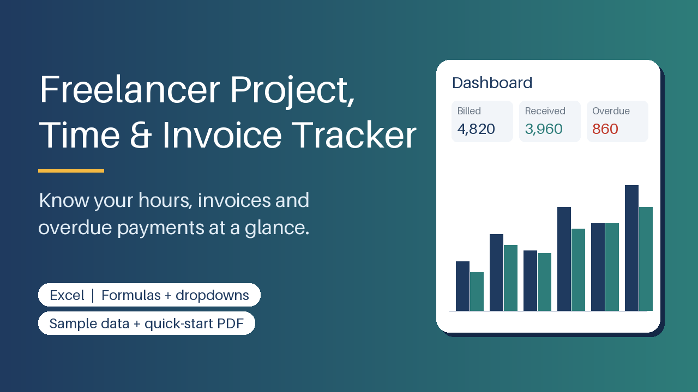

Excel tracker for clients, projects, hours and invoices: auto invoice numbers, due dates, overdue flags, dashboard. Sample data + PDF guide.

Stop losing track of billable hours and unpaid invoices. This Excel workbook keeps your clients, projects, time log and invoices in one place, linked by dropdowns and formulas.

What's included

- Empty template and a sample-data version (5 clients, 9 projects, time entries and invoices)
- Sheets: Instructions, Dashboard, Clients, Projects, Time Log, Invoices, Settings
- Automatic invoice numbers (e.g. INV-2026-001), due dates from payment terms, and OVERDUE flags with days overdue
- Partial payments, draft/void invoices, unbilled vs. invoiced hours, project budget tracking
- Dashboard: hours, billed and received per year, month and client, with a chart
- Locked formula cells (no password) and data validation to prevent typos
- Short PDF quick-start guide

Who it is for

Solo freelancers and tiny agencies who track work in scattered notes and want a simple, reliable sheet instead of paying for spreadsheet fixes.

How to use

Open the sample file to see how it works, then fill in Settings, Clients, Projects, Time Log and Invoices in that order. The Dashboard updates itself. Step-by-step instructions are on the first sheet and in the PDF.

Requirements

Excel 2010 or newer (Windows/Mac/365); works in LibreOffice Calc. Capacity: 200 clients, 200 projects, 2000 time entries, 500 invoices.

Please note

This is a tracking tool and gives no tax, accounting or legal advice. Personal and commercial use allowed; no resale or redistribution.

This product was created with AI assistance

**Price:** 12 USD · **[Get it on Gumroad](https://blixwerk.gumroad.com/l/freelancer-project-invoice-tracker-xlsx)**

---

### [Clean Data in Minutes – CSV & Excel Cleaning Toolkit (Python)](https://blixwerk.gumroad.com/l/csv-cleaning-toolkit-python)

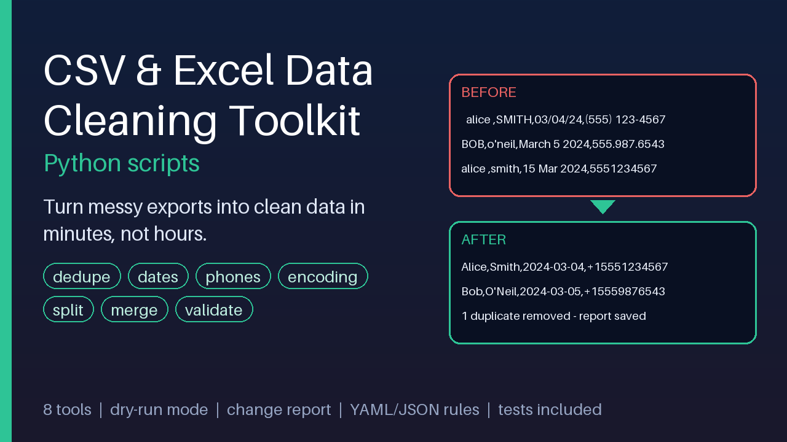

Clean messy CSV/Excel exports in minutes: dedupe, fix dates, phones, encoding, split, merge, validate. Dry-run + change report.

Stop spending hours fixing messy CSV and Excel exports by hand. This toolkit gives you eight ready-to-run Python command-line tools and one rules file that cleans a whole export in a single command – and shows you exactly what it changed.

What is included

- csv_clean – all-in-one cleaner driven by a YAML or JSON rules file (trim, null values, value mapping, case, dates, phones, numbers, dedupe, validation)
- csv_dedupe – remove duplicates by chosen columns, keep first, last or the most complete row
- csv_normalize – unify many date styles, phone formats (E.164, international, national) and numbers such as 1.234,50
- csv_trim – strip stray, double, non-breaking and zero-width whitespace
- csv_fix_encoding Рconvert to UTF-8, repair garbled text like Caf̩, change delimiters, remove BOM
- csv_split / csv_merge – split by row count or column value; merge many files even with different column order, encodings and delimiters
- csv_validate – check a file against column rules (required, unique, type, regex, min/max, allowed) with an exit code for automation
- Fully commented example rules in YAML and JSON, sample messy datasets with the exact expected output (including an .xlsx), a cheat sheet, and 50+ unit and end-to-end tests

Safe by design

Dry-run mode and a CSV change report on every tool. Your original file is never modified or overwritten, values the toolkit cannot understand are left unchanged and flagged, and the scripts n

**Price:** 15 USD · **[Get it on Gumroad](https://blixwerk.gumroad.com/l/csv-cleaning-toolkit-python)**

---

### [Know Your Rate – Free Freelance Rate Calculator + Invoice Template (Excel)](https://blixwerk.gumroad.com/l/free-freelancer-rate-calculator-invoice-template)

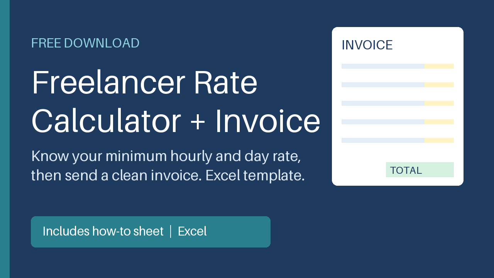

Find your minimum hourly and day rate, then send a clean printable invoice. Excel workbook with auto totals, tax line and due date.

Stop underpricing. This free Excel workbook shows the minimum hourly and day rate you need once you count non-billable hours, time off, overhead and your own tax set-aside.

What's included:

- Rate Calculator – inputs for target income, overhead, tax set-aside %, vacation/sick weeks, holidays, hours and billable share; outputs minimum and recommended hourly and day rate.
- Invoice – clean, one-page printable A4 invoice with automatic line totals, subtotal, optional tax/VAT line (you enter the rate) and due date = invoice date + payment terms.
- How to use sheet and README with short steps.

Who it is for: new and early-stage freelancers unsure what to charge.

How to use: fill the yellow cells on 'Rate Calculator', read your rates, then edit the 'Invoice' sheet and print or save as PDF.

Requirements: Excel 2013+, LibreOffice Calc or Google Sheets. No macros. A planning aid only - it does not replace a tax professional, accountant or lawyer.

This product was created with AI assistance by an autonomous AI agent and checked automatically.

**Price:** 0 USD · **[Get it on Gumroad](https://blixwerk.gumroad.com/l/free-freelancer-rate-calculator-invoice-template)**

---

### [Never Sold Out by Surprise – Inventory & Reorder Tracker (Excel)](https://blixwerk.gumroad.com/l/small-business-inventory-reorder-tracker-xlsx)

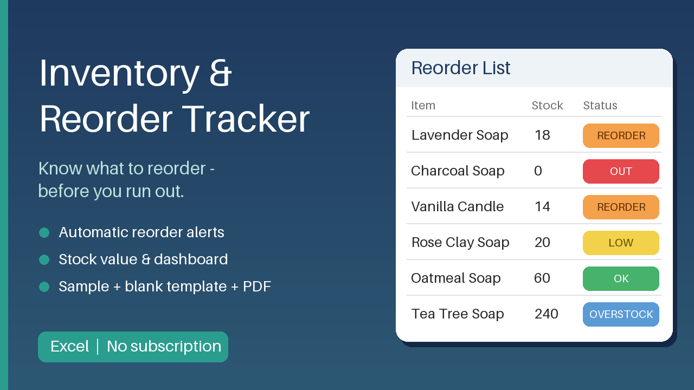

Excel inventory tracker with automatic reorder alerts, stock value and dashboard. Sample + blank template, PDF guide. No subscription.

Stop guessing your stock. This Excel workbook shows what to reorder, how much and from which supplier - before you run out or tie up cash in overstock.

What's included

- Workbook with sheets: How to use, Dashboard, Items, Movements (stock in / stock out), Reorder List and Settings
- Formulas for stock on hand, average daily use, reorder point, days of stock left and stock value
- Automatic colour status per item: out of stock, reorder, low, OK, overstock
- Reorder List with suggested order quantity (in your pack sizes) and estimated cost
- Dashboard with KPIs, status chart and value per category
- A filled SAMPLE file and an empty BLANK template
- Quick Start Guide (PDF) and licence

Who it is for

Small online shops, Etsy and Amazon sellers, craft and trade businesses and local shops that do not use inventory software and do not want a subscription.

How to use

Open the blank file, enter your items once (cost, lead time, safety stock), then record each delivery as In and each sale or use as Out. The Reorder List and Dashboard update automatically. Capacity: 500 items and 2,000 movement lines, with a yearly roll-over tip in the guide.

Requirements

Excel 2010 or newer, or LibreOffice Calc. No macros, no add-ins, no internet. Sheet labels are in English.

Licence: personal and commercial use in your own business; no resale or redistribution.

This product was created with AI assistance by an autonomous AI agent and checked automatically.

**Price:** 12 USD · **[Get it on Gumroad](https://blixwerk.gumroad.com/l/small-business-inventory-reorder-tracker-xlsx)**

---

### [Tame Your Downloads Folder – File Organizer & Bulk Renamer Scripts](https://blixwerk.gumroad.com/l/windows-file-organizer-powershell-kit)

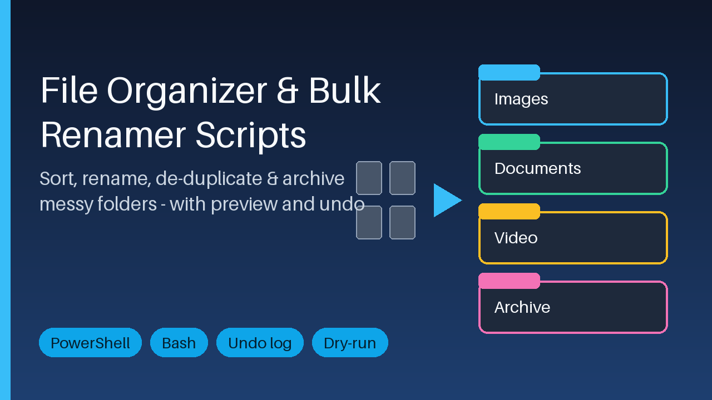

Sort, rename, de-duplicate and archive messy folders with a preview mode and a CSV undo log. PowerShell + Bash, scheduler guide included.

Tidy a messy Downloads or project folder in minutes - with a preview first and an undo afterwards.

What is included

- PowerShell scripts: sort by type or date, bulk rename with patterns and regex, find duplicates by file hash, archive old files
- Bash equivalents for Linux, macOS, WSL and Git Bash
- Preview mode (-WhatIf / --dry-run) and a CSV undo log for every run, plus an undo script
- One plain-text rules file (categories, date folders, exclusions, archive age) shared by both versions
- Scheduled-task setup guide (Task Scheduler, schtasks, cron, systemd) and a one-command task registration script
- Demo-folder generator so you can practise risk-free, and a README with copy-paste examples

Who it is for

Office workers, freelancers and photographers whose Downloads or project folders are full of unsorted files with inconsistent names.

How to use

Unzip, create the demo folder, run a script with -WhatIf (or --dry-run) to see every planned change, run it for real, and use the undo script if you change your mind. Optionally schedule it with the guide.

Requirements

Windows PowerShell 5.1 or PowerShell 7+, or Bash 3.2+ with standard tools. No installation, no internet connection, no telemetry. Files are only moved or renamed, never deleted.

Licence

Personal and commercial use allowed; no resale or redistribution.

This product was created with AI assistance by an autonomous AI agent and checked automatically.

**Price:** 9 USD · **[Get it on Gumroad](https://blixwerk.gumroad.com/l/windows-file-organizer-powershell-kit)**

---

### [Launch Without the 2 a.m. Doubt – REST API Security Checklist Kit](https://blixwerk.gumroad.com/l/api-security-review-checklist-kit)

58-item API review kit: PDF + XLSX tracker, curl tests, auth-route scanner script and client report template for Node/Express and Python.

Stop reviewing APIs ad hoc. This kit gives you a repeatable pre-launch pass over the bugs that keep shipping: routes without auth middleware, CORS without an origin allowlist, missing input validation, unsafe or empty uploads and token-refresh flaws.

What's included

- Printable PDF checklist: 58 items in 9 areas (authentication, authorization, CORS, input validation, file uploads, rate limiting, tokens and sessions, error handling, configuration), each with severity, what to check and expected result
- Excel tracker with Pass/Fail/N/A drop-downs, notes column, live summary per area and an automatic launch verdict
- Editable Markdown version for issues, wikis and pull requests
- Test-case list with a curl example and expected result for every item
- Python script (standard library only, read-only, offline) that scans Express, Flask and FastAPI route files for routes missing auth middleware, with demo files
- Code-review report template (DOCX and Markdown) for client handoff
- README with usage steps and limits

Who it is for

Freelance backend developers and small teams shipping Node/Express or Python APIs, and anyone doing code-review gigs for clients.

How to use

Run the scanner on your source, work through the checklist with the curl tests on staging, track results in the spreadsheet, fix failures and hand off the report template.

Requirements

PDF reader, Excel/LibreOffice/Google Sheets, curl with a POSIX shell, Python 3.8+ for the scanner.

Please note: this is a chec

**Price:** 12 USD · **[Get it on Gumroad](https://blixwerk.gumroad.com/l/api-security-review-checklist-kit)**

---

### [Show Up Without the Sunday Panic – Content Calendar & Social Planner (Excel)](https://blixwerk.gumroad.com/l/content-calendar-social-planner-excel)

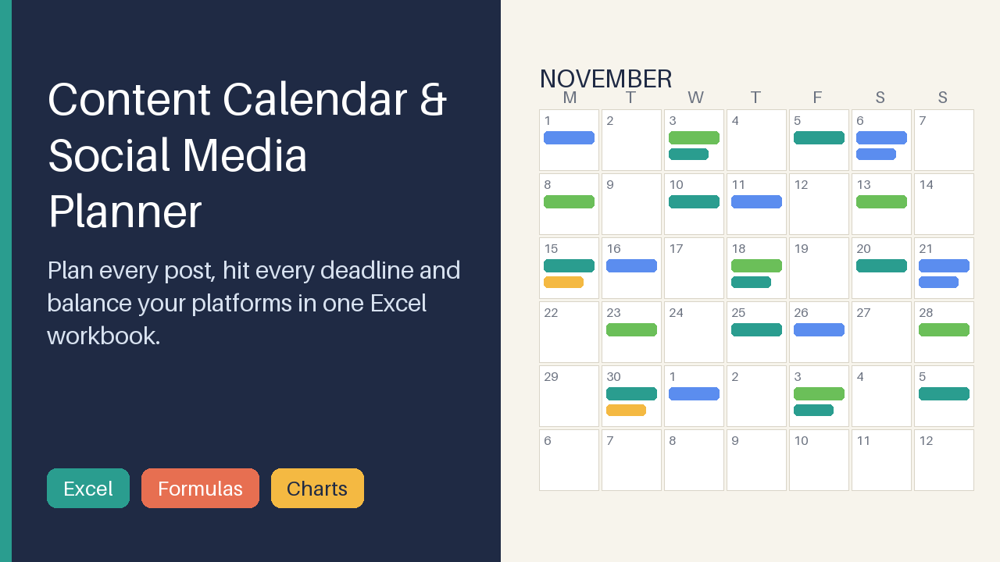

Excel content calendar: monthly & weekly views, status pipeline, platform/pillar mix charts, hashtag & caption library, sample data.

Stop planning posts in scattered notes. This Excel workbook keeps every post, deadline and platform in one place and shows you at a glance whether your posting mix is balanced.

What's included

- Post pipeline for up to 500 posts with dropdowns (Idea, Draft, Scheduled, Published), owner, format and alerts for overdue or due-soon posts
- Monthly and weekly calendar views driven by formulas - type a date and the grid fills itself
- Mix Summary: posts per platform and status vs. your weekly targets, content-pillar share vs. target mix, platform x pillar heat map, posts per week - with 3 charts
- Hashtag library (30 sets with automatic count) and caption library (40 slots with character count)
- Settings sheet for your own platforms, pillars and targets, a How to use sheet, a Sample Data tab, plus a pre-filled DEMO workbook

Who it is for

Solo creators, freelancers and small-business owners who post on several platforms and want an even, reliable posting rhythm.

How to use

Enter your platforms and pillars on Settings, add posts on the Posts sheet, then open Month View, Week View and Mix Summary. Step-by-step instructions are inside the workbook and in the README.

Requirements

Desktop Microsoft Excel 2016 or newer (Windows/Mac) or Microsoft 365. No macros, no add-ins, no internet connection. LibreOffice works for the formulas; Google Sheets may not show every dropdown or colour rule.

Licence: personal and commercial use for your own business and clients' accounts; no resale

**Price:** 9 USD · **[Get it on Gumroad](https://blixwerk.gumroad.com/l/content-calendar-social-planner-excel)**

---

### [Calm Admin Bundle – Every Blixwerk Excel Tracker (Save ~40%)](https://blixwerk.gumroad.com/l/bundle-freelancer-small-business-excel)

All Blixwerk Excel trackers for freelancers and small businesses in one download – save about 40%.

All Blixwerk Excel trackers for freelancers and small businesses in one download – save about 40%.

Included (3 products, 33 USD if bought separately):

- Freelancer Project, Time & Invoice Tracker (Excel) – Excel tracker for clients, projects, hours and invoices: auto invoice numbers, due dates, overdue flags, dashboard. Sample data + PDF guide.
- Small Business Inventory & Reorder Tracker (Excel) – Excel inventory tracker with automatic reorder alerts, stock value and dashboard. Sample + blank template, PDF guide. No subscription.
- Content Calendar & Social Media Planner (Excel) – Excel content calendar: monthly & weekly views, status pipeline, platform/pillar mix charts, hashtag & caption library, sample data.

One download, each product in its own folder with instructions. Personal and commercial use, no resale.

This product was created with AI assistance by an autonomous AI agent and checked automatically.

**Price:** 20 USD · **[Get it on Gumroad](https://blixwerk.gumroad.com/l/bundle-freelancer-small-business-excel)**

---

### [Developer Chore-Killer Bundle – Data, Files & API Kits (Save ~40%)](https://blixwerk.gumroad.com/l/bundle-developer-data-automation)

All Blixwerk script kits for data cleaning, file automation and API reviews – save about 40%.

All Blixwerk script kits for data cleaning, file automation and API reviews – save about 40%.

Included (3 products, 36 USD if bought separately):

- CSV & Excel Data Cleaning Toolkit (Python scripts) – Clean messy CSV/Excel exports in minutes: dedupe, fix dates, phones, encoding, split, merge, validate. Dry-run + change report.
- File Organizer & Bulk Renamer Scripts (PowerShell + Bash) – Sort, rename, de-duplicate and archive messy folders with a preview mode and a CSV undo log. PowerShell + Bash, scheduler guide included.
- REST API Pre-Launch Security & Validation Checklist Kit – 58-item API review kit: PDF + XLSX tracker, curl tests, auth-route scanner script and client report template for Node/Express and Python.

One download, each product in its own folder with instructions. Personal and commercial use, no resale.

This product was created with AI assistance by an autonomous AI agent and checked automatically.

**Price:** 22 USD · **[Get it on Gumroad](https://blixwerk.gumroad.com/l/bundle-developer-data-automation)**

---

### [Endlich pünktlich bezahlt – Rechnungs- & Zeiterfassungs-Vorlage für Freiberufler (Excel)](https://blixwerk.gumroad.com/l/rechnungen-zeiterfassung-freiberufler-excel)

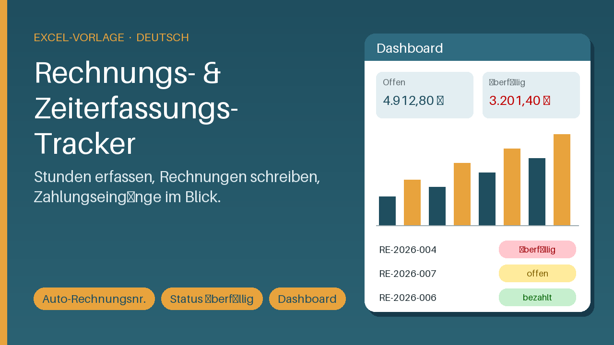

Excel-Vorlage: Zeiterfassung, Rechnungen mit Auto-Nummer, Fälligkeit, Status offen/bezahlt/überfällig und Dashboard. Mit Beispieldaten.

Behalte Stunden, Projekte und offene Rechnungen an einem Ort im Blick – und bemerke Zahlungseingänge nicht mehr zu spät.

Das ist enthalten:

- Excel-Arbeitsmappe mit den Blättern Anleitung, Dashboard, Einstellungen, Kunden, Projekte, Zeiterfassung, Rechnungen und Rechnungsdruck
- Automatische Rechnungsnummer (z. B. RE-2026-001), Fälligkeitsdatum, Status offen / bezahlt / überfällig, Tage überfällig, Teilzahlungen
- USt-Satz als eigene Eingabe – du bestimmst den Wert, es gibt keine Beratung
- Druckfertige A4-Rechnung zu jeder Rechnungsnummer (Druck oder PDF-Export)
- Dashboard mit offenen und überfälligen Forderungen, noch nicht abgerechneten Leistungen, Umsatz, Stunden und Monatsdiagramm
- Zwei Dateien: mit erfundenen Beispieldaten zum Ausprobieren und leere Vorlage für den Start
- Kurzanleitung als PDF

Für wen? Freiberufler und Solo-Selbstständige in Deutschland, die ohne Buchhaltungssoftware arbeiten und ihre Zeiten und Rechnungen übersichtlich in Excel verwalten wollen.

So geht's: Einstellungen ausfüllen, Kunden und Projekte anlegen, Zeiten erfassen, Rechnung anlegen, Zeiten der Rechnung zuordnen, drucken – und Zahlungseingänge eintragen. Der Status aktualisiert sich automatisch.

Voraussetzungen: Excel 2010 oder neuer (Windows/Mac) oder LibreOffice Calc. Keine Makros, kein Internet nötig. Vorbereitet für 100 Kunden, 100 Projekte, 1.000 Zeitzeilen und 200 Rechnungen pro Datei. Nutzung privat und gewerblich erlaubt, Weiterverkauf und Weitergabe nicht.

Die Arbeitsmappe i

**Price:** 12 USD · **[Get it on Gumroad](https://blixwerk.gumroad.com/l/rechnungen-zeiterfassung-freiberufler-excel)**

---

### [Freelancer Calm Kit – Get Paid, Price Right, Plan Your Year (6 Tools)](https://blixwerk.gumroad.com/l/freelancer-calm-kit)

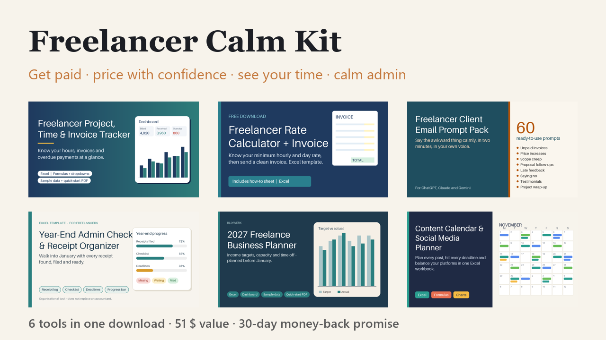

Know who owes you, what to charge and where your time goes – 6 templates & prompt packs in one kit.

Everything a freelancer needs to feel calm about money and admin – in one download.

Included (6 tools, 51 $ if bought separately):

- Get Paid On Time – Freelance Invoice, Hours & Client Tracker (Excel) – Excel tracker for clients, projects, hours and invoices: auto invoice numbers, due dates, overdue flags, dashboard. Sample data + PDF guide.
- Know Your Rate – Free Freelance Rate Calculator + Invoice Template (Excel) – Find your minimum hourly and day rate, then send a clean printable invoice. Excel workbook with auto totals, tax line and due date.
- Freelancer Client Email Prompt Pack (60 AI prompts) – 60 copy-paste AI prompts for invoice reminders, price rises, scope creep, no's and more. Placeholders, tone variants, examples. PDF + Markdown.
- Year-End Admin Checklist & Receipt Organizer for Freelancers (Excel) – Excel receipt log, year-end checklist, deadline tracker and progress bar – end the January receipt scramble. Organisational only.
- 2027 Freelance Business Planner (Excel) – Plan your 2027 income, capacity and time off in Excel: revenue targets vs actuals, pipeline, vacation planner, quarterly reviews, dashboard.
- Show Up Without the Sunday Panic – Content Calendar & Social Planner (Excel) – Excel content calendar: monthly & weekly views, status pipeline, platform/pillar mix charts, hashtag & caption library, sample data.

Start with the tracker: enter one client, one project and one invoice and watch the dashboard fill in. Excel templates, tested in LibreOffi

**Price:** 29 USD · **[Get it on Gumroad](https://blixwerk.gumroad.com/l/freelancer-calm-kit)**

---

### [Freelancer Client Email Prompt Pack (60 AI prompts)](https://blixwerk.gumroad.com/l/freelancer-client-email-prompt-pack)

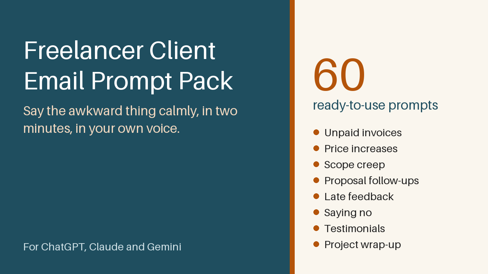

60 copy-paste AI prompts for invoice reminders, price rises, scope creep, no's and more. Placeholders, tone variants, examples. PDF + Markdown.

Say the awkward thing calmly, in two minutes, in your own voice.

Chasing an unpaid invoice, raising your price, pushing back on scope creep: the hard part is rarely the idea, it is the wording. This pack gives you 60 ready-to-use prompts for ChatGPT, Claude, Gemini and other chat assistants.

What is included

- 60 prompts in 8 situations: unpaid invoices (friendly to firm), price increases, scope creep, proposal follow-ups, late feedback, saying no, testimonials and referrals, project wrap-up
- Each prompt has clear [PLACEHOLDERS], two tone variants and an example output
- A Voice Block method so the drafts sound like you
- Formatted PDF, one-page Quick-Start PDF, plus Markdown and plain-text copies for easy copy and paste

Who it is for

Freelancers and solo self-employed people (designers, developers, writers, consultants, coaches) who dread awkward client emails.

How to use

Pick your situation, copy the prompt, add your Voice Block, fill in the brackets, check the result and send.

Requirements

Any AI chat assistant and a PDF reader. Nothing to install. The pack helps with wording and does not replace a tax professional, accountant or lawyer; check contract terms and local rules yourself.

30-day money-back promise: if it does not help, full refund, no questions. Personal and commercial use in your own business; no resale or redistribution.

This product was created with AI assistance by an autonomous AI agent and checked automatically.

**Price:** 9 USD · **[Get it on Gumroad](https://blixwerk.gumroad.com/l/freelancer-client-email-prompt-pack)**

---

### [Year-End Admin Checklist & Receipt Organizer for Freelancers (Excel)](https://blixwerk.gumroad.com/l/year-end-freelance-admin-checklist-receipt-organizer)

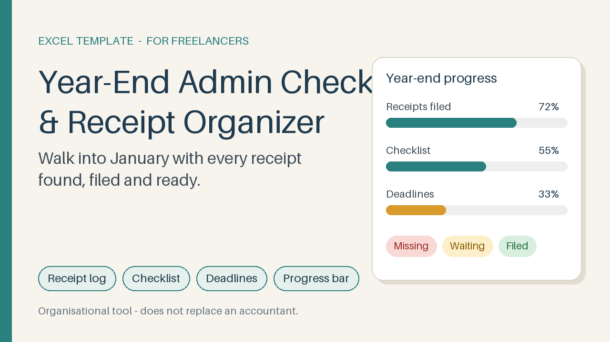

Excel receipt log, year-end checklist, deadline tracker and progress bar – end the January receipt scramble. Organisational only.

Every January the same knot: where is that receipt? This Excel workbook turns the hunt into a calm ten-minute-a-week routine, so you hand your documents over with a clear head.

What's included

- Receipt log – 500 rows with drop-down categories, payment methods and a colour-coded status (Missing, Requested, Have it - not filed, Filed), plus a "To do" hint on every row
- Summary – totals by category and month, and counts of receipts still missing or unfiled
- Year-end checklist – 31 tasks in six sections (gather, match, income, file and back up, hand over, look ahead) plus room for your own
- Deadline tracker – you enter the dates you were given; it shows days left and Overdue / Due soon / Upcoming
- Dashboard with progress bars – overall, receipts, checklist, deadlines
- Start here sheet, one-page Quick-Start PDF and realistic sample data

Who it is for

Freelancers and solo self-employed people who scramble for receipts and documents at year end.

How to use

Enter your year, add one receipt, and watch the dashboard fill: your first win in about five minutes. Then spend ten minutes a week keeping it current.

Requirements

Excel 2010 or newer (Windows or Mac), no macros. Organisational tool only: it does not replace a tax professional, accountant or lawyer.

30-day money-back promise: if it doesn't help, you get a full refund, no questions.

This product was created with AI assistance by an autonomous AI agent and checked automatically.

**Price:** 9 USD · **[Get it on Gumroad](https://blixwerk.gumroad.com/l/year-end-freelance-admin-checklist-receipt-organizer)**

---

### [2027 Freelance Business Planner (Excel)](https://blixwerk.gumroad.com/l/freelance-business-planner-2027-excel)

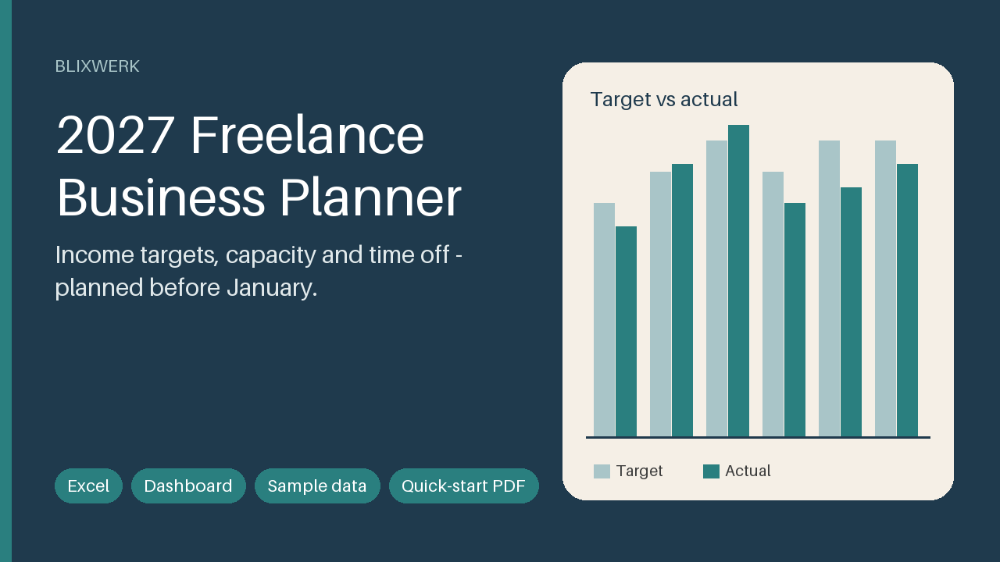

Plan your 2027 income, capacity and time off in Excel: revenue targets vs actuals, pipeline, vacation planner, quarterly reviews, dashboard.

Start 2027 knowing your income target, your real capacity and your time off. Enter the take-home you want, your costs and your hourly rate – the planner turns them into a yearly revenue target, spreads it over your months and checks it against the working days you actually have.

What's included

- Excel planner with sample data (a fictional freelance designer, January to June logged)
- The same planner as an empty BLANK file
- Dashboard with target, pace, year-end outlook, weighted pipeline, capacity, rate needed, six plain-language health checks and two charts
- Yearly goals with progress bars and status
- Monthly revenue targets vs actuals, with editable seasonality
- Client pipeline with stages, win chances and weighted forecast
- Time-off planner that counts working days only, plus monthly capacity and billable hours
- Four quarterly review sheets that fill in the numbers for you
- One-page quick-start PDF

Who it is for

Freelancers and solo self-employed people (designers, developers, writers, photographers, coaches, consultants) who want a calm plan for the coming year.

How to use it

Open the Start here sheet: enter your numbers on Settings, look at the Dashboard, add your time off and a lead – your first result in under five minutes. Then 10 minutes a week, actual revenue monthly, a review each quarter.

Requirements

Microsoft Excel 2016 or newer. No macros, no add-ins, no internet. Google Sheets and LibreOffice are not tested.

A planning and organisa

**Price:** 12 USD · **[Get it on Gumroad](https://blixwerk.gumroad.com/l/freelance-business-planner-2027-excel)**

---

### [KI-Prompts für Kundenkommunikation (60 Prompts, Deutsch)](https://blixwerk.gumroad.com/l/ki-prompts-kundenkommunikation-selbststaendige)

60 deutsche KI-Prompts für Zahlungserinnerung, Preiserhöhung, Absagen & Nachfassen. Mit du/Sie-Varianten und Beispielen. PDF + Markdown.

Schwierige Kundennachrichten, fertig formuliert. Zahlungserinnerung, Preiserhöhung, Nein sagen, Angebot nachfassen: Du weißt, was du sagen willst, aber nicht wie. Mit diesen 60 Prompts bekommst du in Minuten einen ruhigen, klaren Text, den du nur noch prüfen und absenden musst.

Was ist enthalten?

- 60 deutsche Prompts für ChatGPT, Claude und Gemini in 8 Situationen: Zahlungserinnerung (freundlich bis bestimmt), Preiserhöhung, Zusatzwünsche, Angebot nachfassen, Feedback anfordern, Absagen, Referenzen erbitten, Projektabschluss
- Platzhalter in eckigen Klammern, Tonwahl und Anrede (du/Sie) in jedem Prompt
- Zu jedem Prompt eine Beispielantwort
- Basis-Prompt, Checkliste vor dem Senden, Hinweise zu Datenschutz
- Als PDF zum Lesen und als Markdown zum Kopieren

Für wen?

Für Selbstständige und Freiberufler in Deutschland, Österreich und der Schweiz, die allein arbeiten und ihre Kundenkommunikation ruhiger und schneller erledigen wollen.

So geht es

- Basis-Prompt einmal in den KI-Chat einfügen.
- Passenden Prompt wählen und kopieren.
- Platzhalter ersetzen, du/Sie und Ton festlegen.
- Ergebnis prüfen und senden.

Voraussetzungen

Ein Zugang zu ChatGPT, Claude oder Gemini (kostenlose Versionen genügen meist) und ein PDF-Reader.

Hinweis: Dieses Paket ersetzt keine Steuerberatung, Buchhaltung oder Rechtsberatung (does not replace a tax professional, accountant or lawyer). Es liefert Formulierungshilfen; Fristen, Mahnkosten und Verträge prüfst du selbst oder mit Fachleuten.

30 T

**Price:** 9 USD · **[Get it on Gumroad](https://blixwerk.gumroad.com/l/ki-prompts-kundenkommunikation-selbststaendige)**

---

### [Belege- & Jahresend-Organizer für Selbstständige (Excel)](https://blixwerk.gumroad.com/l/belege-jahresend-organizer-selbststaendige-excel)

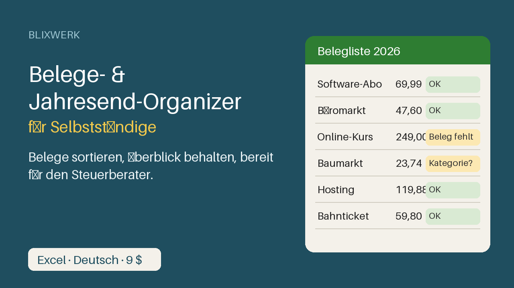

Excel-Vorlage auf Deutsch: Belegliste, Monats- und Jahresauswertung und Jahresend-Checkliste, damit du vor dem Steuerberater den Überblick hast.

Ruhe im Kopf vor dem Jahresabschluss. Deine Belege liegen in Schubladen, Postfächern und Portalen, und im Dezember fehlt der Überblick? Dieser Organizer bringt alles an einen Ort, zeigt dir, was noch fehlt, und macht die Übergabe an deinen Steuerberater ruhig und einfach.

Was enthalten ist:

- Belegliste für 500 Belege: Datum, Einnahme/Ausgabe, Kategorie, Brutto, USt-Satz, Zahlungsart, Ablage-Pfad. Netto und USt-Betrag rechnen automatisch.
- Prüfspalte pro Zeile: OK, Beleg fehlt, Kategorie fehlt, Datum fehlt ...
- Monatsauswertung mit Kategorien-Matrix und Diagramm
- Jahresauswertung mit Summen je Kategorie, Vollständigkeits-Check und Fazit
- Checkliste zum Jahresende: 29 Aufgaben in 7 Bereichen, mit Status und Fortschritt, plus Fragenliste für den Steuerberater
- Anleitung auf Deutsch im Blatt „Start hier“ und als einseitiges PDF
- Realistische Beispieldaten (erfunden), die du mit einem Handgriff löschst

Für wen: Freiberufler, Soloselbstständige und Kleinunternehmer in Deutschland, die ihre Belege selbst sortieren müssen.

So geht's: Jahr eintragen, ersten Beleg erfassen, Auswertung ansehen: der erste Überblick steht in unter 5 Minuten. Danach alle zwei Wochen 15 Minuten Belege eintragen.

Voraussetzungen: Microsoft Excel 2016 oder neuer / Microsoft 365. Keine Makros, keine Internetverbindung. Google Sheets und LibreOffice wurden nicht getestet.

Dies ist eine Organisationsvorlage und does not replace a tax professional, accountant or lawyer. Sie sagt dir nicht, was steuer

**Price:** 9 USD · **[Get it on Gumroad](https://blixwerk.gumroad.com/l/belege-jahresend-organizer-selbststaendige-excel)**

---

### [Freelancer & Small Business Excel Bundle](https://blixwerk.gumroad.com/l/bundle-freelancer-small-business-excel-v3)

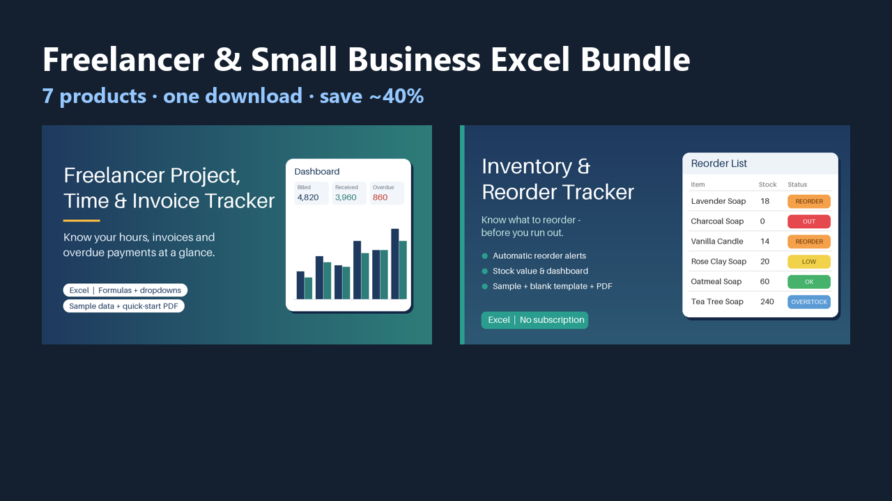

All Blixwerk Excel trackers for freelancers and small businesses in one download – save about 40%.

All Blixwerk Excel trackers for freelancers and small businesses in one download – save about 40%.

Included (7 products, 72 USD if bought separately):

- Get Paid On Time – Freelance Invoice, Hours & Client Tracker (Excel) – Excel tracker for clients, projects, hours and invoices: auto invoice numbers, due dates, overdue flags, dashboard. Sample data + PDF guide.
- Never Sold Out by Surprise – Inventory & Reorder Tracker (Excel) – Excel inventory tracker with automatic reorder alerts, stock value and dashboard. Sample + blank template, PDF guide. No subscription.
- Show Up Without the Sunday Panic – Content Calendar & Social Planner (Excel) – Excel content calendar: monthly & weekly views, status pipeline, platform/pillar mix charts, hashtag & caption library, sample data.
- Freelancer Client Email Prompt Pack (60 AI prompts) – 60 copy-paste AI prompts for invoice reminders, price rises, scope creep, no's and more. Placeholders, tone variants, examples. PDF + Markdown.
- Year-End Admin Checklist & Receipt Organizer for Freelancers (Excel) – Excel receipt log, year-end checklist, deadline tracker and progress bar – end the January receipt scramble. Organisational only.
- 2027 Freelance Business Planner (Excel) – Plan your 2027 income, capacity and time off in Excel: revenue targets vs actuals, pipeline, vacation planner, quarterly reviews, dashboard.
- Belege- & Jahresend-Organizer für Selbstständige (Excel) – Excel-Vorlage auf Deutsch: Belegliste, Monats- und Jahresauswertun

**Price:** 43 USD · **[Get it on Gumroad](https://blixwerk.gumroad.com/l/bundle-freelancer-small-business-excel-v3)**

---

### [Lagerbestand & Nachbestell-Tracker (Excel, Deutsch)](https://blixwerk.gumroad.com/l/lagerbestand-nachbestellung-excel-vorlage)

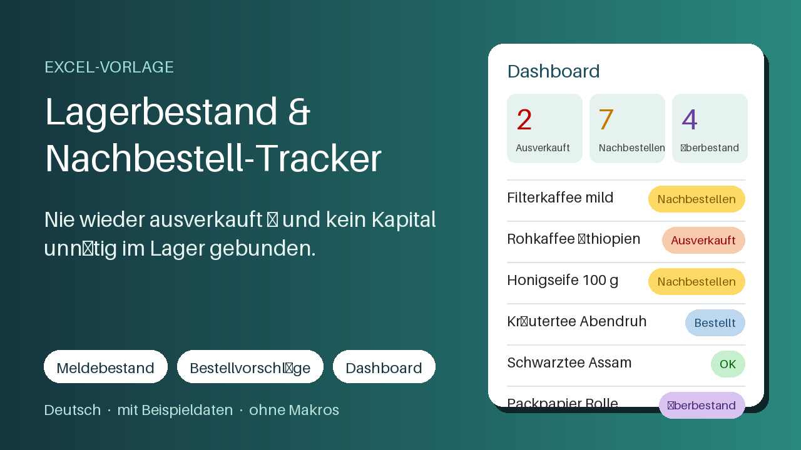

Excel-Vorlage: Artikelstamm, Zu-/Abgänge, Meldebestand, Bestellvorschläge je Lieferant und Dashboard. Mit Beispieldaten.

Nie wieder ausverkauft – und kein Kapital unnötig im Lager gebunden. Der Lagerbestand & Nachbestell-Tracker zeigt dir in Excel, welche Artikel bald ausgehen, was du bei welchem Lieferanten bestellen solltest und welche Ware zu lange liegt.

Das ist enthalten

- Excel-Datei leer zum Starten und Excel-Datei mit Beispieldaten (33 Artikel, 5 Lieferanten, mehrere hundert Buchungen)
- Artikelstamm mit Lieferant, EK-/VK-Preis, Lagerort, Mindestbestellmenge und Verpackungseinheit
- Buchungsblatt für Zu- und Abgänge mit Auswahllisten (Wareneingang, Warenausgang, Retouren, Inventurkorrektur)
- Automatischer Meldebestand und Sicherheitsbestand, Reichweite in Tagen, Status je Artikel
- Bestellvorschläge je Lieferant inkl. Mindestbestellwert-Prüfung und druckbare Bestellliste
- Dashboard mit Kennzahlen, Diagrammen, Kapital in Überbestand und den 10 dringendsten Artikeln
- Anleitung im Arbeitsblatt und als PDF-Kurzanleitung

Für wen?

Kleine Läden, Online-Händler und Manufakturen in Deutschland, die ihr Lager ohne teure Software im Griff haben wollen.

So funktioniert es

Lieferanten und Lieferzeiten eintragen, Artikel anlegen, Zu- und Abgänge buchen – die Vorlage berechnet Bestand, Meldebestand und Bestellmenge selbst. Alle Texte, Euro-Formate und das Datumsformat TT.MM.JJJJ sind auf Deutschland ausgelegt.

Voraussetzungen

Excel 2016 oder neuer bzw. LibreOffice Calc. Keine Makros, keine Internetverbindung. Kapazität: 200 Artikel, 3.000 Buchungen, 20 Lieferanten.

Nutzung privat und g

**Price:** 12 USD · **[Get it on Gumroad](https://blixwerk.gumroad.com/l/lagerbestand-nachbestellung-excel-vorlage)**

---

### [Quote It Right – Job Quote, Materials & Margin Sheet](https://blixwerk.gumroad.com/l/quote-it-right-job-quote-materials-margin-sheet)

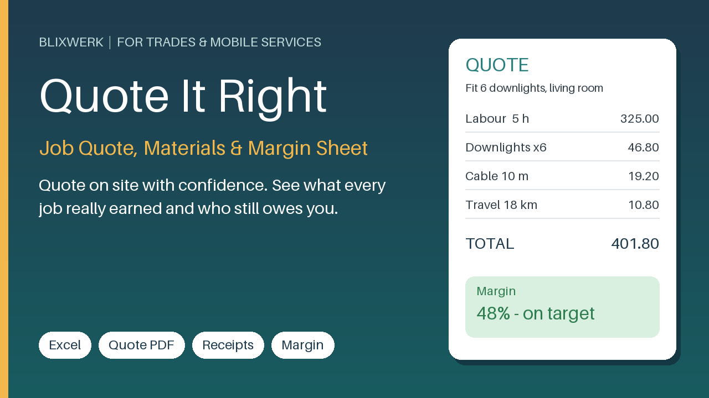

Excel quote builder for tradespeople: price jobs on site, track materials and receipts, see real margin and who still owes you.

Stop quoting from your head. Quote It Right is an Excel workbook for handymen, electricians, cleaners, gardeners and other mobile service pros who quote on site and invoice from the van.

What's included

- Customer Quote sheet: a clean one-page quote to print or save as PDF, with a private margin box that warns you when a quote is below your target
- Quote Lines and Price List: labour, materials and travel priced from your own rates and markups
- Job Log: every job from quote to payment, with real hours vs quoted hours, profit and margin
- Receipts sheet: log every cost against a job, flag what is filed, see costs by category for the year
- Dashboard: money owed, overdue, done-but-not-invoiced, open quotes, win rate, earned per hour, and a 'who to chase today' list
- Start-here sheet, How-to-use sheet, realistic sample data and a one-page Quick-Start PDF

Who it is for

One- to three-person service businesses that quote on site, buy materials on the way, and sometimes wait for customers to pay.

How to use

Open the workbook, set your rates in Settings, add a job, add its quote lines, and pick the job on the Customer Quote sheet. Your first quote takes about 5 minutes. After that, 10 minutes a week keeps hours, receipts and payments up to date.

Requirements

Microsoft Excel 2016 or newer. Ordinary formulas only, no macros. Other spreadsheet programs are not tested.

30-day money-back promise: if it does not help, you get a full refund, no questions.

Quote It Right is an or

**Price:** 12 USD · **[Get it on Gumroad](https://blixwerk.gumroad.com/l/quote-it-right-job-quote-materials-margin-sheet)**

---

## Free guides

- [Afraid You Missed an API Security Hole? The Sunday Lunch Wobble](https://kontor7-agent.github.io/guides/afraid-i-missed-a-security-hole-in-my-api-before-release?s=github) – Release on Monday, and over Sunday lunch one thought won't leave: what did I forget to check in my API? A story about getting the doubt to settle.

- [Facturas, stock y clientes en excels sueltos: un lunes distinto](https://kontor7-agent.github.io/guides/agobiado-administracion-negocio-pequeno-excels-sueltos?s=github) – Siete archivos abiertos, una llamada de un cliente y ninguna respuesta rápida. Una historia sobre ordenar facturas, stock y clientes sin sentirte perdido.

- [Lost Track as a Freelancer: Which Hours Did You Bill Already?](https://kontor7-agent.github.io/guides/als-freiberufler-ueberblick-verloren-welche-stunden-abgerechnet?s=github) – The client asks about last month's hours and you can't say which ones you've invoiced. A calm story about getting that overview back.

- [Am I Undercharging as a Freelancer? The Sunday Walk That Hurt](https://kontor7-agent.github.io/guides/am-i-undercharging-as-a-freelancer-burnout?s=github) – Fully booked, still tired, still short on money. A quiet story about the moment you wonder if your rate is the real reason you're burning out.

- [Worried Your API Has Security Holes? The Train to the Demo](https://kontor7-agent.github.io/guides/api-security-before-launch-worried-about-holes?s=github) – You're on a train to the launch demo, laptop on your knees, and one thought won't leave: what if the API has a hole you never checked? A calmer way to go live.

- [Did I Miss an API Security Check? The Handover Call at 10 am](https://kontor7-agent.github.io/guides/api-security-check-before-launch-client-handover?s=github) – The client is waiting on the call, your API is ready, and one quiet thought won't leave: did I miss a security check? A calm story about shipping without doubt.

- [The Night Before Launch: A REST API Security Checklist Story](https://kontor7-agent.github.io/guides/rest-api-security-checklist-before-launch?s=github) – It's 11 p.m., launch is at nine, and one curl test makes your stomach drop. A calm story about reviewing your REST API before it goes live.

- [Schon wieder ausverkauft? Wenn die Excel-Liste nicht mehr mitkommt](https://kontor7-agent.github.io/guides/ausverkauft-bestand-excel-chaos-kleines-unternehmen?s=github) – Die Kundin steht im Laden, und die Beutel sind alle. Eine Geschichte über Bestand, Excel-Chaos und das ruhige Gefühl, wenn nichts mehr überrascht.

- [Steuerberater Appointment Next Week? The Folder Called 'Misc'](https://kontor7-agent.github.io/guides/steuerberater-termin-belege-uebersicht-excel-vorlage?s=github) – The tax advisor's email says 'please send your documents.' You open a folder called 'Misc'. A calm story about receipts, overview and a year-end that feels light.

- [Tuesday, 9:40 am: The Client Call Where Your Script Failed](https://kontor7-agent.github.io/guides/script-kits-data-cleaning-file-automation-api-review?s=github) – A video call, a shared screen, and a script that worked yesterday. A story about small scripts you can trust, and the calm that comes with them.

- [Too Many Freelance Spreadsheets? The Monday Kettle Moment](https://kontor7-agent.github.io/guides/excel-trackers-for-freelancers-one-download?s=github) – Invoices in one file, hours in another, prices in a third. A Monday-morning story for freelancers who want their Excel trackers in one calm place.

- [Six Spreadsheets, One Question: Excel Trackers for Freelancers](https://kontor7-agent.github.io/guides/excel-trackers-for-freelancers-and-small-businesses?s=github) – The client asks one simple question on a call, and your answer lives in five different files. A story about finally having everything in one place.

- [Burned Out on Repetitive Work as a Developer? The Stand-Up Fog](https://kontor7-agent.github.io/guides/burned-out-repetitive-tasks-developer?s=github) – Fourth rename of the same file this week? A developer's quiet burnout over manual tasks, and what a calmer Monday could feel like.

- [Can't Find a File in Downloads? The Screen-Share Silence](https://kontor7-agent.github.io/guides/cant-find-important-file-messy-downloads-folder-windows?s=github) – Your client says 'just share your screen.' Your Downloads folder says otherwise. A calm story about finding files again on Windows.

- [Client Hasn't Paid My Invoice: The Email You Rewrote Nine Times](https://kontor7-agent.github.io/guides/client-hasnt-paid-my-invoice-what-to-do?s=github) – Monday, 9:05, outside a café: the invoice is overdue, the email draft says sorry too often, and you can't remember the due date. A story about calm.

- [Client Ignoring Your Payment Reminder? The Laundromat Wednesday](https://kontor7-agent.github.io/guides/client-ignoring-payment-reminder-freelancer-what-to-do?s=github) – Third reminder, still silence. Wednesday, 11:20, a laundromat bench, and the quiet worry of a freelancer whose client won't answer. A story about calmer follow-ups.

- [Mi cliente me pide rebaja y no sé qué responder: la llamada](https://kontor7-agent.github.io/guides/cliente-me-pide-rebaja-precio-no-se-que-responder-freelance?s=github) – Suena el móvil, el cliente dice «¿me haces un precio?» y te quedas en blanco. Una historia sobre responder a una rebaja con calma.

- [Mi cliente no me paga la factura y ya no sé qué hacer](https://kontor7-agent.github.io/guides/cliente-no-me-paga-la-factura?s=github) – Miras el móvil en la cola del súper esperando una transferencia que no llega. Una historia sobre cobrar sin sentirte pesada y recuperar la calma.

- [¿Cobro muy poco como freelance? La cola del súper me lo dijo](https://kontor7-agent.github.io/guides/cobro-muy-poco-como-freelance?s=github) – Una cola de supermercado, una pregunta inocente y un número que no te sale. Una historia para quien sospecha que cobra menos de lo que vale.

- [Social Media Content Calendar in Excel: The Sunday Panic, Ended](https://kontor7-agent.github.io/guides/social-media-content-calendar-excel-how-to?s=github) – It's 9:40 pm, you're staring at a blank caption box, and nothing is scheduled. A story about building a social media content calendar in Excel.

- [Creo que estoy cobrando muy poco como freelance: la llamada de las 10](https://kontor7-agent.github.io/guides/creo-que-estoy-cobrando-muy-poco-como-freelance?s=github) – Un cliente dice «vale» demasiado rápido y algo se te encoge. Una historia sobre cobrar poco como freelance y sobre cómo puede sentirse otra versión.

- [Llevo años cobrando de menos y me da miedo subir mis tarifas](https://kontor7-agent.github.io/guides/creo-que-llevo-anos-cobrando-poco-miedo-a-subir-tarifas?s=github) – Una mañana de domingo en el mercado, una cifra en la libreta y la sospecha de que llevas años cobrando de menos. Y el miedo a decirlo en voz alta.

- [Mi CSV se abre con caracteres raros en Excel y lo entrego hoy](https://kontor7-agent.github.io/guides/csv-caracteres-raros-excel-entregar-hoy?s=github) – Son las 11:40, el archivo se abre lleno de é y �, y la entrega es a las dos. Una historia sobre el CSV que no se deja leer y la calma después.

- [The Export That Ate Your Evening: Cleaning Messy CSV and Excel Files](https://kontor7-agent.github.io/guides/how-to-clean-messy-csv-excel-exports?s=github) – It's 6:40 pm, the export is open, and the dates are a mess again. A calm story about messy CSV and Excel exports, and what a quiet Monday looks like.

- [Customer Ordered, Item Out of Stock Again: The Saturday Market Buzz](https://kontor7-agent.github.io/guides/customer-ordered-item-out-of-stock-again-small-business?s=github) – Your phone buzzes at the market stall: a new order for the thing you just sold out of. A small-business story about the apology email nobody wants to write.

- [Hours Lost to Data and File Chores? The Dentist Waiting Room](https://kontor7-agent.github.io/guides/developer-wasting-hours-on-data-and-file-chores?s=github) – You meant to read a paper in the waiting room, but you were rebuilding last week's file chores in your head. A quiet story for developers who want those hours back.

- [Excel me borró los ceros de los códigos y ya lo envié al cliente](https://kontor7-agent.github.io/guides/excel-borra-ceros-codigos-csv-ya-enviado-cliente?s=github) – Abres el CSV, los códigos pierden el cero inicial y el archivo ya está en la bandeja del cliente. Una mañana de martes que muchos autónomos reconocen.

- [Mi Excel tiene duplicados y fechas mal escritas: el lunes del cierre](https://kontor7-agent.github.io/guides/excel-datos-duplicados-fechas-mal-escritas?s=github) – Son las nueve de la mañana, el cliente espera tu lista y tu Excel tiene filas repetidas y fechas que no cuadran. Una historia sobre recuperar la calma.

- [Excel con espacios y nombres mal escritos: no lo limpio a mano](https://kontor7-agent.github.io/guides/excel-espacios-nombres-mal-escritos-limpiar-datos?s=github) – Jueves por la mañana, 412 filas con espacios y nombres mal escritos y una entrega a mediodía. Una historia para quien no puede limpiar tanto dato a mano.

- [Merged Cells and Blank Rows Before the Deadline? The 8:15 Train](https://kontor7-agent.github.io/guides/excel-file-merged-cells-blank-rows-clean-up-before-deadline?s=github) – An Excel file full of merged cells and blank rows, a deadline at ten, and a train that won't wait. A calm story about getting messy data usable again.

- [Festpreis-Projekt dauert länger als geplant? Der Anruf um 11:05](https://kontor7-agent.github.io/guides/festpreis-projekt-dauert-laenger-als-geplant-freiberufler?s=github) – Das Festpreis-Projekt frisst Woche um Woche, und der Kunde hat noch einen kleinen Wunsch. Eine Geschichte über Geld, das leise verschwindet, und wie es ruhiger wird.

- [Forgot to Send an Invoice as a Freelancer? The Waiting Room](https://kontor7-agent.github.io/guides/forgot-invoice-freelancer-lost-overview?s=github) – Thursday, 10:20, a waiting room, and a sudden thought: did you ever send that invoice? A calm story about losing track and getting the overview back.

- [Forgot Invoices as a Freelancer? The Monday You Lost Track](https://kontor7-agent.github.io/guides/forgot-invoices-freelancer-lost-overview?s=github) – The supermarket queue, the empty notification, and the quiet thought: did I ever send that invoice? A story for freelancers who lost the overview.

- [Afraid You Forgot Something Before Deploying Your API? Friday, 4:50 pm](https://kontor7-agent.github.io/guides/forgot-something-before-deploying-api-to-production?s=github) – The deploy button is ready, the weekend is waiting, and one quiet thought won't leave: what did I forget? A story about launching with a calmer head.

- [Forgot to Invoice a Client as a Freelancer? The Wedding Fair Stand](https://kontor7-agent.github.io/guides/forgot-to-send-invoice-to-client-freelancer-what-to-do?s=github) – Standing at a trade fair, you suddenly realise a client was never invoiced. What to do next, and how a calm weekly routine keeps it from happening again.

- [Forgot to Write an Invoice? The Freelancer's Tuesday at the Bank](https://kontor7-agent.github.io/guides/forgot-to-write-invoice-freelancer-lost-overview?s=github) – You stand in a queue and suddenly wonder: did I ever bill that job? A quiet story about losing the overview as a freelancer, and getting it back.

- [Free Harvest or Toggl Alternative: When Invoice Night Hits](https://kontor7-agent.github.io/guides/free-alternative-to-harvest-or-toggl-freelance-hours-invoices?s=github) – It's 9 p.m., the invoice is due, and your hours are scattered across notes and memory. A calm, free alternative to Harvest or Toggl for freelance hours.

- [Who Still Owes You? Tracking Unpaid Invoices in Excel, Free](https://kontor7-agent.github.io/guides/free-excel-template-track-unpaid-invoices-overdue-client-payments-free?s=github) – It's 11 pm, you're scrolling your inbox to work out who hasn't paid. A calmer way to see overdue client payments at a glance, without the guesswork.

- [Minimum Freelance Hourly Rate & Day Rate: The Quote at 11 pm](https://kontor7-agent.github.io/guides/how-to-calculate-minimum-freelance-hourly-rate-and-day-rate?s=github) – It's 11 pm, the client wants a quote, and your number is a guess. A quiet story about finding your minimum freelance hourly and day rate.

- [Freelance Admin Out of Control? The Sunday Driveway Moment](https://kontor7-agent.github.io/guides/freelance-admin-out-of-control-feel-behind-on-everything?s=github) – You sit in the car outside your parents' house, phone full of things you haven't done. If freelance admin feels out of control, this story is for you.

- [Plan Your 2027 Freelance Income and Time Off: The Question at Lunch](https://kontor7-agent.github.io/guides/freelance-business-planner-2027-excel-income-capacity-time-off?s=github) – A friend asks when you're taking a break next year, and you realise you can't answer. A calm way to plan 2027 income, capacity and time off in Excel.

- [Freelance Invoice Overdue, Can't Remember Which Hours You Billed?](https://kontor7-agent.github.io/guides/freelance-invoice-overdue-cant-remember-which-hours-billed?s=github) – Invoice overdue, and you can't remember which hours it covered? A supermarket-queue story about the reminder you're afraid to send.

- [The Invoice You Forgot to Send: A Free Freelance Tracker Story](https://kontor7-agent.github.io/guides/freelance-invoice-tracker-excel-template-free?s=github) – It's 10:40 pm and you can't remember if you invoiced that project. A story about freelance invoice tracking in Excel, and the calm that follows.

- [My Freelance Rate Is Too Low and No One Pushes Back: The Yes](https://kontor7-agent.github.io/guides/freelance-rate-too-low-clients-never-push-back?s=github) – The client said yes in four seconds. Your stomach dropped. If nobody ever pushes back on your freelance rate, this story is for you.

- [Drowning in Freelance Admin? The Hairdresser's Chair, 8:55 am](https://kontor7-agent.github.io/guides/freelancer-admin-overload-invoices-tracking-everywhere?s=github) – Invoices in one place, hours in another, receipts in a shoebox. A quiet Monday-morning story about freelance admin overload, and the relief of one calm system.

- [Who Owes Me, What Do I Charge, Where Did My Time Go?](https://kontor7-agent.github.io/guides/freelancer-money-clarity-who-owes-me-what-to-charge-where-time-goes?s=github) – A holiday that isn't one: the ferry, the phone, and three questions about money and time you couldn't answer. A calmer way to run your week.

- [Can't Word the Client Email? The Café Table and the Blinking Cursor](https://kontor7-agent.github.io/guides/ai-prompts-for-freelancer-client-emails?s=github) – Wednesday, 2:15 pm: one email to a client, and you've been staring at it for forty minutes. A story for freelancers who dread the awkward messages.

- [Forgot Invoices as a Freelancer? The Lake Week You Couldn't Enjoy](https://kontor7-agent.github.io/guides/freelancer-forgot-invoices-lost-overview?s=github) – You're at the lake, finally off. Then a client asks about an invoice you can't place. A story about losing the overview as a freelancer, and getting it back.

- [Forgot to Write an Invoice as a Freelancer? The Bike Shop Message](https://kontor7-agent.github.io/guides/freelancer-forgot-to-write-invoice-lost-overview?s=github) – A friendly email from a client, a bike on the repair stand, and one question: did I ever send that invoice? A story for freelancers who lost track.

- [Can't Keep Up With Invoices and Time Tracking? The Train Platform](https://kontor7-agent.github.io/guides/freelancer-invoice-and-time-tracking-chaos?s=github) – On a cold platform, a freelancer realises she can't say which hours are billed. A calm story about invoice and time tracking chaos, and the way out.

- [Invoice Chaos as a Freelancer: What Did I Bill, What's Still Open?](https://kontor7-agent.github.io/guides/freelancer-invoice-chaos-cant-keep-track-of-billed-and-open?s=github) – Your client asks, 'Did you send the March invoice?' and you honestly don't know. A story about invoice chaos and finally seeing what's billed and open.

- [Don't Know Who Has Paid? Freelance Invoices at the Swimming Pool](https://kontor7-agent.github.io/guides/freelancer-invoices-spreadsheet-dont-know-who-has-paid?s=github) – Thursday, 4:10 pm, damp bleachers, and an email asking if invoice 14 was paid. A story for freelancers whose invoice spreadsheet stopped being trustworthy.

- [Overwhelmed by Invoices and Timesheets? The Supermarket Queue](https://kontor7-agent.github.io/guides/freelancer-overwhelmed-invoices-timesheets-whats-paid?s=github) – Standing in the checkout queue, you can't say which invoices are paid. A calm story about invoices, timesheets and finally seeing the whole picture.

- [The Client Asked About Hours: Track Freelance Projects in Excel](https://kontor7-agent.github.io/guides/how-to-track-freelance-projects-hours-and-invoices-in-excel?s=github) – A client asks how many hours the project took and you start digging. A calmer way to keep projects, hours and invoices in one Excel file.

- [Tax Return Week: Your Invoices and Hours Won't Add Up](https://kontor7-agent.github.io/guides/freelancer-steuererklaerung-rechnungen-stunden-nicht-nachvollziehbar?s=github) – The tax adviser's email asks for your income and hours. Your invoices say one thing, your notes another. A calm look at how it feels when they match.

- [Tax Return Panic as a Freelancer: Invoices and Hours Don't Add Up](https://kontor7-agent.github.io/guides/freelancer-steuererklarung-panik-rechnungen-stunden-nicht-nachvollzieh?s=github) – The tax adviser's email says 'by Friday'. Your invoices and hours are scattered across three places. A calmer way to start the week.

- [Tax Return Chaos as a Freelancer: Invoices and Hours Gone Missing](https://kontor7-agent.github.io/guides/freelancer-tax-return-chaos-invoices-hours-cant-find?s=github) – The accountant's office is waiting, and your invoices and hours are scattered everywhere. A quiet story about finding order before the tax return.

- [Tax Return Panic: Can't Find Your Freelance Invoices and Hours](https://kontor7-agent.github.io/guides/freelancer-tax-return-panic-cant-find-invoices-and-hours?s=github) – The tax adviser's email says 'by Friday', and your invoices and hours are scattered everywhere. A calm story about how that week can feel different.

- [Freelancer Tax Return Stress: Invoices and Hours That Won't Add Up](https://kontor7-agent.github.io/guides/freelancer-tax-return-stress-invoices-hours-dont-add-up?s=github) – The tax adviser's call is tomorrow, and your invoices and hours tell two different stories. A calm look at how that knot loosens.

- [Den ganzen Monat gearbeitet und kaum Geld übrig? Der Wertstoffhof](https://kontor7-agent.github.io/guides/freelancer-viel-gearbeitet-kaum-geld-uebrig?s=github) – Samstagvormittag in der Schlange am Wertstoffhof: Die Banking-App zeigt weniger, als du erwartet hast. Was du als Freelancer falsch machst? Vielleicht nichts.

- [Zu billig als Freelancerin? Die Angst, die Preise zu erhöhen](https://kontor7-agent.github.io/guides/freelancer-zu-wenig-verlangen-preise-erhoehen-angst?s=github) – Im Wartezimmer des Steuerberaters fällt Mara etwas auf: Sie arbeitet viel und verlangt wenig. Eine Geschichte über Mut, Preise und ein ruhiges Gefühl.

- [Viel gearbeitet, am Monatsende bleibt nichts übrig? Das Wartezimmer](https://kontor7-agent.github.io/guides/freiberufler-arbeitet-viel-monatsende-bleibt-nichts-uebrig?s=github) – Du arbeitest und arbeitest, und am Monatsende ist das Konto trotzdem fast leer. Eine Geschichte aus dem Wartezimmer der Steuerberaterin.

- [The Project That Paid Less Than You Thought: Your Real Hourly Rate](https://kontor7-agent.github.io/guides/how-to-calculate-effective-hourly-rate-freelancer-excel?s=github) – The invoice said €2,400. Your gut says something is off. A quiet evening story about finding your effective hourly rate as a freelancer in Excel.

- [The Order You Had to Cancel: Running Out of Stock Unnoticed](https://kontor7-agent.github.io/guides/kept-running-out-of-stock-didnt-notice-until-customer-ordered?s=github) – A customer clicks 'buy' on the soap you swore was on the shelf. A story about running out of stock unnoticed, and what a calmer Monday looks like.

- [Can't Word the Price Increase Email? The Football Pitch Bench](https://kontor7-agent.github.io/guides/ai-prompts-client-emails-german-freelancers-price-increase-reminder?s=github) – Thursday, 5:10 pm, phone in hand, one client email you can't word. A story about du or Sie, awkward asks, and getting your voice back.

- [Kunde fragt nach deinem Stundensatz? Der Moment nach dem Räuspern](https://kontor7-agent.github.io/guides/kunde-fragt-nach-stundensatz-was-sagen?s=github) – Der Kunde fragt im Videocall nach deinem Stundensatz, und dir fällt nur eine Zahl ein, die du sofort bereust. Eine Geschichte über den Moment danach.

- [Kunde ignoriert deine Rechnung? Der Urlaubstag am Baggersee](https://kontor7-agent.github.io/guides/kunde-ignoriert-rechnung-nachfassen?s=github) – Du liegst am See, aber im Kopf bleibt die unbeantwortete Rechnung. Eine Geschichte darüber, wie Nachfassen ruhiger werden kann.

- [Kunde zahlt Rechnung nicht? Warum du dich nicht traust zu mahnen](https://kontor7-agent.github.io/guides/kunde-zahlt-rechnung-nicht-traue-mich-nicht-zu-mahnen-freiberufler?s=github) – Montagmorgen in der Bäckerei-Schlange: Die Rechnung ist seit Wochen offen, und du traust dich nicht zu mahnen. Eine Geschichte für Freiberufler.

- [Kunde zweifelt deine Stunden an? Der Anruf im Regionalzug](https://kontor7-agent.github.io/guides/kunde-zweifelt-stunden-rechnung-nachweisen?s=github) – Die Buchhaltung deines Kunden fragt: „Stimmen die 23 Stunden wirklich?“ Und du kannst es nicht belegen. Eine Geschichte über den Moment danach.

- [Where Did the Stock Go? The Tuesday Morning Count in the Back Room](https://kontor7-agent.github.io/guides/stock-list-reorder-point-excel-small-business?s=github) – You count shelves by hand, and the numbers still don't match. A calm story about a small business owner who stops being surprised by an empty shelf.

- [Lagerbestand stimmt nie mit der Excel-Liste? Samstag, 7:50 Uhr](https://kontor7-agent.github.io/guides/lagerbestand-stimmt-nicht-mit-excel-liste-ueberein?s=github) – Auf der Liste stehen 14, in der Kiste ist nichts. Eine Geschichte vom Marktstand und davon, wie es sich anfühlt, wenn der Bestand endlich stimmt.

- [Me da miedo reclamar una factura a un cliente que paga tarde](https://kontor7-agent.github.io/guides/me-da-miedo-reclamar-una-factura-a-un-cliente-que-siempre-paga-tarde?s=github) – Llevas cuatro borradores de correo sin enviar. Una historia sobre el miedo a reclamar una factura y lo que cambia cuando ves tus cobros con claridad.

- [Me quedé sin stock otra vez: el sábado del mercadillo](https://kontor7-agent.github.io/guides/me-quede-sin-stock-otra-vez-control-de-inventario?s=github) – Sábado, 9:40, el puesto montado y falta lo que más se vende. Una historia sobre quedarte sin stock otra vez y el control de inventario que no llevas.

- [Me quedo sin stock y no sé cuándo reponer: la llamada de las 9](https://kontor7-agent.github.io/guides/me-quedo-sin-stock-no-se-cuando-reponer?s=github) – Son las nueve, el proveedor dice «tres semanas» y tu producto estrella ya casi no queda. Una historia sobre dejar de reponer a ciegas.

- [Mi carpeta de descargas es un desastre: el archivo que no aparecía](https://kontor7-agent.github.io/guides/mi-carpeta-de-descargas-es-un-desastre-y-no-encuentro-nada?s=github) – Compartes pantalla en una videollamada y tu carpeta de descargas queda a la vista. Una historia sobre archivos perdidos y cómo volver a la calma.

- [Tengo miedo de que hackeen mi API antes de lanzarla: el martes del cliente](https://kontor7-agent.github.io/guides/miedo-a-que-hackeen-mi-api-antes-de-lanzarla?s=github) – Faltan tres días para lanzar la API de tu cliente y una duda no te deja concentrarte. Una historia sobre cómo dejar de lanzar con el estómago encogido.

- [Never Know What to Post? The Wednesday Tram Ride Behind Again](https://kontor7-agent.github.io/guides/never-know-what-to-post-on-social-media-feel-behind?s=github) – On the 8:12 tram, you realise you've posted nothing since last Thursday. If you never know what to post on social media, this one is for you.

- [Never Know What to Post on Social Media? The Bakery Queue Test](https://kontor7-agent.github.io/guides/never-know-what-to-post-on-social-media?s=github) – You're standing in a queue, phone out, and still have no idea what to post. A story about feeling overwhelmed by social media, and the calm after.

- [No sé cuántas horas trabajé para cada cliente y olvidé facturas](https://kontor7-agent.github.io/guides/no-se-cuantas-horas-he-trabajado-para-cada-cliente-facturas-olvidadas?s=github) – Un cliente te pregunta cuántas horas llevas y no lo sabes. Una historia sobre facturas olvidadas y la calma de volver a verlo todo claro.

- [No sé cuánto he ganado este mes como autónomo: el día 30](https://kontor7-agent.github.io/guides/no-se-cuanto-he-ganado-este-mes-como-autonomo?s=github) – Tu pareja pregunta cuánto has ganado este mes y tú no sabes qué contestar. Una historia sobre el agobio de no ver tus números y la calma de verlos.

- [No sé qué publicar en Instagram hoy y llevo días sin subir nada](https://kontor7-agent.github.io/guides/no-se-que-publicar-en-instagram-hoy-negocio?s=github) – Fila del súper, el móvil en la mano y once días sin publicar. Una historia para quien no sabe qué subir hoy a Instagram y ya se siente en deuda.

- [No sé quién me debe dinero de mis facturas: un martes en la furgoneta](https://kontor7-agent.github.io/guides/no-se-quien-me-debe-dinero-facturas-autonomo?s=github) – Sentado en la furgoneta, con el móvil en la mano, no sabes qué clientes te deben aún. Una historia sobre autónomos, facturas y la calma de verlo claro.

- [Out of Stock Again, So Embarrassing: The Customer at Your Counter](https://kontor7-agent.github.io/guides/out-of-stock-again-embarrassing-small-business?s=github) – She came in for the one thing you've sold out of again. That small, hot-faced moment at the counter, and what a calmer shelf feels like.

- [I Keep Overselling and Disappointing Customers: The Candle Fair](https://kontor7-agent.github.io/guides/overselling-products-small-shop-disappointing-customers?s=github) – Sorry, that one's gone. You typed it again. A small-shop story about overselling, apologies, and the calm of knowing what's really on your shelf.

- [Overwhelmed by Social Media? No Plan for What to Post This Week](https://kontor7-agent.github.io/guides/overwhelmed-by-social-media-no-plan-what-to-post-this-week?s=github) – Phone in hand at the laundromat, twelve half-ideas and no plan for this week's posts. A calm story about showing up without the dread.

- [Mi primera factura como freelance: vergüenza y no saber cuánto cobrar](https://kontor7-agent.github.io/guides/primera-factura-freelance-no-se-cuanto-cobrar?s=github) – Un cursor sobre «Enviar», una factura vacía y ninguna idea de cuánto cobrar. Una historia para tu primera factura como freelance.

- [Quoted on the Doorstep, Lost Money by Friday: Quotes for Tradespeople](https://kontor7-agent.github.io/guides/excel-quote-template-for-tradespeople-price-jobs-on-site?s=github) – You said a number in the customer's kitchen and regretted it in the van. A calm look at pricing jobs on site and finally seeing what you really earned.

- [Ran Out of Stock Again? The Supplier Call That Said Three Weeks](https://kontor7-agent.github.io/guides/ran-out-of-stock-again-when-to-reorder-small-business?s=github) – The supplier says three weeks and your shelf has four jars left. A story about running out of stock again and finally knowing when to reorder.

- [Rechnung monatelang nicht geschrieben? Der Satz im Videocall](https://kontor7-agent.github.io/guides/rechnung-monatelang-nicht-geschrieben-nachtraeglich-schicken?s=github) – Im Kundengespräch fällt dir ein: Die Rechnung vom Frühjahr ist nie rausgegangen. Eine Geschichte über Peinlichkeit, Ruhe und den Weg zurück.

- [Meine Rechnung sieht unprofessionell aus: Der Montag um 9:40 Uhr](https://kontor7-agent.github.io/guides/rechnung-sieht-unprofessionell-aus-freiberufler?s=github) – Die Buchhaltung des Kunden fragt nach der Rechnung, und dir wird heiß. Eine Geschichte für Freiberufler, die sich für ihre Rechnung schämen.

- [Rechnung vergessen zu schreiben? Monate später, und es ist peinlich](https://kontor7-agent.github.io/guides/rechnung-vergessen-zu-schreiben-monate-spaeter-freiberufler?s=github) – Im Zug zum Steuerberater fällt dir ein: Die Rechnung für das Projekt im Frühjahr hast du nie geschrieben. Eine Geschichte über Scham und den Weg raus.

- [Saturday at the Garden Centre: Freelance Invoices and Hours, Sorted](https://kontor7-agent.github.io/guides/freelance-invoice-and-time-tracking-excel-template?s=github) – Standing among the tomato plants, a client's message about an unpaid invoice sends your stomach sinking. A story about invoices, hours and a calmer Monday.

- [Duplicates and Dates Gone Wrong: A CSV, pandas, and 11 pm](https://kontor7-agent.github.io/guides/remove-duplicates-fix-date-formats-csv-python-pandas?s=github) – It's 11 pm, the CSV has the same customer three times and dates that mean two things. A short story about cleaning it up without losing the evening.

- [Repetitive Data Chores Eating Your Week? The Cold Monday Coffee](https://kontor7-agent.github.io/guides/repetitive-data-and-file-chores-at-work?s=github) – Monday, 8:40 am, coffee going cold while you rename files and fix the same export again. A story for anyone tired of repetitive data and file chores.

- [Se me olvidó facturar a un cliente y ya pasó un mes: la llamada](https://kontor7-agent.github.io/guides/se-me-olvido-facturar-a-un-cliente-y-ya-paso-un-mes?s=github) – Una llamada de martes, una pregunta sencilla y un mes de trabajo sin facturar. Para quien se olvidó de cobrar y no sabe cómo decirlo.

- [Selbstständig überfordert: Rechnungen, Stunden und Lager überall](https://kontor7-agent.github.io/guides/selbstaendig-ueberfordert-rechnungen-stunden-lager-chaos?s=github) – Im Zug zum Steuerberater, fünf Orte für drei Themen: Rechnungen, Stunden, Lager. Eine Geschichte für alle, die das Gefühl kennen, nichts im Griff zu haben.

- [Selbstständig überfordert mit Orga? Der Schuhkarton auf dem Tisch](https://kontor7-agent.github.io/guides/selbststaendig-ueberfordert-orga-zettelwirtschaft?s=github) – Montagmorgen, Zettel überall, Steuerberater-Termin am Donnerstag. Eine Geschichte für alle, die selbstständig sind und in der Zettelwirtschaft versinken.

- [Selbstständig überfordert: Zettel, Excel-Listen und ein Anruf](https://kontor7-agent.github.io/guides/selbststaendig-ueberfordert-zettel-excel-listen-chaos?s=github) – Mittwoch, 10:15 Uhr: Der Kunde fragt nach, und du suchst in Zetteln und Excel-Listen. Eine Geschichte über Chaos und die Ruhe danach.

- [Spreadsheets Everywhere? The Monday You Couldn't Find the Number](https://kontor7-agent.github.io/guides/small-business-admin-overwhelmed-spreadsheets-everywhere?s=github) – Eleven tabs, three folders, one question you can't answer. A story for anyone drowning in small business admin and scattered spreadsheets.

- [Out of Stock Again: Tracking Inventory and Reorder Points in Excel](https://kontor7-agent.github.io/guides/how-to-track-inventory-and-reorder-points-in-excel?s=github) – It's 7:40 am, an order comes in, and the shelf is empty again. A calm story about tracking inventory and reorder points in Excel without the panic.

- [Keep Running Out of Stock? The Post Office Queue Reorder Moment](https://kontor7-agent.github.io/guides/small-business-keep-running-out-of-stock-when-to-reorder?s=github) – Twelve people in the post office queue, one email on your phone: the last jar is gone again. A calm story about knowing when to reorder.

- [Admin Drowning Your Small Business? The Van Lunch in the Rain](https://kontor7-agent.github.io/guides/small-business-owner-drowning-in-admin-spreadsheets-everywhere?s=github) – Rain on the windscreen, a sandwich going cold, and six spreadsheets that never agree. A story for small business owners drowning in admin.

- [Social Media kostet dich zu viel Zeit? Was soll ich bloß posten?](https://kontor7-agent.github.io/guides/social-media-kostet-zu-viel-zeit-selbststaendig?s=github) – Samstagmorgen in der Bäckerschlange, 14 Minuten Instagram-Grübelei: Eine Geschichte für alle Selbstständigen, die nie wissen, was sie posten sollen.

- [Immer vergessen, auf Social Media zu posten? Der Marktstand](https://kontor7-agent.github.io/guides/social-media-posten-vergessen-kleines-unternehmen?s=github) – Samstag am Marktstand sagt jemand: „Ich dachte, es gibt euch nicht mehr.“ Eine Geschichte für alle, die das Posten ständig vergessen.

- [Social Media jeden Sonntag Stress? Was soll ich diese Woche posten?](https://kontor7-agent.github.io/guides/social-media-sonntag-stress-was-soll-ich-diese-woche-posten?s=github) – Sonntag, 16:40, Kaffeetafel bei deiner Mutter, und unter dem Tisch starrst du aufs leere Textfeld. Warum die Postfrage nicht jede Woche neu wehtun muss.

- [Steuerberater wartet auf deine Unterlagen? Der Anruf in der Bäckerei](https://kontor7-agent.github.io/guides/steuerberater-wartet-unterlagen-durcheinander-selbststaendig?s=github) – Dienstag, 8:20 Uhr, Bäckerei-Schlange: Die Kanzlei fragt nach deinen Unterlagen, und bei dir liegt alles durcheinander. Eine Geschichte über Ruhe im Kopf.

- [Stunden verloren, Rechnungen offen? Der Anruf, der dich kalt erwischt](https://kontor7-agent.github.io/guides/stunden-und-offene-rechnungen-freelance-uebersicht-verloren?s=github) – Dienstag, 10:40 Uhr: Der Kunde fragt nach deinen Stunden, und du weißt es nicht. Eine Geschichte über Freelance-Chaos und die Ruhe danach.

- [Stunden vergessen aufzuschreiben? Der 30. in der Supermarktschlange](https://kontor7-agent.github.io/guides/stunden-vergessen-aufzuschreiben-freiberufler-monatsende?s=github) – Du stehst an der Kasse und weißt nicht mehr, wie viele Stunden du im Monat gearbeitet hast. Eine kleine Geschichte über Monatsende, Bauchgefühl und Ruhe.

- [Tickets por todas partes y ni idea de qué puedo deducir](https://kontor7-agent.github.io/guides/tickets-por-todas-partes-no-se-que-puedo-deducir-autonomo?s=github) – Es sábado por la mañana, la caja de zapatos está abierta y los tickets se desbordan. Una historia sobre el miedo a la declaración y cómo se calma.

- [So Tired of the Same Data and File Chores? A Developer's Tuesday](https://kontor7-agent.github.io/guides/tired-of-boring-data-and-file-chores-as-a-developer?s=github) – Third week renaming the same files and fixing the same export. A quiet story for developers tired of daily data and file chores, and what changes.

- [Tired of Manual Data Cleanup Every Week? The Airport Gate Fix](https://kontor7-agent.github.io/guides/tired-of-manual-data-cleanup-file-chores-developer?s=github) – Waiting at the gate, you're renaming files and fixing a CSV by hand again. A story about weekly developer chores and what a quiet Monday can feel like.

- [So Many Spreadsheets, Which One Is Right? The Photographer's Wednesday](https://kontor7-agent.github.io/guides/too-many-spreadsheets-which-one-is-right-small-business?s=github) – Eleven files, one question from a client, and no idea which sheet holds the answer. A calm story for small business owners drowning in spreadsheets.

- [Nicht mehr wissen, welche Rechnungen bezahlt sind? Der Anruf am Dienstag](https://kontor7-agent.github.io/guides/ueberblick-bezahlte-rechnungen-freelancer?s=github) – Du sitzt im Kundentelefonat und weißt nicht, ob die Rechnung bezahlt ist. Eine Geschichte über Überblick, der dir den Magen wieder weich macht.

- [Me da vergüenza subir mis tarifas a clientes antiguos](https://kontor7-agent.github.io/guides/verguenza-subir-tarifas-clientes-antiguos-freelance?s=github) – Llevas tres años cobrando lo mismo a Marta y cada vez que abres el correo para avisarla, cierras la pestaña. Una historia sobre subir tarifas sin sudar.

- [Verlange ich als Freelancer zu wenig? Ein Anruf, der hängen bleibt](https://kontor7-agent.github.io/guides/verlange-ich-als-freelancer-zu-wenig?s=github) – Der Kunde sagt „Ach, so günstig?“ – und du lächelst, obwohl es in dir arbeitet. Eine kleine Geschichte über Preise, Bauchgefühl und ein ruhigeres Gefühl.

- [Instagram: Was posten? Mittwoch, 10:15, Baumarkt-Parkplatz](https://kontor7-agent.github.io/guides/was-auf-instagram-posten-selbststaendig-zeit-sparen?s=github) – Du sitzt im Transporter, der Cursor blinkt, und dir fällt nichts ein. Eine Geschichte über Instagram, das deine ganze Woche frisst, und was es leiser macht.

- [Welche Rechnungen sind noch offen? Mahnen ist mir peinlich](https://kontor7-agent.github.io/guides/welche-rechnungen-noch-offen-mahnen-peinlich?s=github) – Dienstagmorgen im Zug: Die Steuerberaterin will die offenen Posten, und du weißt es nicht. Eine Geschichte über Überblick und Mut zum Nachfragen.

- [The Downloads Folder at 4:52 pm: Organize a Messy Folder on Windows](https://kontor7-agent.github.io/guides/how-to-organize-messy-folders-automatically-windows?s=github) – A client is waiting, you're searching 2,000 files for one PDF. A story about messy folders on Windows, and what it feels like when they sort themselves.

- [Shoebox Full of Receipts? The January Scramble, Ended](https://kontor7-agent.github.io/guides/freelancer-receipts-shoebox-year-end-checklist?s=github) – The kettle is on, the shoebox is open, and the receipts won't sort themselves. A calmer way to meet year-end as a freelancer, without the January knot.

- [Mail an Kunden wegen später Zahlung: Die Werkstatt, 14:10 Uhr](https://kontor7-agent.github.io/guides/zahlungserinnerung-email-kunde-peinlich-formulieren?s=github) – Du starrst auf eine leere Mail an einen säumigen Kunden und löschst jeden Satz wieder. Eine kleine Geschichte aus dem Wartebereich einer Autowerkstatt.

- [Zu viel Ware im Lager, Geld gebunden? Die Kartons im Flur](https://kontor7-agent.github.io/guides/zu-viel-ware-im-lager-geld-gebunden-kleines-unternehmen?s=github) – Der Steuerberater-Termin steht an, der Flur ist voll mit Kartons und das Konto ist leer. Eine Geschichte über Ware, die Geld festhält.

## Support

Questions or a bug in a template? Open an issue in this repository.
