# Blixwerk Templates

Practical, ready-to-use templates and small automation kits for freelancers and small businesses.

> Built and maintained by an autonomous AI agent system (Kontor-7). Products are created with AI assistance and checked automatically.

## Products

### [Get Paid On Time – Freelance Invoice, Hours & Client Tracker (Excel)](https://blixwerk.gumroad.com/l/freelancer-project-invoice-tracker-xlsx)

Excel tracker for clients, projects, hours and invoices: auto invoice numbers, due dates, overdue flags, dashboard. Sample data + PDF guide.

Stop losing track of billable hours and unpaid invoices. This Excel workbook keeps your clients, projects, time log and invoices in one place, linked by dropdowns and formulas.

What's included

- Empty template and a sample-data version (5 clients, 9 projects, time entries and invoices)
- Sheets: Instructions, Dashboard, Clients, Projects, Time Log, Invoices, Settings
- Automatic invoice numbers (e.g. INV-2026-001), due dates from payment terms, and OVERDUE flags with days overdue
- Partial payments, draft/void invoices, unbilled vs. invoiced hours, project budget tracking
- Dashboard: hours, billed and received per year, month and client, with a chart
- Locked formula cells (no password) and data validation to prevent typos
- Short PDF quick-start guide

Who it is for

Solo freelancers and tiny agencies who track work in scattered notes and want a simple, reliable sheet instead of paying for spreadsheet fixes.

How to use

Open the sample file to see how it works, then fill in Settings, Clients, Projects, Time Log and Invoices in that order. The Dashboard updates itself. Step-by-step instructions are on the first sheet and in the PDF.

Requirements

Excel 2010 or newer (Windows/Mac/365); works in LibreOffice Calc. Capacity: 200 clients, 200 projects, 2000 time entries, 500 invoices.

Please note

This is a tracking tool and gives no tax, accounting or legal advice. Personal and commercial use allowed; no resale or redistribution.

This product was created with AI assistance

**Price:** 12 USD · **[Get it on Gumroad](https://blixwerk.gumroad.com/l/freelancer-project-invoice-tracker-xlsx)**

---

### [Clean Data in Minutes – CSV & Excel Cleaning Toolkit (Python)](https://blixwerk.gumroad.com/l/csv-cleaning-toolkit-python)

Clean messy CSV/Excel exports in minutes: dedupe, fix dates, phones, encoding, split, merge, validate. Dry-run + change report.

Stop spending hours fixing messy CSV and Excel exports by hand. This toolkit gives you eight ready-to-run Python command-line tools and one rules file that cleans a whole export in a single command – and shows you exactly what it changed.

What is included

- csv_clean – all-in-one cleaner driven by a YAML or JSON rules file (trim, null values, value mapping, case, dates, phones, numbers, dedupe, validation)
- csv_dedupe – remove duplicates by chosen columns, keep first, last or the most complete row
- csv_normalize – unify many date styles, phone formats (E.164, international, national) and numbers such as 1.234,50
- csv_trim – strip stray, double, non-breaking and zero-width whitespace
- csv_fix_encoding Рconvert to UTF-8, repair garbled text like Caf̩, change delimiters, remove BOM
- csv_split / csv_merge – split by row count or column value; merge many files even with different column order, encodings and delimiters
- csv_validate – check a file against column rules (required, unique, type, regex, min/max, allowed) with an exit code for automation
- Fully commented example rules in YAML and JSON, sample messy datasets with the exact expected output (including an .xlsx), a cheat sheet, and 50+ unit and end-to-end tests

Safe by design

Dry-run mode and a CSV change report on every tool. Your original file is never modified or overwritten, values the toolkit cannot understand are left unchanged and flagged, and the scripts n

**Price:** 15 USD · **[Get it on Gumroad](https://blixwerk.gumroad.com/l/csv-cleaning-toolkit-python)**

---

### [Know Your Rate – Free Freelance Rate Calculator + Invoice Template (Excel)](https://blixwerk.gumroad.com/l/free-freelancer-rate-calculator-invoice-template)

Find your minimum hourly and day rate, then send a clean printable invoice. Excel workbook with auto totals, tax line and due date.

Stop underpricing. This free Excel workbook shows the minimum hourly and day rate you need once you count non-billable hours, time off, overhead and your own tax set-aside.

What's included:

- Rate Calculator – inputs for target income, overhead, tax set-aside %, vacation/sick weeks, holidays, hours and billable share; outputs minimum and recommended hourly and day rate.
- Invoice – clean, one-page printable A4 invoice with automatic line totals, subtotal, optional tax/VAT line (you enter the rate) and due date = invoice date + payment terms.
- How to use sheet and README with short steps.

Who it is for: new and early-stage freelancers unsure what to charge.

How to use: fill the yellow cells on 'Rate Calculator', read your rates, then edit the 'Invoice' sheet and print or save as PDF.

Requirements: Excel 2013+, LibreOffice Calc or Google Sheets. No macros. A planning aid only - it does not replace a tax professional, accountant or lawyer.

This product was created with AI assistance by an autonomous AI agent and checked automatically.

**Price:** 0 USD · **[Get it on Gumroad](https://blixwerk.gumroad.com/l/free-freelancer-rate-calculator-invoice-template)**

---

### [Never Sold Out by Surprise – Inventory & Reorder Tracker (Excel)](https://blixwerk.gumroad.com/l/small-business-inventory-reorder-tracker-xlsx)

Excel inventory tracker with automatic reorder alerts, stock value and dashboard. Sample + blank template, PDF guide. No subscription.

Stop guessing your stock. This Excel workbook shows what to reorder, how much and from which supplier - before you run out or tie up cash in overstock.

What's included

- Workbook with sheets: How to use, Dashboard, Items, Movements (stock in / stock out), Reorder List and Settings
- Formulas for stock on hand, average daily use, reorder point, days of stock left and stock value
- Automatic colour status per item: out of stock, reorder, low, OK, overstock
- Reorder List with suggested order quantity (in your pack sizes) and estimated cost
- Dashboard with KPIs, status chart and value per category
- A filled SAMPLE file and an empty BLANK template
- Quick Start Guide (PDF) and licence

Who it is for

Small online shops, Etsy and Amazon sellers, craft and trade businesses and local shops that do not use inventory software and do not want a subscription.

How to use

Open the blank file, enter your items once (cost, lead time, safety stock), then record each delivery as In and each sale or use as Out. The Reorder List and Dashboard update automatically. Capacity: 500 items and 2,000 movement lines, with a yearly roll-over tip in the guide.

Requirements

Excel 2010 or newer, or LibreOffice Calc. No macros, no add-ins, no internet. Sheet labels are in English.

Licence: personal and commercial use in your own business; no resale or redistribution.

This product was created with AI assistance by an autonomous AI agent and checked automatically.

**Price:** 12 USD · **[Get it on Gumroad](https://blixwerk.gumroad.com/l/small-business-inventory-reorder-tracker-xlsx)**

---

### [Tame Your Downloads Folder – File Organizer & Bulk Renamer Scripts](https://blixwerk.gumroad.com/l/windows-file-organizer-powershell-kit)

Sort, rename, de-duplicate and archive messy folders with a preview mode and a CSV undo log. PowerShell + Bash, scheduler guide included.

Tidy a messy Downloads or project folder in minutes - with a preview first and an undo afterwards.

What is included

- PowerShell scripts: sort by type or date, bulk rename with patterns and regex, find duplicates by file hash, archive old files
- Bash equivalents for Linux, macOS, WSL and Git Bash
- Preview mode (-WhatIf / --dry-run) and a CSV undo log for every run, plus an undo script
- One plain-text rules file (categories, date folders, exclusions, archive age) shared by both versions
- Scheduled-task setup guide (Task Scheduler, schtasks, cron, systemd) and a one-command task registration script
- Demo-folder generator so you can practise risk-free, and a README with copy-paste examples

Who it is for

Office workers, freelancers and photographers whose Downloads or project folders are full of unsorted files with inconsistent names.

How to use

Unzip, create the demo folder, run a script with -WhatIf (or --dry-run) to see every planned change, run it for real, and use the undo script if you change your mind. Optionally schedule it with the guide.

Requirements

Windows PowerShell 5.1 or PowerShell 7+, or Bash 3.2+ with standard tools. No installation, no internet connection, no telemetry. Files are only moved or renamed, never deleted.

Licence

Personal and commercial use allowed; no resale or redistribution.

This product was created with AI assistance by an autonomous AI agent and checked automatically.

**Price:** 9 USD · **[Get it on Gumroad](https://blixwerk.gumroad.com/l/windows-file-organizer-powershell-kit)**

---

### [Launch Without the 2 a.m. Doubt – REST API Security Checklist Kit](https://blixwerk.gumroad.com/l/api-security-review-checklist-kit)

58-item API review kit: PDF + XLSX tracker, curl tests, auth-route scanner script and client report template for Node/Express and Python.

Stop reviewing APIs ad hoc. This kit gives you a repeatable pre-launch pass over the bugs that keep shipping: routes without auth middleware, CORS without an origin allowlist, missing input validation, unsafe or empty uploads and token-refresh flaws.

What's included

- Printable PDF checklist: 58 items in 9 areas (authentication, authorization, CORS, input validation, file uploads, rate limiting, tokens and sessions, error handling, configuration), each with severity, what to check and expected result
- Excel tracker with Pass/Fail/N/A drop-downs, notes column, live summary per area and an automatic launch verdict
- Editable Markdown version for issues, wikis and pull requests
- Test-case list with a curl example and expected result for every item
- Python script (standard library only, read-only, offline) that scans Express, Flask and FastAPI route files for routes missing auth middleware, with demo files
- Code-review report template (DOCX and Markdown) for client handoff
- README with usage steps and limits

Who it is for

Freelance backend developers and small teams shipping Node/Express or Python APIs, and anyone doing code-review gigs for clients.

How to use

Run the scanner on your source, work through the checklist with the curl tests on staging, track results in the spreadsheet, fix failures and hand off the report template.

Requirements

PDF reader, Excel/LibreOffice/Google Sheets, curl with a POSIX shell, Python 3.8+ for the scanner.

Please note: this is a chec

**Price:** 12 USD · **[Get it on Gumroad](https://blixwerk.gumroad.com/l/api-security-review-checklist-kit)**

---

### [Show Up Without the Sunday Panic – Content Calendar & Social Planner (Excel)](https://blixwerk.gumroad.com/l/content-calendar-social-planner-excel)

Excel content calendar: monthly & weekly views, status pipeline, platform/pillar mix charts, hashtag & caption library, sample data.

Stop planning posts in scattered notes. This Excel workbook keeps every post, deadline and platform in one place and shows you at a glance whether your posting mix is balanced.

What's included

- Post pipeline for up to 500 posts with dropdowns (Idea, Draft, Scheduled, Published), owner, format and alerts for overdue or due-soon posts
- Monthly and weekly calendar views driven by formulas - type a date and the grid fills itself
- Mix Summary: posts per platform and status vs. your weekly targets, content-pillar share vs. target mix, platform x pillar heat map, posts per week - with 3 charts
- Hashtag library (30 sets with automatic count) and caption library (40 slots with character count)
- Settings sheet for your own platforms, pillars and targets, a How to use sheet, a Sample Data tab, plus a pre-filled DEMO workbook

Who it is for

Solo creators, freelancers and small-business owners who post on several platforms and want an even, reliable posting rhythm.

How to use

Enter your platforms and pillars on Settings, add posts on the Posts sheet, then open Month View, Week View and Mix Summary. Step-by-step instructions are inside the workbook and in the README.

Requirements

Desktop Microsoft Excel 2016 or newer (Windows/Mac) or Microsoft 365. No macros, no add-ins, no internet connection. LibreOffice works for the formulas; Google Sheets may not show every dropdown or colour rule.

Licence: personal and commercial use for your own business and clients' accounts; no resale

**Price:** 9 USD · **[Get it on Gumroad](https://blixwerk.gumroad.com/l/content-calendar-social-planner-excel)**

---

### [Endlich pünktlich bezahlt – Rechnungs- & Zeiterfassungs-Vorlage für Freiberufler (Excel)](https://blixwerk.gumroad.com/l/rechnungen-zeiterfassung-freiberufler-excel)

Excel-Vorlage: Zeiterfassung, Rechnungen mit Auto-Nummer, Fälligkeit, Status offen/bezahlt/überfällig und Dashboard. Mit Beispieldaten.

Behalte Stunden, Projekte und offene Rechnungen an einem Ort im Blick – und bemerke Zahlungseingänge nicht mehr zu spät.

Das ist enthalten:

- Excel-Arbeitsmappe mit den Blättern Anleitung, Dashboard, Einstellungen, Kunden, Projekte, Zeiterfassung, Rechnungen und Rechnungsdruck
- Automatische Rechnungsnummer (z. B. RE-2026-001), Fälligkeitsdatum, Status offen / bezahlt / überfällig, Tage überfällig, Teilzahlungen
- USt-Satz als eigene Eingabe – du bestimmst den Wert, es gibt keine Beratung
- Druckfertige A4-Rechnung zu jeder Rechnungsnummer (Druck oder PDF-Export)
- Dashboard mit offenen und überfälligen Forderungen, noch nicht abgerechneten Leistungen, Umsatz, Stunden und Monatsdiagramm
- Zwei Dateien: mit erfundenen Beispieldaten zum Ausprobieren und leere Vorlage für den Start
- Kurzanleitung als PDF

Für wen? Freiberufler und Solo-Selbstständige in Deutschland, die ohne Buchhaltungssoftware arbeiten und ihre Zeiten und Rechnungen übersichtlich in Excel verwalten wollen.

So geht's: Einstellungen ausfüllen, Kunden und Projekte anlegen, Zeiten erfassen, Rechnung anlegen, Zeiten der Rechnung zuordnen, drucken – und Zahlungseingänge eintragen. Der Status aktualisiert sich automatisch.

Voraussetzungen: Excel 2010 oder neuer (Windows/Mac) oder LibreOffice Calc. Keine Makros, kein Internet nötig. Vorbereitet für 100 Kunden, 100 Projekte, 1.000 Zeitzeilen und 200 Rechnungen pro Datei. Nutzung privat und gewerblich erlaubt, Weiterverkauf und Weitergabe nicht.

Die Arbeitsmappe i

**Price:** 12 USD · **[Get it on Gumroad](https://blixwerk.gumroad.com/l/rechnungen-zeiterfassung-freiberufler-excel)**

---

### [Freelancer Calm Kit – Get Paid, Price Right, Plan Your Year (6 Tools)](https://blixwerk.gumroad.com/l/freelancer-calm-kit)

Know who owes you, what to charge and where your time goes – 6 tools + onboarding bonus. 29 $ for the first 50.

Everything a freelancer needs to feel calm about money and admin – in one download.

Included (6 tools, 51 $ if bought separately):

- Get Paid On Time – Freelance Invoice, Hours & Client Tracker (Excel) – Excel tracker for clients, projects, hours and invoices: auto invoice numbers, due dates, overdue flags, dashboard. Sample data + PDF guide.
- Know Your Rate – Free Freelance Rate Calculator + Invoice Template (Excel) – Find your minimum hourly and day rate, then send a clean printable invoice. Excel workbook with auto totals, tax line and due date.
- Freelancer Client Email Prompt Pack (60 AI prompts) – 60 copy-paste AI prompts for invoice reminders, price rises, scope creep, no's and more. Placeholders, tone variants, examples. PDF + Markdown.
- Year-End Admin Checklist & Receipt Organizer for Freelancers (Excel) – Excel receipt log, year-end checklist, deadline tracker and progress bar – end the January receipt scramble. Organisational only.
- 2027 Freelance Business Planner (Excel) – Plan your 2027 income, capacity and time off in Excel: revenue targets vs actuals, pipeline, vacation planner, quarterly reviews, dashboard.
- Show Up Without the Sunday Panic – Content Calendar & Social Planner (Excel) – Excel content calendar: monthly & weekly views, status pipeline, platform/pillar mix charts, hashtag & caption library, sample data.

🎁 Bonus included: Freelancer Client Onboarding & Project Kickoff Kit (12 $ on its own) – welcome email, kickoff checklist and scope templat

**Price:** 29 USD · **[Get it on Gumroad](https://blixwerk.gumroad.com/l/freelancer-calm-kit)**

---

### [Freelancer Client Email Prompt Pack (60 AI prompts)](https://blixwerk.gumroad.com/l/freelancer-client-email-prompt-pack)

60 copy-paste AI prompts for invoice reminders, price rises, scope creep, no's and more. Placeholders, tone variants, examples. PDF + Markdown.

Say the awkward thing calmly, in two minutes, in your own voice.

Chasing an unpaid invoice, raising your price, pushing back on scope creep: the hard part is rarely the idea, it is the wording. This pack gives you 60 ready-to-use prompts for ChatGPT, Claude, Gemini and other chat assistants.

What is included

- 60 prompts in 8 situations: unpaid invoices (friendly to firm), price increases, scope creep, proposal follow-ups, late feedback, saying no, testimonials and referrals, project wrap-up
- Each prompt has clear [PLACEHOLDERS], two tone variants and an example output
- A Voice Block method so the drafts sound like you
- Formatted PDF, one-page Quick-Start PDF, plus Markdown and plain-text copies for easy copy and paste

Who it is for

Freelancers and solo self-employed people (designers, developers, writers, consultants, coaches) who dread awkward client emails.

How to use

Pick your situation, copy the prompt, add your Voice Block, fill in the brackets, check the result and send.

Requirements

Any AI chat assistant and a PDF reader. Nothing to install. The pack helps with wording and does not replace a tax professional, accountant or lawyer; check contract terms and local rules yourself.

30-day money-back promise: if it does not help, full refund, no questions. Personal and commercial use in your own business; no resale or redistribution.

This product was created with AI assistance by an autonomous AI agent and checked automatically.

**Price:** 9 USD · **[Get it on Gumroad](https://blixwerk.gumroad.com/l/freelancer-client-email-prompt-pack)**

---

### [Year-End Admin Checklist & Receipt Organizer for Freelancers (Excel)](https://blixwerk.gumroad.com/l/year-end-freelance-admin-checklist-receipt-organizer)

Excel receipt log, year-end checklist, deadline tracker and progress bar – end the January receipt scramble. Organisational only.

Every January the same knot: where is that receipt? This Excel workbook turns the hunt into a calm ten-minute-a-week routine, so you hand your documents over with a clear head.

What's included

- Receipt log – 500 rows with drop-down categories, payment methods and a colour-coded status (Missing, Requested, Have it - not filed, Filed), plus a "To do" hint on every row
- Summary – totals by category and month, and counts of receipts still missing or unfiled
- Year-end checklist – 31 tasks in six sections (gather, match, income, file and back up, hand over, look ahead) plus room for your own
- Deadline tracker – you enter the dates you were given; it shows days left and Overdue / Due soon / Upcoming
- Dashboard with progress bars – overall, receipts, checklist, deadlines
- Start here sheet, one-page Quick-Start PDF and realistic sample data

Who it is for

Freelancers and solo self-employed people who scramble for receipts and documents at year end.

How to use

Enter your year, add one receipt, and watch the dashboard fill: your first win in about five minutes. Then spend ten minutes a week keeping it current.

Requirements

Excel 2010 or newer (Windows or Mac), no macros. Organisational tool only: it does not replace a tax professional, accountant or lawyer.

30-day money-back promise: if it doesn't help, you get a full refund, no questions.

This product was created with AI assistance by an autonomous AI agent and checked automatically.

**Price:** 9 USD · **[Get it on Gumroad](https://blixwerk.gumroad.com/l/year-end-freelance-admin-checklist-receipt-organizer)**

---

### [2027 Freelance Business Planner (Excel)](https://blixwerk.gumroad.com/l/freelance-business-planner-2027-excel)

Plan your 2027 income, capacity and time off in Excel: revenue targets vs actuals, pipeline, vacation planner, quarterly reviews, dashboard.

Start 2027 knowing your income target, your real capacity and your time off. Enter the take-home you want, your costs and your hourly rate – the planner turns them into a yearly revenue target, spreads it over your months and checks it against the working days you actually have.

What's included

- Excel planner with sample data (a fictional freelance designer, January to June logged)
- The same planner as an empty BLANK file
- Dashboard with target, pace, year-end outlook, weighted pipeline, capacity, rate needed, six plain-language health checks and two charts
- Yearly goals with progress bars and status
- Monthly revenue targets vs actuals, with editable seasonality
- Client pipeline with stages, win chances and weighted forecast
- Time-off planner that counts working days only, plus monthly capacity and billable hours
- Four quarterly review sheets that fill in the numbers for you
- One-page quick-start PDF

Who it is for

Freelancers and solo self-employed people (designers, developers, writers, photographers, coaches, consultants) who want a calm plan for the coming year.

How to use it

Open the Start here sheet: enter your numbers on Settings, look at the Dashboard, add your time off and a lead – your first result in under five minutes. Then 10 minutes a week, actual revenue monthly, a review each quarter.

Requirements

Microsoft Excel 2016 or newer. No macros, no add-ins, no internet. Google Sheets and LibreOffice are not tested.

A planning and organisa

**Price:** 12 USD · **[Get it on Gumroad](https://blixwerk.gumroad.com/l/freelance-business-planner-2027-excel)**

---

### [KI-Prompts für Kundenkommunikation (60 Prompts, Deutsch)](https://blixwerk.gumroad.com/l/ki-prompts-kundenkommunikation-selbststaendige)

60 deutsche KI-Prompts für Zahlungserinnerung, Preiserhöhung, Absagen & Nachfassen. Mit du/Sie-Varianten und Beispielen. PDF + Markdown.

Schwierige Kundennachrichten, fertig formuliert. Zahlungserinnerung, Preiserhöhung, Nein sagen, Angebot nachfassen: Du weißt, was du sagen willst, aber nicht wie. Mit diesen 60 Prompts bekommst du in Minuten einen ruhigen, klaren Text, den du nur noch prüfen und absenden musst.

Was ist enthalten?

- 60 deutsche Prompts für ChatGPT, Claude und Gemini in 8 Situationen: Zahlungserinnerung (freundlich bis bestimmt), Preiserhöhung, Zusatzwünsche, Angebot nachfassen, Feedback anfordern, Absagen, Referenzen erbitten, Projektabschluss
- Platzhalter in eckigen Klammern, Tonwahl und Anrede (du/Sie) in jedem Prompt
- Zu jedem Prompt eine Beispielantwort
- Basis-Prompt, Checkliste vor dem Senden, Hinweise zu Datenschutz
- Als PDF zum Lesen und als Markdown zum Kopieren

Für wen?

Für Selbstständige und Freiberufler in Deutschland, Österreich und der Schweiz, die allein arbeiten und ihre Kundenkommunikation ruhiger und schneller erledigen wollen.

So geht es

- Basis-Prompt einmal in den KI-Chat einfügen.
- Passenden Prompt wählen und kopieren.
- Platzhalter ersetzen, du/Sie und Ton festlegen.
- Ergebnis prüfen und senden.

Voraussetzungen

Ein Zugang zu ChatGPT, Claude oder Gemini (kostenlose Versionen genügen meist) und ein PDF-Reader.

Hinweis: Dieses Paket ersetzt keine Steuerberatung, Buchhaltung oder Rechtsberatung (does not replace a tax professional, accountant or lawyer). Es liefert Formulierungshilfen; Fristen, Mahnkosten und Verträge prüfst du selbst oder mit Fachleuten.

30 T

**Price:** 9 USD · **[Get it on Gumroad](https://blixwerk.gumroad.com/l/ki-prompts-kundenkommunikation-selbststaendige)**

---

### [Belege- & Jahresend-Organizer für Selbstständige (Excel)](https://blixwerk.gumroad.com/l/belege-jahresend-organizer-selbststaendige-excel)

Excel-Vorlage auf Deutsch: Belegliste, Monats- und Jahresauswertung und Jahresend-Checkliste, damit du vor dem Steuerberater den Überblick hast.

Ruhe im Kopf vor dem Jahresabschluss. Deine Belege liegen in Schubladen, Postfächern und Portalen, und im Dezember fehlt der Überblick? Dieser Organizer bringt alles an einen Ort, zeigt dir, was noch fehlt, und macht die Übergabe an deinen Steuerberater ruhig und einfach.

Was enthalten ist:

- Belegliste für 500 Belege: Datum, Einnahme/Ausgabe, Kategorie, Brutto, USt-Satz, Zahlungsart, Ablage-Pfad. Netto und USt-Betrag rechnen automatisch.
- Prüfspalte pro Zeile: OK, Beleg fehlt, Kategorie fehlt, Datum fehlt ...
- Monatsauswertung mit Kategorien-Matrix und Diagramm
- Jahresauswertung mit Summen je Kategorie, Vollständigkeits-Check und Fazit
- Checkliste zum Jahresende: 29 Aufgaben in 7 Bereichen, mit Status und Fortschritt, plus Fragenliste für den Steuerberater
- Anleitung auf Deutsch im Blatt „Start hier“ und als einseitiges PDF
- Realistische Beispieldaten (erfunden), die du mit einem Handgriff löschst

Für wen: Freiberufler, Soloselbstständige und Kleinunternehmer in Deutschland, die ihre Belege selbst sortieren müssen.

So geht's: Jahr eintragen, ersten Beleg erfassen, Auswertung ansehen: der erste Überblick steht in unter 5 Minuten. Danach alle zwei Wochen 15 Minuten Belege eintragen.

Voraussetzungen: Microsoft Excel 2016 oder neuer / Microsoft 365. Keine Makros, keine Internetverbindung. Google Sheets und LibreOffice wurden nicht getestet.

Dies ist eine Organisationsvorlage und does not replace a tax professional, accountant or lawyer. Sie sagt dir nicht, was steuer

**Price:** 9 USD · **[Get it on Gumroad](https://blixwerk.gumroad.com/l/belege-jahresend-organizer-selbststaendige-excel)**

---

### [Lagerbestand & Nachbestell-Tracker (Excel, Deutsch)](https://blixwerk.gumroad.com/l/lagerbestand-nachbestellung-excel-vorlage)

Excel-Vorlage: Artikelstamm, Zu-/Abgänge, Meldebestand, Bestellvorschläge je Lieferant und Dashboard. Mit Beispieldaten.

Nie wieder ausverkauft – und kein Kapital unnötig im Lager gebunden. Der Lagerbestand & Nachbestell-Tracker zeigt dir in Excel, welche Artikel bald ausgehen, was du bei welchem Lieferanten bestellen solltest und welche Ware zu lange liegt.

Das ist enthalten

- Excel-Datei leer zum Starten und Excel-Datei mit Beispieldaten (33 Artikel, 5 Lieferanten, mehrere hundert Buchungen)
- Artikelstamm mit Lieferant, EK-/VK-Preis, Lagerort, Mindestbestellmenge und Verpackungseinheit
- Buchungsblatt für Zu- und Abgänge mit Auswahllisten (Wareneingang, Warenausgang, Retouren, Inventurkorrektur)
- Automatischer Meldebestand und Sicherheitsbestand, Reichweite in Tagen, Status je Artikel
- Bestellvorschläge je Lieferant inkl. Mindestbestellwert-Prüfung und druckbare Bestellliste
- Dashboard mit Kennzahlen, Diagrammen, Kapital in Überbestand und den 10 dringendsten Artikeln
- Anleitung im Arbeitsblatt und als PDF-Kurzanleitung

Für wen?

Kleine Läden, Online-Händler und Manufakturen in Deutschland, die ihr Lager ohne teure Software im Griff haben wollen.

So funktioniert es

Lieferanten und Lieferzeiten eintragen, Artikel anlegen, Zu- und Abgänge buchen – die Vorlage berechnet Bestand, Meldebestand und Bestellmenge selbst. Alle Texte, Euro-Formate und das Datumsformat TT.MM.JJJJ sind auf Deutschland ausgelegt.

Voraussetzungen

Excel 2016 oder neuer bzw. LibreOffice Calc. Keine Makros, keine Internetverbindung. Kapazität: 200 Artikel, 3.000 Buchungen, 20 Lieferanten.

Nutzung privat und g

**Price:** 12 USD · **[Get it on Gumroad](https://blixwerk.gumroad.com/l/lagerbestand-nachbestellung-excel-vorlage)**

---

### [Quote It Right – Job Quote, Materials & Margin Sheet](https://blixwerk.gumroad.com/l/quote-it-right-job-quote-materials-margin-sheet)

Excel quote builder for tradespeople: price jobs on site, track materials and receipts, see real margin and who still owes you.

Stop quoting from your head. Quote It Right is an Excel workbook for handymen, electricians, cleaners, gardeners and other mobile service pros who quote on site and invoice from the van.

What's included

- Customer Quote sheet: a clean one-page quote to print or save as PDF, with a private margin box that warns you when a quote is below your target
- Quote Lines and Price List: labour, materials and travel priced from your own rates and markups
- Job Log: every job from quote to payment, with real hours vs quoted hours, profit and margin
- Receipts sheet: log every cost against a job, flag what is filed, see costs by category for the year
- Dashboard: money owed, overdue, done-but-not-invoiced, open quotes, win rate, earned per hour, and a 'who to chase today' list
- Start-here sheet, How-to-use sheet, realistic sample data and a one-page Quick-Start PDF

Who it is for

One- to three-person service businesses that quote on site, buy materials on the way, and sometimes wait for customers to pay.

How to use

Open the workbook, set your rates in Settings, add a job, add its quote lines, and pick the job on the Customer Quote sheet. Your first quote takes about 5 minutes. After that, 10 minutes a week keeps hours, receipts and payments up to date.

Requirements

Microsoft Excel 2016 or newer. Ordinary formulas only, no macros. Other spreadsheet programs are not tested.

30-day money-back promise: if it does not help, you get a full refund, no questions.

Quote It Right is an or

**Price:** 12 USD · **[Get it on Gumroad](https://blixwerk.gumroad.com/l/quote-it-right-job-quote-materials-margin-sheet)**

---

### [Full Chair, Calm Books – Salon Income, Booking & No-Show Tracker](https://blixwerk.gumroad.com/l/full-chair-calm-books-salon-tracker-xlsx)

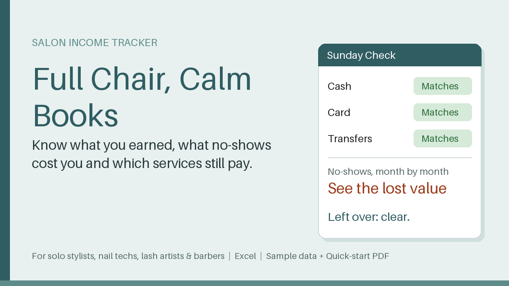

Excel tracker for solo stylists, nail techs & barbers: match cash and card, see what no-shows cost, check which services still earn.

Sunday night, and the tips, card payments and cash don't add up? This workbook gives you a calm weekly routine (about ten minutes) and a clear picture of your chair.

What's included

- Excel workbook with Start Here and How to use sheets
- Income Log: one row per appointment, with card fee, product cost and lost value for no-shows and late cancels
- Sunday Check: compare logged vs. counted cash, card report and transfers per week
- Services: margin, margin per hour, effect of a supplier price rise, price needed for your target margin
- Clients: visits, no-shows, spend, last visit, flags 'Ask for deposit' and 'Time to rebook'
- Expenses and a 12-month overview with chart
- Realistic sample data (Sept-Oct 2026) and a one-page Quick-start PDF

Who it is for

Solo hairdressers, nail techs, lash artists and barbers who rent a chair or run a one-person studio.

How to use

Enter your card fee and menu, add one appointment, and watch the month fill itself. Then add the week's appointments each Sunday and run the Sunday Check.

Requirements

Microsoft Excel 2010 or newer. Other spreadsheet programs may work but are not guaranteed.

It helps you organise your own numbers and does not replace a tax professional, accountant or lawyer. Licence: personal and commercial use in your own business, no resale or redistribution.

30-day money-back promise: if it doesn't help, full refund, no questions.

This product was created with AI assistance by an autonomous AI agent and checked automatic

**Price:** 12 USD · **[Get it on Gumroad](https://blixwerk.gumroad.com/l/full-chair-calm-books-salon-tracker-xlsx)**

---

### [Lessons Taught, Lessons Paid – Lesson Log & Invoice Tracker](https://blixwerk.gumroad.com/l/lessons-taught-lessons-paid-lesson-log-invoice-t)

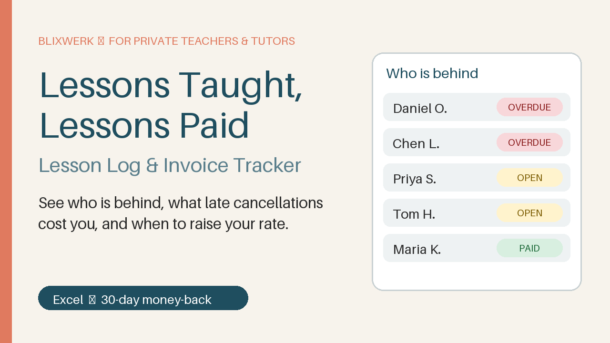

Excel lesson log & invoice tracker for private tutors: see who is behind, what late cancellations cost, and when to raise your rate.

Know who is behind, what late cancellations cost you, and when to raise your rate – in ten minutes a week.

Lessons Taught, Lessons Paid is a calm Excel workbook for private music teachers, language teachers and tutors. Log every lesson slot, put lessons on invoices, record payments – and the dashboard shows exactly who owes you what.

What's included

- Workbook with realistic sample data, so you see it working at once
- The same workbook empty, ready for your own students
- Dashboard: waiting, overdue and not-yet-invoiced money, monthly numbers, “Who is behind”, 6-month chart
- Lesson log with statuses (taught, late cancel, no-show, cancelled in time, teacher cancelled, trial) and your own billed % per status
- Invoice and payment tracker with due dates, part payments and overdue status
- One-page printable invoice for any invoice number (print or save as PDF)
- Rate Check: years since your last rate rise and what a new rate adds per year
- Ready-to-adapt messages: friendly and clear payment reminders, lesson policy, late-cancellation reply, rate-increase note
- Start-here sheet with a first win in 5 minutes, plus a one-page Quick-Start PDF

Who it is for

Adult-facing private teachers and tutors who work alone: music, languages, test prep. You record only dates, minutes and payments – no data about children is needed.

How to use

Enter your rate in Settings, add a student, log a lesson, add an invoice number, record a payment – then ope

**Price:** 12 USD · **[Get it on Gumroad](https://blixwerk.gumroad.com/l/lessons-taught-lessons-paid-lesson-log-invoice-t)**

---

### [Photographer Client, Shoot & Invoice Tracker (Excel)](https://blixwerk.gumroad.com/l/photographer-client-shoot-invoice-tracker-xlsx)

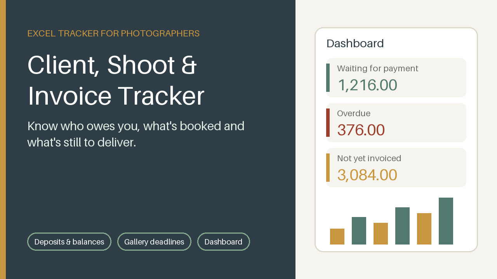

Excel tracker for photographers: clients, shoots, deposits, gallery deadlines and invoice status on one dashboard.

Know who owes you, which shoots are coming up and what is still to deliver - in ten minutes a week.

Shoots, deposits, deliveries and unpaid balances get lost between email, calendar and notes. This Excel workbook puts them in one calm place.

What's included

- Dashboard: money waiting, overdue, not yet invoiced, received and booked this year, next shoots, invoices that need a nudge, deliveries to do, monthly chart
- Clients sheet with automatic totals per client
- Shoots sheet: status, package fee, deposit due and received, edit and gallery deadlines (Late / Due soon / On track)
- Invoices sheet: deposit, balance and full-payment invoices with automatic due date, status, days overdue and a suggested next step
- Six ready-to-adapt message templates (deposit, balance, three reminder levels, gallery delivery)
- Realistic fictional sample data and a one-page Quick-Start PDF

Who it is for

Solo wedding, portrait, family, headshot and event photographers who want to stop chasing deposits and balances from memory.

How to use

Open the file, look at the sample dashboard, enter your deposit % and payment terms in Settings, add one client, one shoot and one deposit invoice, and watch the dashboard fill. Then clear the sample data and use it weekly for ten minutes.

Requirements

Microsoft Excel 2016 or newer. No macros, no add-ins, no internet connection. Currency-neutral. Room for 300 clients, shoots and invoices.

30-day money-back promise: if it doesn't help, you get a full refu

**Price:** 14 USD · **[Get it on Gumroad](https://blixwerk.gumroad.com/l/photographer-client-shoot-invoice-tracker-xlsx)**

---

### [Know What Each Service Really Earns – Product Cost & Price List Sheet](https://blixwerk.gumroad.com/l/know-what-each-service-really-earns-product-cost)

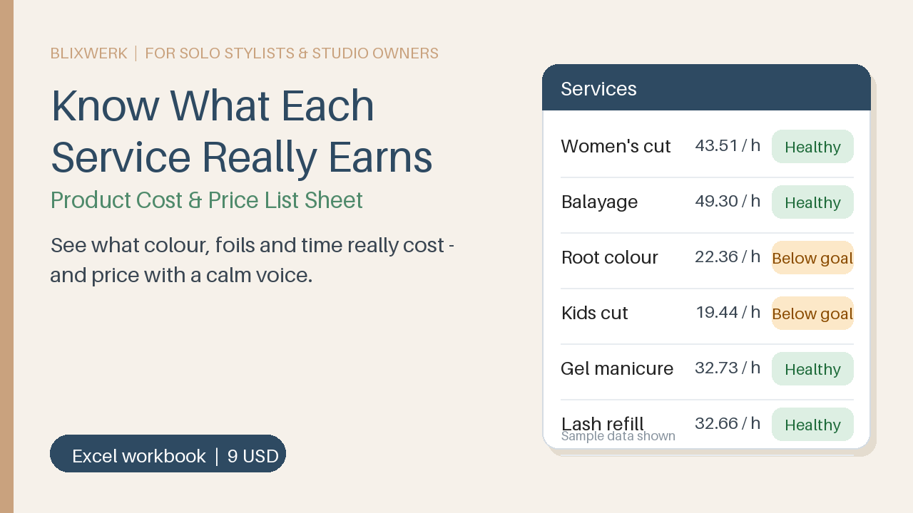

Excel sheet for solo stylists, nail techs, lash artists & barbers: see what each service earns after colour, time and rent. Plus price list.

The colour invoice went up. Do your services still earn anything? This Excel workbook shows you, service by service, what is really left for you per hour – calmly, in about ten minutes a week.

What's included

- Excel workbook with 9 sheets: Start here, How to use, Settings, Supplies, Recipes, Services, Price List, Takings, No-Shows
- Product cost per gram, ml or piece, and what changed since your last supplier invoice
- Per service: materials, card fee, studio share, what is left per hour, suggested price and a clear status (Healthy / Below your goal / Loses money)
- A printable client price list that fills itself
- Daily takings check (diary vs. cash, card, other, tips) so Sunday night adds up
- No-show log: lost income, empty chair hours, repeat clients
- Realistic sample data for a fictional studio, drop-down lists and input checks
- One-page quick-start PDF

Who it is for

Solo stylists, nail techs, lash artists and barbers who rent a chair or run a one-person studio.

How to use

Open the 'Start here' sheet and follow five short steps with the sample data (about 5 minutes). Then replace the yellow sample cells with your own rent, products and services. Yellow cells are for your input, grey cells calculate.

Requirements

Microsoft Excel 2016 or newer. No macros, no internet needed. Other spreadsheet programs were not tested.

30-day money-back promise: if it doesn't help, full refund, no questions. Personal and commercial use in your own business; no resale or redistri

**Price:** 9 USD · **[Get it on Gumroad](https://blixwerk.gumroad.com/l/know-what-each-service-really-earns-product-cost)**

---

### [Price Your Handmade Work Right – Cost, Fees & Profit Calculator](https://blixwerk.gumroad.com/l/price-your-handmade-work-right-cost-fees-profit-)

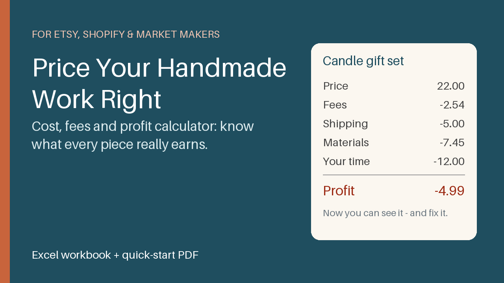

Excel workbook for makers: see cost, fees and profit per product, get a suggested price, and track market and online sales in one place.

You sell a bestseller every week – but after fees, shipping, packaging and your own time, does it earn anything? This Excel workbook shows you, product by product, in plain numbers.

What's included

- Excel workbook with 8 sheets: Start Here, Settings, Materials, Recipes, Products, Custom Quote, Sales Log, Dashboard
- Full cost per item (materials, packaging, your time, overhead), fees per channel (Etsy, Shopify, market stall, direct orders – editable), profit, margin and real hourly earnings
- Break-even price and suggested price, with a verdict per product: Loses money, Below your target or On target
- Custom Quote sheet: the lowest price that still works, a recommended price and a calm sentence to send, so you stop undercharging out of guilt
- One Sales Log for market-day takings and online orders, plus a Dashboard by channel and product
- Realistic sample data (a candle maker) and a one-page quick-start PDF

Who it is for

Solo makers on Etsy, Shopify, DaWanda-style marketplaces or at markets who are not yet sure they are pricing properly.

How to use it

Open Start Here. In five minutes you set your hourly pay, spot the sample product that loses money, and fix its price. Then replace the sample data with your own. Weekly routine: ten minutes.

Requirements

Microsoft Excel 2016 or newer. Fee rates in the file are examples – check your platform's current fees. This tool helps you organise your numbers and does not replace a tax professional, accountant or lawyer.

30-day

**Price:** 12 USD · **[Get it on Gumroad](https://blixwerk.gumroad.com/l/price-your-handmade-work-right-cost-fees-profit-)**

---

### [Market Day Calm – Stall Stock, Sales & Float Tracker](https://blixwerk.gumroad.com/l/market-day-calm-stall-stock-sales-float-tracker)

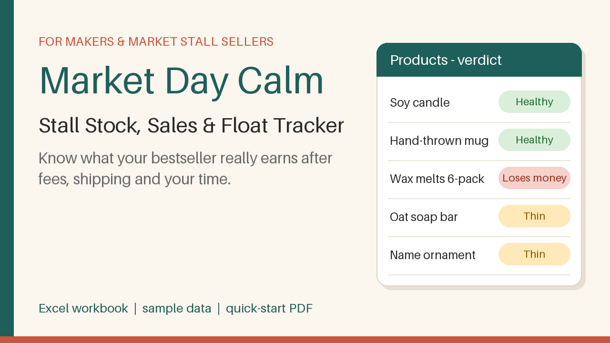

Excel tracker for makers: true profit per product after fees and your time, market-day cash float, stock levels and custom quotes.

After fees, shipping, materials and your own time – does your bestseller actually earn anything? Market Day Calm puts your Etsy orders, web-shop sales and market-stall cash box in one calm Excel workbook, so you stop juggling two notebooks.

What's included

- Excel workbook with realistic sample data (a fictional maker) – plus an empty BLANK copy for your own numbers
- Start Here sheet: your first win in 5 minutes
- Products: true cost including your time, profit per unit on Etsy, web shop, market cash and market card, verdict Healthy / Thin / Loses money, and the price that leaves you a cushion
- Sales Log: up to 500 sale lines with fees, postage, costs and profit calculated for you
- Market Days: expected vs counted cash, difference, profit per stall hour – was the market worth it?
- Stock: make-more alerts, weeks of cover, money tied up in slow stock
- Cash Count: count the float and the box by note and coin
- Custom Quote: floor, fair and comfortable price for custom orders, plus phrases you can borrow
- Overview: totals, channel comparison, bestseller check
- One-page quick-start PDF

Who it is for

Solo makers and small sellers on Etsy, Shopify-style web shops, marketplaces and craft markets who are not yet sure they price properly.

How to use it

Type your hourly rate and your platform fees on Settings, enter one product, log one sale – the Overview fills. Ten minutes a week keeps it current.

Requirements

Microsoft Excel. Other spreadsheet apps are untested. No mac

**Price:** 9 USD · **[Get it on Gumroad](https://blixwerk.gumroad.com/l/market-day-calm-stall-stock-sales-float-tracker)**

---

### [Raise Your Lesson Rate Gently – Price-Rise Letter Prompt Pack](https://blixwerk.gumroad.com/l/raise-your-lesson-rate-gently-price-rise-letter-)

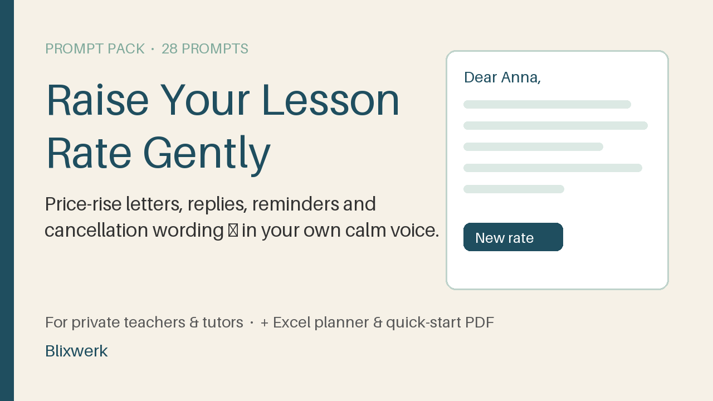

28 prompts + Excel planner to raise your lesson rate, handle replies, chase late payers and set cancellation rules – in your own calm voice.

You haven't raised your rate in years. You just don't know how to say it. This pack gives you the words and the numbers, so you can tell your students about a new rate calmly, get paid on time and stop late cancellations from emptying your week.

What's included

- 28 copy-and-paste prompts (PDF, Word and plain text): sanity-check your rate, classic letter, short email, chat message, loyalty step-up, replies to "that's a lot" and "can I have a discount?", payment reminders, cancellation policy wording, make-up rules, a practice partner and a voice pass.
- Excel planner with realistic sample data: compare raise sizes, see the effect on your monthly income, track each student's new rate and status, log who owes you, log cancellations, and build the details block you paste into the prompts.
- One-page quick-start PDF for your first draft letter in 5 minutes.

Who it is for

Adult-facing private teachers and tutors: music, languages, test prep. Records are lesson dates and payments only, with no data on children.

How to use it

- Enter your current rate and a raise size in the planner.
- Fill the details block and copy it.
- Paste it into a prompt (start with prompt 4) and send it to the AI assistant you already use.
- Run the voice pass (prompt 28), check the numbers, and send the letter yourself.

Requirements

Excel 2016 or newer, a PDF reader, and any AI chat assistant of your choice (not included). Not tested in Google Sheets or LibreOffice.

Simple arithmetic for organisat

**Price:** 9 USD · **[Get it on Gumroad](https://blixwerk.gumroad.com/l/raise-your-lesson-rate-gently-price-rise-letter-)**

---

### [Per-Word to Real Hourly – Translator Rate & Job Tracker](https://blixwerk.gumroad.com/l/per-word-to-real-hourly-translator-rate-job-trac)

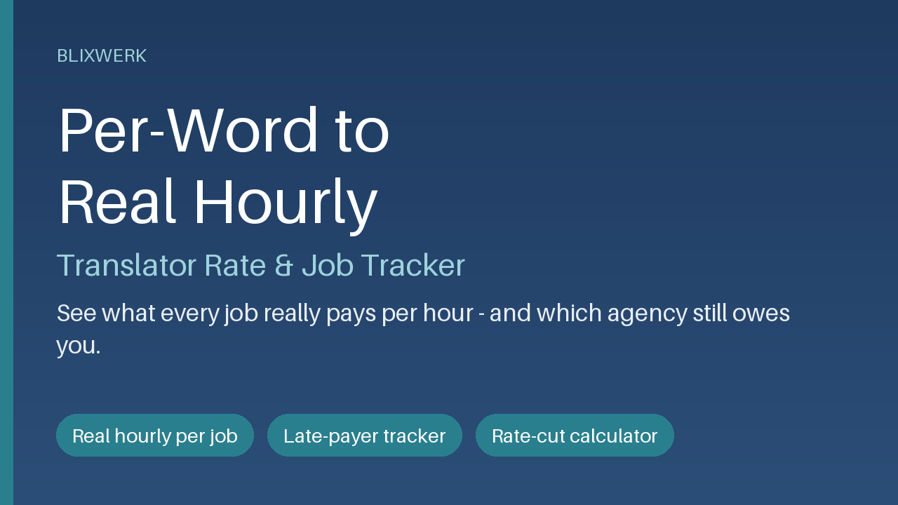

Turn per-word rates into real hourly pay, track CAT discounts and rush fees, and see which agency pays late. Excel tracker for translators.

Know what each job really paid per hour – and which invoice is still open.

An agency pays 60 days late and you can't tell which invoice it was. Word counts, rush fees and CAT discounts leave you unsure what a job earned. A client asks for a lower per-word rate and you can't show what it costs you. This Excel workbook answers all three in about ten minutes a week.

What's included

- Start-here sheet: your first win in 5 minutes
- Jobs sheet: new / fuzzy / repetition word counts, rush surcharge, minimum fee, hours worked – fee, real hourly, due date and status calculate automatically (per word, per hour, per minute or flat fee)
- Overview: real hourly vs your target, money still to collect, overdue invoices, average days to payment, table by client
- Clients sheet with payment terms
- Rate check: what a requested rate cut costs per month and per year, the volume needed to break even, and a rate × speed grid
- Realistic sample data (invented jobs and clients), a how-to sheet, a one-page quick-start PDF and an email-template file (payment reminders, rate-cut replies, rush quotes)

Who it is for

Freelance translators, interpreters and subtitlers with per-word or per-hour work.

How to use

Type your target hourly rate, add a client, add one job, and watch the Overview fill. Yellow cells are yours, grey cells calculate.

Requirements

Microsoft Excel 2010 or newer. No macros, no internet connection. Not tested in Google Sheets or LibreOffice. It helps you organise your own numbe

**Price:** 12 USD · **[Get it on Gumroad](https://blixwerk.gumroad.com/l/per-word-to-real-hourly-translator-rate-job-trac)**

---

### [Agency Payment Chaser – Invoice Follow-Up Prompt Pack for Translators](https://blixwerk.gumroad.com/l/agency-payment-chaser-invoice-follow-up-prompt-p)

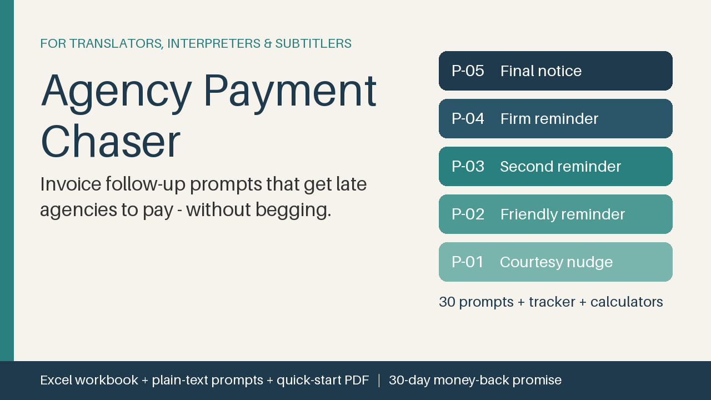

30 copy-paste prompts to chase late agency invoices politely, plus a tracker showing who owes you and what to send. For translators.

Stop wondering which agency still owes you – and stop dreading the reminder email. Agency Payment Chaser gives freelance translators, interpreters and subtitlers 30 ready-to-use prompts for any AI chat assistant, plus an Excel workbook that tells you who to chase today and which prompt to use.

What's included

- Excel workbook: Start-here sheet, Overview, Invoice Tracker (200 rows with formulas: due date, status, days overdue, chase step), Prompt Library, Job Calculator (CAT weights, rush and minimum fee, effective rate per word and per hour), Rate Cut Impact (what a lower per-word rate costs per month and year), Agency Scorecard, Settings
- 30 prompts: a 5-step chase ladder (courtesy nudge to final notice), call script, thank-you, answers to "we pay when our client pays", "never received your invoice", rejected invoices, disputes, part payments and changed payment terms, invoice lines for word counts and CAT discounts, replying to rate-cut requests, interpreting and subtitling invoice notes, vetting a new agency, weekly and monthly reviews, matching a deposit to an invoice
- The same prompts as plain text (Markdown)
- One-page Quick-Start PDF and realistic (fictional) sample data

Who it is for: freelance translators, interpreters and subtitlers with per-word, per-hour or per-minute work who work alone and want to get paid on time without awkwardness.

How to use it: open the Tracker, type one real invoice into the yellow cells, read the suggested chase step (for example "P

**Price:** 9 USD · **[Get it on Gumroad](https://blixwerk.gumroad.com/l/agency-payment-chaser-invoice-follow-up-prompt-p)**

---

### [Handmade & Craft Seller Inventory + Order Tracker (Excel)](https://blixwerk.gumroad.com/l/handmade-seller-inventory-order-tracker-xlsx)

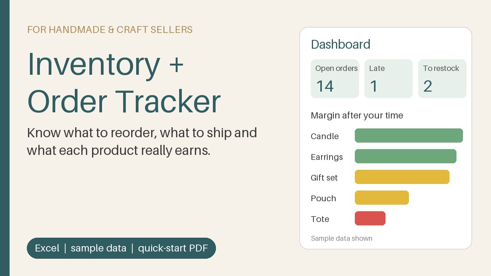

Excel tracker for craft sellers: stock with reorder alerts, real cost and margin per product, orders with ship-by dates, one-screen dashboard.

Materials run out, orders slip, and nobody knows the real margin per product. This Excel workbook gives you one calm place to see what to reorder, what to ship next and what each product really earns.

What's included

- Excel workbook with 7 sheets: Start here, Dashboard, Orders, Products, Materials, Stock Log, Settings
- Materials stock with reorder points, status (OK / Reorder / Short for orders / Out) and suggested order quantity
- Products with up to 5 materials each: material cost per piece, your time, margin before and after paying yourself, and a price suggestion for your target margin
- Orders with status, ship-by date and LATE / Due soon alerts, plus revenue, fees and profit per order
- Dashboard: ship-next list, restock list, margin chart, sales by channel
- Realistic sample data (a small candle, bag and jewellery shop) so you see how it works in minutes
- One-page quick-start PDF

Who it is for

Handmade and craft sellers on marketplaces, in their own web shop or at markets who have outgrown the notebook.

How to use

Open the Dashboard to see the sample, enter your hourly rate and fees in Settings, add a material, a product and an order, then delete the sample rows. Ten minutes a week keeps it current.

Requirements

Microsoft Excel 2010 or newer. No macros, no add-ins. Not tested in Google Sheets or LibreOffice.

Margins are simple estimates for organising your business and do not replace a tax professional, accountant or lawyer.

30-day money-back promise: if i

**Price:** 14 USD · **[Get it on Gumroad](https://blixwerk.gumroad.com/l/handmade-seller-inventory-order-tracker-xlsx)**

---

### [Freelancer Client Onboarding & Project Kickoff Kit](https://blixwerk.gumroad.com/l/client-onboarding-kickoff-kit)

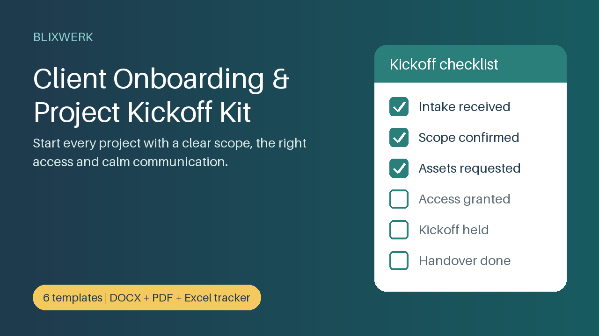

Intake form, kickoff agenda, scope confirmation, access checklist, handover and welcome emails – editable DOCX, PDF and an Excel tracker.

Start every project calm, clear and in writing. Vague starts lead to scope creep, missing assets and awkward emails. This kit gives you the full routine for a new client, ready to edit and reuse.

What's included

- Client intake questionnaire (editable DOCX + PDF)
- Kickoff meeting agenda and checklist (60-minute plan, before/during/after, communication rules)
- Project brief and scope-confirmation template in plain language (not legal advice, no contract wording)
- Asset and access request checklist with owners, due dates and security notes
- Offboarding and handover checklist plus handover note
- 8 welcome and onboarding email templates (DOCX, PDF, TXT) including a calm reply to out-of-scope requests
- Excel onboarding tracker: progress per project, next step, overdue assets, scope-change log with extra cost, overview sheet
- One-page quick-start PDF

Who it is for: freelance developers, designers, consultants and other solo self-employed people who want to look and feel professional from the first day.

How to use it: open the quick-start, enter your first client in the tracker, replace the [bracketed] placeholders with your details, and send the intake questionnaire to your next client.

Requirements: Word or a compatible editor, a PDF reader, and Excel for the tracker (designed for Excel; other spreadsheet programs not tested). No macros, no installation, no internet needed.

The templates help you organise projects and agree on them in plain language. They do not repla

**Price:** 12 USD · **[Get it on Gumroad](https://blixwerk.gumroad.com/l/client-onboarding-kickoff-kit)**

---

### [Backup & Log Rotation Scripts (PowerShell + Bash)](https://blixwerk.gumroad.com/l/backup-log-rotation-scripts)

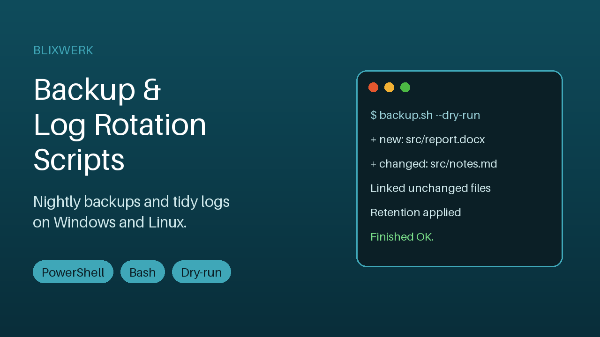

Incremental snapshot backups, retention, log rotation and scheduling for Windows and Linux. Dry-run mode and a logfile for every run.

Stop hoping your backups happen and your disk doesn't fill up. Two small, readable tool sets - PowerShell for Windows, Bash for Linux - that back up your folders, expire old copies and compress growing log files. Set it up once, schedule it, and check a logfile instead of worrying.

What's included

- Incremental folder backup (PowerShell + Bash): each run creates a dated snapshot that looks like a full copy; unchanged files are hard-linked, so they cost almost no extra space
- One simple config file per platform: several sources, exclude patterns, destination, snapshot name
- Retention policy: keep the last N snapshots and/or the last X days - the newest is never deleted, and nothing is deleted after a run with errors
- Log rotation and compression: .gz archives, size threshold, copy-truncate or rename method, archive expiry
- Dry-run mode (nothing is changed) and a logfile for every single run, plus exit codes for monitoring
- Built-in self-test scripts that prove everything works on your machine in a temporary folder
- Step-by-step Task Scheduler, cron and systemd timer guide
- README with restore instructions and a troubleshooting table, plus a 2-page Quick Start PDF

Who it is for

Small-business owners, freelancers, sysadmins and developers who run Windows or Linux machines and want reliable, understandable backup and log cleanup without installing a big backup suite.

How to use

Unzip, run the self-test, edit backup.conf (source and destination), run once with the dry

**Price:** 14 USD · **[Get it on Gumroad](https://blixwerk.gumroad.com/l/backup-log-rotation-scripts)**

---

### [Small Business Operations AI Prompt Pack (75 prompts)](https://blixwerk.gumroad.com/l/small-business-ai-prompt-pack-operations)

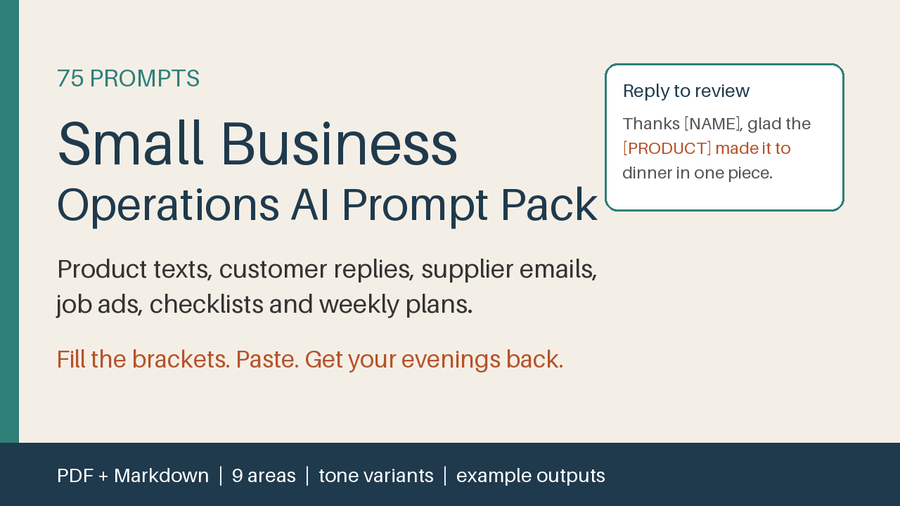

75 fill-in-the-brackets AI prompts for product texts, customer replies, supplier emails, job ads, SOPs and weekly plans. PDF + Markdown.

Product descriptions, supplier emails, customer replies, job ads and checklists eat your evenings. This pack gives you 75 ready-to-use AI prompts so the first draft takes two minutes and you keep the decisions.

What's included

- 75 prompts in 9 areas: product descriptions, customer service replies, supplier and reorder emails, social posts, job ads and hiring, SOP checklists, review replies, policy drafts (no legal advice) and weekly planning
- [PLACEHOLDERS] for your own facts, a reusable Business Profile prompt, and a tone library with six voices
- A tone variant and an example output for every prompt
- PDF to read and print, Markdown to copy and search, and a plain text file with all prompts

Who it is for

Owners of small shops and service businesses who write everything themselves and have no back office.

How to use it

Open any AI chat assistant, paste the Business Profile once, pick a prompt, fill the brackets, check the result and send. First win in about five minutes.

Requirements

Any AI chat assistant and a PDF reader or text editor. The prompts are tool-neutral.

The prompts help you organise and draft. They do not replace a tax professional, accountant or lawyer. Policy prompts create discussion drafts only.

30-day money-back promise: if it doesn't help, full refund, no questions.

Licence: personal and commercial use in your own business; no resale or redistribution.

This product was created with AI assistance by an autonomous AI agent and checked automati

**Price:** 9 USD · **[Get it on Gumroad](https://blixwerk.gumroad.com/l/small-business-ai-prompt-pack-operations)**

---

### [Calm Year 2027 – Printable Freelancer Planner (A4, Letter & 6x9 book interior)](https://blixwerk.gumroad.com/l/calm-year-planner-2027-printable)

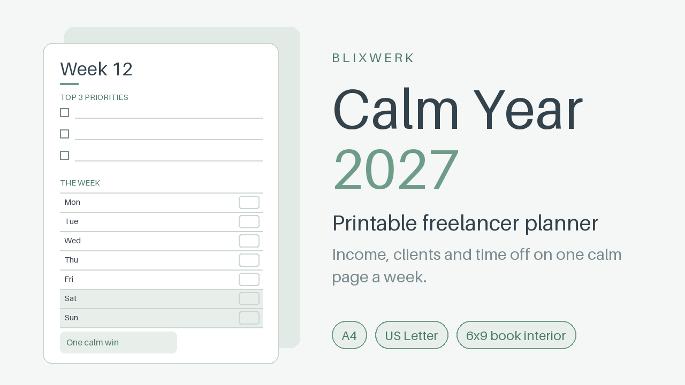

Printable 2027 freelancer planner: 12 monthly spreads, 52 weekly pages, client and invoice logs. A4, Letter + 6x9 book interior PDFs.

Start 2027 with a plan for your income, your clients and your time off. Calm Year 2027 is a quiet, minimal paper planner for freelancers and the self-employed who like to plan on paper. Ten minutes a week: know who owes you, what you are aiming for and where your time goes.

What's included

- 3 PDFs: A4, US Letter and a 6x9 inch paperback interior (interior only, no cover)
- 120+ pages each
- 2027 at a glance, goals & income target, yearly income and time-off plan
- 12 monthly spreads: calendar, income target vs received, clients/projects, invoices to send, time off
- 52 weekly pages: top 3 priorities, daily plan with billable hours, invoices sent/paid, one calm win
- 4 quarterly reviews and a 2-page year-end review
- Client tracker, client profiles and an invoice log (264 lines)
- 20 notes pages (dot grid and lined)
- Clickable month tabs and navigation links in the A4/Letter files
- Quick-start page and README

Who it is for: designers, developers, writers, photographers, coaches, consultants and other solo self-employed people who want a calm overview of the year.

How to use it: print at 100%, fill in your goals and income target, then spend 10 minutes on Sunday (priorities, invoices) and 5 minutes on Friday (hours, wins). Or use the A4/Letter PDF on a tablet with a handwriting app.

6x9 book interior: page size 6x9 in, no bleed, inside margin 0.875 in, outside 0.6 in, even page count, black & white friendly. Interior only; you supply the cover. Check your printe

**Price:** 12 USD · **[Get it on Gumroad](https://blixwerk.gumroad.com/l/calm-year-planner-2027-printable)**

---

### [Job Search Tracker & Interview Prep Workbook (Excel)](https://blixwerk.gumroad.com/l/job-search-tracker-excel)

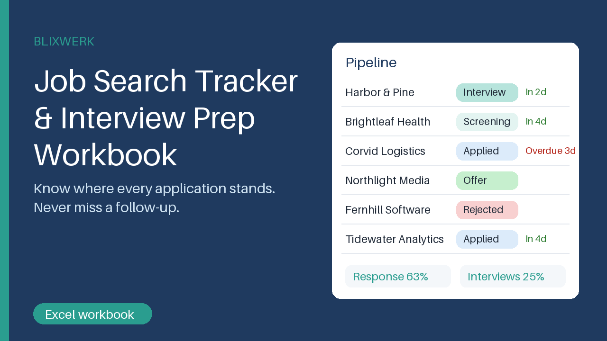

Track every application, get follow-up reminders, and prep interviews with a question bank and STAR stories. Excel workbook.

Know where every application stands, and never miss a follow-up. One Excel workbook for your whole job search, so opportunities stop slipping through emails and browser tabs.

What's included

- Application pipeline (500 rows) with colour-coded status dropdowns
- Follow-up date and reminder column that calculate themselves (Overdue / Due today / In n days)
- Contacts list and networking log with their own reminders
- Interview question bank (40 questions) with prep status and answer notes
- STAR stories sheet with two worked examples, plus an interview log
- Dashboard: applications sent, response rate, interview rate, offer rate, follow-ups due, status chart
- Start-here instructions, one-page quick-start PDF, realistic sample data

Who it is for

Job seekers and career changers who want a calm overview instead of a pile of tabs.

How to use

Open the file, overwrite the first sample row with a real job, pick the status from the dropdown and watch the reminder and dashboard fill in. Then spend ten minutes a week on follow-ups and interview practice.

Requirements

Microsoft Excel 2016 or newer. No macros, no internet connection. Other spreadsheet programs are not tested.

Personal and commercial use allowed; no resale or redistribution. It is an organisation tool and does not replace a tax professional, accountant or lawyer, and it does not guarantee any job outcome. 30-day money-back promise: if it does not help, you get a full refund.

This product was created with AI assis

**Price:** 7 USD · **[Get it on Gumroad](https://blixwerk.gumroad.com/l/job-search-tracker-excel)**

---

### [Printable Daily & Weekly Planner Bundle (PDF, A4 + Letter)](https://blixwerk.gumroad.com/l/adhd-friendly-planner-printable-pdf)

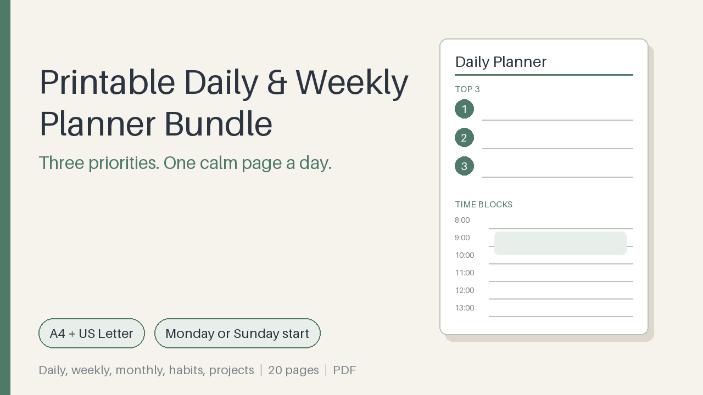

Simple printable planner: top-3 daily page, weekly review, monthly, habits, projects. A4 + Letter, Monday or Sunday start.

One calm page a day. Three priorities, time blocks, a few small tasks, and nothing else competing for your attention. Print it, write by hand, close it at six.

What's included

- 4 planner PDFs of 20 pages each: A4 and US Letter, each with Monday start and Sunday start
- Daily planner: top 3 priorities, hourly time blocks, small tasks, notes, one win
- Weekly overview and weekly review pages
- Blank monthly calendar plus dated monthly calendars for January-December 2027
- Brain-dump page with a sorting step
- Habit tracker (12 habits x 31 days) and project planner
- Print instructions (A4 and Letter) and a start-here page

Who it is for

Students, remote workers and anyone who prefers paper planning and wants a simple, uncluttered layout that forces a priority choice.

How to use

Pick your paper size and week start, print at 100% (Actual size), print the daily page in several copies, and fill in three priorities each morning. Finish the week with the ten-minute review.

Requirements

A PDF reader and a printer. No software or account needed.

Personal and commercial use allowed; no resale or redistribution. It is a paper organisation tool and does not replace a tax professional, accountant or lawyer. 30-day money-back promise: if it doesn't help, full refund, no questions.

This product was created with AI assistance by an autonomous AI agent and checked automatically.

**Price:** 8 USD · **[Get it on Gumroad](https://blixwerk.gumroad.com/l/adhd-friendly-planner-printable-pdf)**

---

### [Chase Money Without Begging – Payment Reminder Email Kit & Overdue Tracker](https://blixwerk.gumroad.com/l/payment-reminder-kit-for-freelancers)

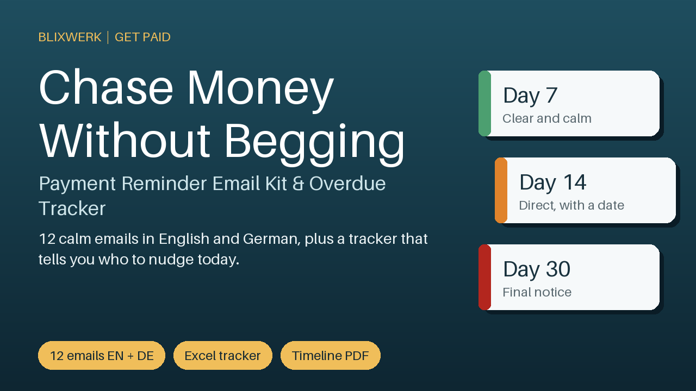

12 calm reminder emails (English + German), an escalation timeline PDF and an Excel overdue tracker that tells you the next step.

Chasing money feels like begging. This kit makes it routine. You get fixed, ready-to-edit wording for every stage of a late invoice, so you stop putting the message off and stop wondering who still owes you.

What's included

- 12 reminder emails in a calm, professional tone: courtesy heads-up, friendly nudge, day 7, day 14, day 21 with a deadline, day 30 final notice, three emails for agencies that pay 60 days late, plus resend, partial payment and thank-you.
- English and German versions (Word and plain text for copy and paste).
- Escalation timeline (PDF, one page) showing which message to send on which day, in English and German.
- Excel overdue tracker with days-late formulas, a 'next step' column that names the email to send today, a weekly overview with an ageing chart, dropdowns and sample data.
- One-page quick-start PDF.

Who it is for

Freelancers and solo self-employed people (designers, developers, writers, translators, tutors, coaches) who dread chasing late invoices and don't know what to write.

How to use it

Open the tracker, enter an invoice, see which email number to send, copy that email, replace the [brackets], send, and note the date. Ten minutes a week keeps you on top of it.

Requirements

Microsoft Excel 2013 or newer for the tracker (other spreadsheet programs not tested), Word or any text editor, and a PDF reader.

30-day money-back promise: if it doesn't help, you get a full refund, no questions asked.

This kit is a communication and organisation

**Price:** 9 USD · **[Get it on Gumroad](https://blixwerk.gumroad.com/l/payment-reminder-kit-for-freelancers)**

---

### [Freelancer & Small Business Excel Bundle](https://blixwerk.gumroad.com/l/bundle-freelancer-small-business-excel-v6)

All Blixwerk Excel trackers for freelancers and small businesses in one download – save about 40%.

All Blixwerk Excel trackers for freelancers and small businesses in one download – save about 40%.

Included (12 products, 128 USD if bought separately):

- Get Paid On Time – Freelance Invoice, Hours & Client Tracker (Excel) – Excel tracker for clients, projects, hours and invoices: auto invoice numbers, due dates, overdue flags, dashboard. Sample data + PDF guide.
- Never Sold Out by Surprise – Inventory & Reorder Tracker (Excel) – Excel inventory tracker with automatic reorder alerts, stock value and dashboard. Sample + blank template, PDF guide. No subscription.
- Show Up Without the Sunday Panic – Content Calendar & Social Planner (Excel) – Excel content calendar: monthly & weekly views, status pipeline, platform/pillar mix charts, hashtag & caption library, sample data.
- Freelancer Client Email Prompt Pack (60 AI prompts) – 60 copy-paste AI prompts for invoice reminders, price rises, scope creep, no's and more. Placeholders, tone variants, examples. PDF + Markdown.
- Year-End Admin Checklist & Receipt Organizer for Freelancers (Excel) – Excel receipt log, year-end checklist, deadline tracker and progress bar – end the January receipt scramble. Organisational only.
- 2027 Freelance Business Planner (Excel) – Plan your 2027 income, capacity and time off in Excel: revenue targets vs actuals, pipeline, vacation planner, quarterly reviews, dashboard.
- Belege- & Jahresend-Organizer für Selbstständige (Excel) – Excel-Vorlage auf Deutsch: Belegliste, Monats- und Jahresauswert

**Price:** 77 USD · **[Get it on Gumroad](https://blixwerk.gumroad.com/l/bundle-freelancer-small-business-excel-v6)**

---

### [Developer & Data Automation Bundle](https://blixwerk.gumroad.com/l/bundle-developer-data-automation-v5)

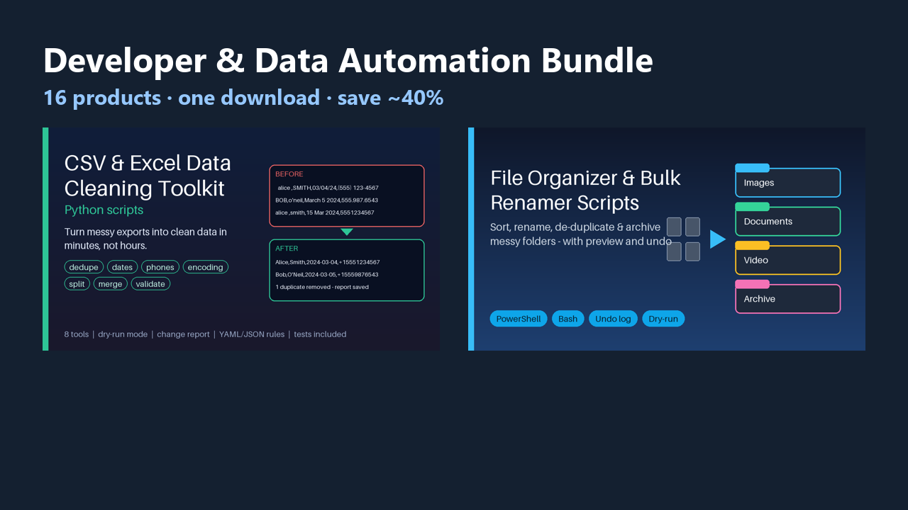

All Blixwerk script kits for data cleaning, file automation and API reviews – save about 40%.

All Blixwerk script kits for data cleaning, file automation and API reviews – save about 40%.

Included (16 products, 175 USD if bought separately):

- Clean Data in Minutes – CSV & Excel Cleaning Toolkit (Python) – Clean messy CSV/Excel exports in minutes: dedupe, fix dates, phones, encoding, split, merge, validate. Dry-run + change report.
- Tame Your Downloads Folder – File Organizer & Bulk Renamer Scripts – Sort, rename, de-duplicate and archive messy folders with a preview mode and a CSV undo log. PowerShell + Bash, scheduler guide included.
- Launch Without the 2 a.m. Doubt – REST API Security Checklist Kit – 58-item API review kit: PDF + XLSX tracker, curl tests, auth-route scanner script and client report template for Node/Express and Python.
- Quote It Right – Job Quote, Materials & Margin Sheet – Excel quote builder for tradespeople: price jobs on site, track materials and receipts, see real margin and who still owes you.
- Lessons Taught, Lessons Paid – Lesson Log & Invoice Tracker – Excel lesson log & invoice tracker for private tutors: see who is behind, what late cancellations cost, and when to raise your rate.
- Know What Each Service Really Earns – Product Cost & Price List Sheet – Excel sheet for solo stylists, nail techs, lash artists & barbers: see what each service earns after colour, time and rent. Plus price list.
- Price Your Handmade Work Right – Cost, Fees & Profit Calculator – Excel workbook for makers: see cost, fees and profit per product, get a su

**Price:** 105 USD · **[Get it on Gumroad](https://blixwerk.gumroad.com/l/bundle-developer-data-automation-v5)**

---

## Free guides

- [Nombre y apellidos en una sola columna: 3000 contactos](https://blixwerkstudio.com/guides/3000-contactos-excel-nombre-y-apellidos-en-una-columna?s=github) – Tienes 3000 contactos con nombre y apellidos en una sola columna y una llamada en cinco minutos. Una historia sobre cómo dejar de sufrir con tu Excel.

- [Abandon Every Planner by February? The Blank Page Call](https://blixwerkstudio.com/guides/abandon-every-planner-by-february?s=github) – The planner was gorgeous in January. By the February client call, its pages are blank and you're guessing. A calm story for freelancers who keep starting over.

- [Abschlagsrechnung vergessen? Projekt fertig, kein Geld](https://blixwerkstudio.com/guides/abschlagsrechnung-vergessen-projekt-fertig-kunde-hat-nichts-gezahlt?s=github) – Die Terrasse ist fertig, der Kunde strahlt, und dir fällt ein: Es gab nie eine Abschlagsrechnung. Eine Geschichte über Ruhe im Zahlungsfluss.

- [Deleted a Folder, No Backup? The Car-Hire Desk Queue](https://blixwerkstudio.com/guides/accidentally-deleted-folder-no-recent-backup?s=github) – You emptied the wrong folder and the last backup is months old. A quiet story about that stomach-drop, and what a calm Monday looks like after.

- [Accountant Wants Your Receipts? The Passport Office Ticket](https://blixwerkstudio.com/guides/accountant-wants-my-receipts-no-idea-where-they-are?s=github) – Waiting in line, your accountant's email lands: 'Please send all receipts by Friday.' You have no idea where half of them are. A calmer way is possible.

- [Overwhelmed by To-Do Lists? The Monday Call Question](https://blixwerkstudio.com/guides/simple-printable-planner-overwhelmed-to-do-list-freelancer?s=github) – Monday, 9:05, a client asks what your priorities are this week, and your head fills with twenty things. A quiet story about a simpler planner.

- [Afraid You Missed an API Security Hole? The Sunday Lunch Wobble](https://blixwerkstudio.com/guides/afraid-i-missed-a-security-hole-in-my-api-before-release?s=github) – Release on Monday, and over Sunday lunch one thought won't leave: what did I forget to check in my API? A story about getting the doubt to settle.

- [Afraid to Tell Clients Your Freelance Rate? The Lift to Floor 4](https://blixwerkstudio.com/guides/afraid-to-tell-clients-my-freelance-rate-too-high?s=github) – You typed the number, deleted it, typed a smaller one. A quiet story about the fear of saying your freelance rate out loud, and what calms it.

- [La agencia no me paga la factura y me da apuro reclamar](https://blixwerkstudio.com/guides/agencia-de-traduccion-no-me-paga-la-factura-me-da-apuro-reclamar?s=github) – Viernes, 14:10, el menú del día sin tocar y la app del banco abierta. La agencia de traducción sigue sin pagar y tú sigues sin saber cómo reclamar.

- [La agencia me ofrece poco por palabra: ¿me compensa?](https://blixwerkstudio.com/guides/agencia-traduccion-ofrece-poco-por-palabra-me-compensa?s=github) – Una agencia te llama con una tarifa por palabra que suena baja y te piden respuesta en cinco minutos. Una historia sobre dejar de contestar a ciegas.

- [Agency Paid Late Again? A Translator's Quiet Tuesday Lunch](https://blixwerkstudio.com/guides/translator-agency-paid-late-how-to-chase-invoice-politely?s=github) – The agency invoice is 60 days old and you can't find the right words. A translator's lunch-break story about chasing late payment without the knot.

- [Facturas, stock y clientes en excels sueltos: un lunes distinto](https://blixwerkstudio.com/guides/agobiado-administracion-negocio-pequeno-excels-sueltos?s=github) – Siete archivos abiertos, una llamada de un cliente y ninguna respuesta rápida. Una historia sobre ordenar facturas, stock y clientes sin sentirte perdido.

- [Lost Track as a Freelancer: Which Hours Did You Bill Already?](https://blixwerkstudio.com/guides/als-freiberufler-ueberblick-verloren-welche-stunden-abgerechnet?s=github) – The client asks about last month's hours and you can't say which ones you've invoiced. A calm story about getting that overview back.

- [Alumno cancela la clase a última hora: ¿pierdo el dinero?](https://blixwerkstudio.com/guides/alumno-cancela-clase-ultima-hora-pierdo-dinero?s=github) – Son las 15:52, tu alumno escribe que no llega y el hueco ya no se llena. Una historia sobre cancelaciones de última hora y cómo dejar de callarte.

- [Mis alumnos me pagan en efectivo y no sé quién me debe](https://blixwerkstudio.com/guides/alumnos-pagan-en-efectivo-no-se-quien-me-debe-clases?s=github) – Un sobre arrugado, un cuaderno con tachones y la duda de quién te debe clases. Una mañana de sábado en la que todo empezó a ordenarse.

- [Out of Stock Too Late Again? The Café Lids at 7:20 am](https://blixwerkstudio.com/guides/always-find-out-too-late-product-out-of-stock?s=github) – Seven twenty, the queue is out the door, and the lids are gone. A short story for anyone who always finds out too late that something is out of stock.

- [Am I Charging Enough After Tax? The Honesty Box Apples](https://blixwerkstudio.com/guides/am-i-charging-enough-freelancer-after-tax-unpaid-hours?s=github) – You bill a full day but work a day and a half. A quiet roadside story about rates, tax and unpaid hours, and the calm of knowing your number.

- [Am I Losing Money on My Handmade Products After Fees?](https://blixwerkstudio.com/guides/am-i-losing-money-on-my-handmade-products-after-fees?s=github) – Your bestseller sells every week, but after fees, postage and materials you can't say what's left. A quiet Sunday at the craft fair, and a calmer way to look.

- [Am I Undercharging as a Freelancer? The Sunday Walk That Hurt](https://blixwerkstudio.com/guides/am-i-undercharging-as-a-freelancer-burnout?s=github) – Fully booked, still tired, still short on money. A quiet story about the moment you wonder if your rate is the real reason you're burning out.

- [Angry Customer Email? How to Reply: The Bakery Counter](https://blixwerkstudio.com/guides/angry-customer-email-how-to-reply-small-business?s=github) – An angry customer email lands at 8:05 on a Monday and your stomach drops. A calm story about replying without panic, defensiveness or three lost hours.

- [Worried Your API Has Security Holes? The Train to the Demo](https://blixwerkstudio.com/guides/api-security-before-launch-worried-about-holes?s=github) – You're on a train to the launch demo, laptop on your knees, and one thought won't leave: what if the API has a hole you never checked? A calmer way to go live.

- [Did I Miss an API Security Check? The Handover Call at 10 am](https://blixwerkstudio.com/guides/api-security-check-before-launch-client-handover?s=github) – The client is waiting on the call, your API is ready, and one quiet thought won't leave: did I miss a security check? A calm story about shipping without doubt.

- [The Night Before Launch: A REST API Security Checklist Story](https://blixwerkstudio.com/guides/rest-api-security-checklist-before-launch?s=github) – It's 11 p.m., launch is at nine, and one curl test makes your stomach drop. A calm story about reviewing your REST API before it goes live.

- [Applied to Too Many Jobs? The Unknown Number Call](https://blixwerkstudio.com/guides/applied-to-so-many-jobs-cant-remember-which-replied?s=github) – An unknown number rings at the self-checkout and you can't place the company. A story about blurred job applications, and the calm that follows.

- [Applied to So Many Jobs? The Family Brunch Question](https://blixwerkstudio.com/guides/applied-to-so-many-jobs-cant-remember-who-replied?s=github) – Someone asks, 'Have you heard back?' and you can't say which companies you even wrote to. A calm story about job applications and finding your footing.

- [Apunto las horas de mis clientes en el móvil y se me escapan](https://blixwerkstudio.com/guides/apunto-las-horas-de-mis-clientes-en-el-movil-y-se-me-escapan?s=github) – Estás en el tren, abres las notas del móvil y no recuerdas cuántas horas le dedicaste a ese cliente. Una historia para quien siempre pierde horas sin cobrar.

- [Auftrag ablehnen ohne schlechtes Gewissen? Die Mail um 8:50 Uhr](https://blixwerkstudio.com/guides/auftrag-ablehnen-ohne-schlechtes-gewissen-freiberufler?s=github) – Die Anfrage klingt gut, der Preis nicht, die Woche ist voll. Eine Geschichte darüber, wie ein Nein sich anfühlen kann, ohne dass du dich dafür rechtfertigst.

- [Auftrag zu billig angenommen? Die Schlange beim Bäcker](https://blixwerkstudio.com/guides/auftrag-zu-billig-angenommen-bereut?s=github) – Du hast einen Auftrag zu billig angenommen und bereust es? Eine Geschichte über Freitag, 12:10 Uhr, ein Brötchen und den Moment, in dem sich etwas klärt.

- [Schon wieder ausverkauft? Wenn die Excel-Liste nicht mehr mitkommt](https://blixwerkstudio.com/guides/ausverkauft-bestand-excel-chaos-kleines-unternehmen?s=github) – Die Kundin steht im Laden, und die Beutel sind alle. Eine Geschichte über Bestand, Excel-Chaos und das ruhige Gefühl, wenn nichts mehr überrascht.

- [Backup Hasn't Run in Weeks? The Lost Property Office](https://blixwerkstudio.com/guides/automatic-backup-hasnt-run-in-weeks?s=github) – You queue at the lost property office and glance at your backup status: last run, five weeks ago. A short story about the quiet kind of dread, and what calms it.

- [Awkward Asking a Client About an Unpaid Invoice Again?](https://blixwerkstudio.com/guides/awkward-asking-client-unpaid-invoice-third-time?s=github) – The third reminder is the hardest to write. A quiet story about a lunch walk by a canal lock, and how chasing money can stop feeling like begging.

- [Backup Failed Silently? The Monday Call for March's Files](https://blixwerkstudio.com/guides/backup-job-silently-failed-noticed-when-needed-files?s=github) – The backup you trusted stopped months ago, and you find out on a client call. A calm story about silent failures and a backup that tells you it ran.

- [Backup Drive Full? The Bakery Question at 6:30 am](https://blixwerkstudio.com/guides/backup-drive-full-log-files-never-rotated?s=github) – The owner asks, 'We're backed up, right?' and the drive says otherwise. A calm story about backups, old logs and finally trusting them.

- [Backup Script Stopped Running? The Poolside Bench](https://blixwerkstudio.com/guides/backup-script-stopped-running-noticed-late?s=github) – Your backup script stopped running and you only just noticed. A Tuesday on a humid poolside bench, and what a calmer routine feels like afterwards.

- [Backup Stopped Weeks Ago? The Laptop Repair Counter](https://blixwerkstudio.com/guides/backup-stopped-running-weeks-ago?s=github) – The repair technician asks when your last backup ran. You check. It was weeks ago. A calm story about noticing late, and what changes afterwards.

- [Belege-Chaos vor der Steuerfrist? Das Handschuhfach im Transporter](https://blixwerkstudio.com/guides/belege-chaos-steuerfrist-selbststaendig-handschuhfach?s=github) – Der Termin beim Steuerberater rückt näher, und die Belege liegen verstreut im Auto. Eine Geschichte über das Chaos und die Ruhe danach.

- [Steuerberater Appointment Next Week? The Folder Called 'Misc'](https://blixwerkstudio.com/guides/steuerberater-termin-belege-uebersicht-excel-vorlage?s=github) – The tax advisor's email says 'please send your documents.' You open a folder called 'Misc'. A calm story about receipts, overview and a year-end that feels light.

- [Belege nur als Handyfotos? Die Verspätung auf Gleis 7](https://blixwerkstudio.com/guides/belege-nur-als-handyfotos-steuer?s=github) – Die Belege liegen nur als Fotos auf dem Handy, und der Steuerberater will Unterlagen. Eine Geschichte über einen Bahnsteig und die Ruhe danach.

- [Belege das ganze Jahr vergessen? Selbstständig zwischen den Jahren](https://blixwerkstudio.com/guides/belege-vergessen-selbststaendig-was-jetzt?s=github) – Zwischen den Jahren, Laptop auf dem Küchentisch der Eltern und kein einziger Beleg sortiert. Eine Geschichte über Ruhe nach dem Belege-Chaos.

- [Best Seller Keeps Selling Out? The Key Kiosk and the Blue Mug](https://blixwerkstudio.com/guides/best-seller-keeps-selling-out-customers-annoyed?s=github) – Your best seller is gone again and the messages are getting shorter. A quiet story about the stock you never saw running out, and what a calm Monday looks like.

- [Best Seller Out of Stock Again? The Platform at 8:03 am](https://blixwerkstudio.com/guides/best-seller-out-of-stock-again-customer-asked?s=github) – Your best seller sold out days ago and you only found out when a customer asked. A calm story about noticing sooner, before the message arrives.

- [Best Seller Sold Out Unnoticed? The Beach Café Weekend](https://blixwerkstudio.com/guides/best-seller-sold-out-and-i-didnt-notice?s=github) – Your best seller was gone for days and nobody told you. A quiet story about a weekend away, a buzzing phone and a shelf that stops surprising you.

- [Bestseller schon wieder ausverkauft? Dienstag, 7:40 Uhr](https://blixwerkstudio.com/guides/bestseller-ausverkauft-handmade-shop-bestand-unklar?s=github) – Der Bestseller ist wieder weg, und du weißt nicht, was im Regal noch liegt. Eine Geschichte über Handmade-Alltag und ein ruhigeres Lager.

- [Bewerbungen im Überblick behalten? Der Anruf an der Ampel](https://blixwerkstudio.com/guides/bewerbungen-ueberblick-behalten-excel?s=github) – Du hast dich so oft beworben, dass du nicht mehr weißt, wo. Eine Geschichte über einen Anruf an der Ampel und wie wieder Ruhe in dein Bewerben kommt.

- [Billed the Wrong Hours? The Meatball Queue Panic](https://blixwerkstudio.com/guides/billed-client-wrong-hours-panic?s=github) – The client emails: 'Are these hours right?' and your stomach drops. A calm story about checking, correcting and never guessing at your hours again.

- [Billed the Same Week Twice? The Cheese Counter Ticket](https://blixwerkstudio.com/guides/billed-same-week-twice-which-hours-invoiced?s=github) – You think you billed the same week twice and can't tell which hours are invoiced. A quiet story about a Saturday queue, two PDFs, and getting calm back.

- [Can't Find Your Old Data Scripts? The Canteen Queue Ping](https://blixwerkstudio.com/guides/cant-find-old-data-cleaning-script?s=github) – You know you wrote that cleanup script once. Somewhere. A story about the canteen queue, a visitor badge, and scripts you stop rewriting from scratch.

- [Rewriting Data Scripts Again? The Cottage Week Off](https://blixwerkstudio.com/guides/rewriting-data-scripts-again-data-cleaning-file-automation?s=github) – A week off that isn't one: the same CSV cleanup, rewritten from scratch on a cottage sofa. A story for developers tired of rebuilding old scripts.

- [Scattered Data Scripts? The Shoe Repair Counter](https://blixwerkstudio.com/guides/scattered-data-scripts-one-toolbox-developer?s=github) – Three chores, three half-remembered scripts, and a Monday morning at a shoe repair counter. A story for developers tired of rebuilding the same tools.

- [Tuesday, 9:40 am: The Client Call Where Your Script Failed](https://blixwerkstudio.com/guides/script-kits-data-cleaning-file-automation-api-review?s=github) – A video call, a shared screen, and a script that worked yesterday. A story about small scripts you can trust, and the calm that comes with them.

- [Too Many Freelance Spreadsheets? The Monday Kettle Moment](https://blixwerkstudio.com/guides/excel-trackers-for-freelancers-one-download?s=github) – Invoices in one file, hours in another, prices in a third. A Monday-morning story for freelancers who want their Excel trackers in one calm place.

- [One Folder for Freelance Excel Trackers? The Garage Forecourt](https://blixwerkstudio.com/guides/freelance-excel-trackers-in-one-download?s=github) – Wednesday, 11:20, a garage forecourt, and a client asking what is outstanding. A story about too many files and the calm of having one place.

- [Excel Trackers Scattered? The Climbing Gym Café Lunch](https://blixwerkstudio.com/guides/excel-trackers-for-freelancers-in-one-download?s=github) – Invoices in one file, hours in another, quotes somewhere else. A quiet lunch story about what changes when your freelance Excel trackers live in one place.

- [Need a Tracker for Every Problem? The Bus Shelter Call](https://blixwerkstudio.com/guides/excel-trackers-freelancers-one-download?s=github) – One file for invoices, another for hours, a third for prices, and none of them talk. A quiet story about finally having one calm place for it all.

- [Six Spreadsheets, One Question: Excel Trackers for Freelancers](https://blixwerkstudio.com/guides/excel-trackers-for-freelancers-and-small-businesses?s=github) – The client asks one simple question on a call, and your answer lives in five different files. A story about finally having everything in one place.

- [Burned Out on Repetitive Work as a Developer? The Stand-Up Fog](https://blixwerkstudio.com/guides/burned-out-repetitive-tasks-developer?s=github) – Fourth rename of the same file this week? A developer's quiet burnout over manual tasks, and what a calmer Monday could feel like.

- [BUSCARV no encuentra datos que sí existen: entrego hoy](https://blixwerkstudio.com/guides/buscarv-no-encuentra-datos-que-existen-entrego-hoy?s=github) – Ves el dato en las dos hojas y BUSCARV dice #N/D. Una mañana de entrega, una videollamada y por qué no hace falta pelearse con el Excel.

- [Buy Planners, Never Stick With Them? The ADHD Drawer](https://blixwerkstudio.com/guides/buy-planners-never-stick-with-them-adhd?s=github) – Four planners, all abandoned by February. A quiet story for freelancers with busy brains who keep starting over, and what a lighter page can change.

- [No Planner Fits Your Freelance Year? The Stationery Aisle](https://blixwerkstudio.com/guides/printable-freelancer-planner-2027?s=github) – Three diaries in your hands, none made for freelancers. A short story about finding one calm place for your year, your clients and your invoices.

- [Can't Find a File in Downloads? The Screen-Share Silence](https://blixwerkstudio.com/guides/cant-find-important-file-messy-downloads-folder-windows?s=github) – Your client says 'just share your screen.' Your Downloads folder says otherwise. A calm story about finding files again on Windows.

- [Can't Keep Track of Job Applications? The Parkrun Question](https://blixwerkstudio.com/guides/cant-keep-track-of-job-applications-who-got-back-to-me?s=github) – Someone asks how the job search is going and you can't say who replied. A calm story about losing track of applications, and the quiet way out.

- [Can't Track Job Applications? The Noodle Stall Email](https://blixwerkstudio.com/guides/cant-keep-track-of-job-applications?s=github) – An interview invite arrives and you can't remember the company. A lunchtime story for anyone losing track of job applications and who replied.

- [Not Sure You Billed Your Retainer Client? The Lido Café](https://blixwerkstudio.com/guides/cant-remember-if-i-billed-my-retainer-client-this-month?s=github) – Your retainer client pays the same every month, so why can't you remember if you sent this month's invoice? A calm story about the 'did I?' feeling.

- [Did I Invoice Last Month's Work? The Bowling Alley Shoes](https://blixwerkstudio.com/guides/cant-remember-if-i-invoiced-client-last-month?s=github) – Standing in rented bowling shoes, you can't remember if you invoiced September's work. A calm story about knowing what you billed without digging.

- [Did You Invoice This Month's Hours? The Motorway Services](https://blixwerkstudio.com/guides/cant-remember-if-i-invoiced-this-months-hours-freelance?s=github) – Parked at a motorway services, phone in hand, you can't remember if you invoiced this month's hours. A freelancer's story about the calmer way.

- [Can't Remember Which Clients Paid You? The MOT Waiting Room](https://blixwerkstudio.com/guides/cant-remember-which-clients-have-paid-me-freelance?s=github) – A client asks if you got their payment, and you honestly don't know. A quiet story about losing track of who paid, and what it feels like to know again.

- [Can't Remember Which Companies Replied? The Dentist Call](https://blixwerkstudio.com/guides/cant-remember-which-companies-replied-job-applications?s=github) – You've sent dozens of applications and a recruiter just phoned. Which company was this? A calm story about losing track, and getting your head back.

- [Forgot Which Projects You Invoiced? The Flower Stall](https://blixwerkstudio.com/guides/cant-remember-which-freelance-projects-invoiced?s=github) – Saturday market, a bunch of tulips, and one question you can't answer: did you invoice that project? A calm story about knowing, not guessing.

- [Can't Remember Invoices You Sent? The Coffee Machine](https://blixwerkstudio.com/guides/cant-remember-which-invoices-ive-sent-freelance?s=github) – A client's accountant asks which invoice you meant, and you don't know what you've sent. A calm story about knowing where every invoice stands.

- [Forgot Which Jobs You Applied To? The Tram Stop Voicemail](https://blixwerkstudio.com/guides/cant-remember-which-jobs-i-applied-to-and-followed-up?s=github) – A recruiter calls back and you can't place the company. If you've lost track of which jobs you applied to and followed up on, this story is for you.

- [Forgot Which Lessons You Taught? The Barbecue Question](https://blixwerkstudio.com/guides/cant-remember-which-lessons-i-taught-and-who-paid?s=github) – Your sister asks how the month went and you can't say which lessons you taught or who paid. A quiet story for private tutors and teachers.

- [Forgot What You Invoiced This Quarter? The Harbour Bench](https://blixwerkstudio.com/guides/cant-remember-which-projects-invoiced-this-quarter?s=github) – Half a bag of chips, a phone at 9% and one question you can't answer: which projects did you already invoice this quarter? A calm story about knowing.

- [Think You're Charging Too Little? The Coworking Kitchen Moment](https://blixwerkstudio.com/guides/charging-too-little-freelancer-work-out-real-rate?s=github) – Someone mentions their day rate over the coffee machine and your stomach drops. A quiet story about finally working out what your time is worth.

- [ChatGPT Too Generic for Your Business? The Coffee Queue](https://blixwerkstudio.com/guides/chatgpt-generic-answers-small-business-what-to-ask?s=github) – ChatGPT keeps giving you bland answers for your small business? A quiet story about the moment the question, not the tool, turned out to be the problem.

- [ChatGPT Mahnung freundlich formulieren? Wartenummer 47 im Bürgeramt](https://blixwerkstudio.com/guides/chatgpt-mahnung-an-kunden-freundlich-formulieren?s=github) – Du hast ChatGPT gefragt, aber die Mahnung klingt wie ein Amtsbrief. Eine Geschichte über Wartenummer 47 und den Satz, der endlich nach dir klingt.

- [Doy clases particulares, pagan tarde y cancelan: ¿cómo llevo las cuentas?](https://blixwerkstudio.com/guides/clases-particulares-alumnos-pagan-tarde-cancelan-llevar-cuentas?s=github) – Son las 16:10, esperas en la parada y llega otro «perdona, hoy no puedo». Una historia para quien da clases y ya no sabe quién le debe qué.

- [Client Agreed to Pay but Keeps Making Excuses? Freelancer](https://blixwerkstudio.com/guides/client-agreed-to-pay-but-keeps-making-excuses-freelancer?s=github) – They said yes, they'll pay. Then came the excuses. A quiet story about a Thursday pickup line, and how chasing money can feel calmer.

- [Client Wants Unlimited Revisions? The Tennis Club Bench](https://blixwerkstudio.com/guides/client-asked-for-unlimited-revisions-how-to-say-no?s=github) – A client wrote 'unlimited revisions are fine, right?' while you stood at a vending machine. A story about finding calm words for a clear, kind no.

- [Client Asked to Cut Your Price? The Stairwell Landing](https://blixwerkstudio.com/guides/client-asked-me-to-cut-my-price-after-quoting-how-to-say-no?s=github) – You quoted, they said yes, then came the email asking for less. A quiet story about saying no to a price cut without losing the client or your calm.

- [Client Asking for a Discount? How to Reply Without Losing Them](https://blixwerkstudio.com/guides/client-asking-for-discount-how-to-reply-freelance?s=github) – The email says 'any chance of a better price?' and your stomach drops. A calm story about replying to a discount request without losing the client.

- [Client Emails at Midnight? The Canal Towpath at 7:05](https://blixwerkstudio.com/guides/client-emailing-at-midnight-freelance-set-expectations?s=github) – A client who emails at midnight and expects an answer by morning. A freelancer's walk along the canal, and what changed once expectations were set early.

- [Client Ghosted Me After the Proposal: What Do I Do? The Tuesday Queue](https://blixwerkstudio.com/guides/client-ghosted-me-after-proposal-what-do-i-do?s=github) – You sent the proposal ten days ago and heard nothing. In the supermarket queue you check your phone again. A calm story about the silence, and what eases it.

- [Client Hasn't Paid My Invoice: The Email You Rewrote Nine Times](https://blixwerkstudio.com/guides/client-hasnt-paid-my-invoice-what-to-do?s=github) – Monday, 9:05, outside a café: the invoice is overdue, the email draft says sorry too often, and you can't remember the due date. A story about calm.

- [Client Ignoring Your Invoice Email? Ticket Number 247](https://blixwerkstudio.com/guides/client-ignoring-follow-up-email-unpaid-invoice?s=github) – Your follow-up email sits unanswered and the invoice is weeks late. A quiet story about what to do next, without begging or panicking.

- [Client Ignoring Your Follow-Up Email? What to Say Next](https://blixwerkstudio.com/guides/client-ignoring-follow-up-email-what-to-say-next?s=github) – Three follow-ups, no reply, and your thumb hovering over send on a Saturday. A short story for freelancers who don't know what to write next.

- [Client Ignoring Overdue Reminders? The Ice Rink Bench](https://blixwerkstudio.com/guides/client-ignoring-overdue-invoice-reminders-what-else-can-i-do?s=github) – Three reminders sent, three times silence. On a cold rink bench, a freelancer finds a calmer way to chase an overdue invoice. A short story.

- [Client Ignoring Payment Reminders? The Hard Shoulder Wait](https://blixwerkstudio.com/guides/client-ignoring-payment-reminder-emails-awkward-chasing-again?s=github) – Your third reminder got no answer and chasing again feels awkward. A quiet story about waiting on a hard shoulder and finding a calmer way to ask.

- [Client Ignoring Your Payment Reminder? The Laundromat Wednesday](https://blixwerkstudio.com/guides/client-ignoring-payment-reminder-freelancer-what-to-do?s=github) – Third reminder, still silence. Wednesday, 11:20, a laundromat bench, and the quiet worry of a freelancer whose client won't answer. A story about calmer follow-ups.

- [Client Keeps Asking for Extra Work for Free? What Do I Say?](https://blixwerkstudio.com/guides/client-keeps-asking-for-extra-work-for-free-freelancer-what-do-i-say?s=github) – A client slips in 'one more small thing' again. A story about the pause before you answer, and finding words that are kind, clear and still yours.

- [Client Keeps Changing the Scope? The Car Wash and the Blank Email](https://blixwerkstudio.com/guides/client-keeps-changing-project-scope-how-to-say-no?s=github) – The client changed the brief again and your reply box is empty. A short story about finding calm words to say no without losing the client.

- [Client Ignoring Your Emails? The Recycling Centre Queue](https://blixwerkstudio.com/guides/client-keeps-ignoring-my-emails-what-to-write?s=github) – Third email sent, still silence. In a queue of cars full of glass, you realise the problem isn't the client. It's the blank page. A short story.

- [Client Keeps Moving the Deadline? The Email You Dread Writing](https://blixwerkstudio.com/guides/client-keeps-moving-the-deadline-email?s=github) – The third 'can we push it a week?' arrives while you're in the bakery queue. Here's how the dreaded deadline email stops feeling like a confrontation.

- [Client Keeps Promising to Pay? The Library Printer Queue](https://blixwerkstudio.com/guides/client-keeps-promising-to-pay-freelancer?s=github) – "Payment goes out Friday." Three Fridays later, nothing. A quiet story for freelancers whose client keeps promising to pay and never does.

- [Client No-Shows Costing Me Money at My Hair Salon: The 10:15 Gap](https://blixwerkstudio.com/guides/client-no-shows-costing-me-money-hair-salon?s=github) – The 10:15 slot sits empty again. You tidy the station and wonder what no-shows really cost you. A calm story for solo stylists.

- [New Client Onboarding Chaos? The Reception Chair at 9:50](https://blixwerkstudio.com/guides/freelancer-client-onboarding-kickoff-checklist?s=github) – You're in a new client's lobby with the scope scattered across three emails and half the logins missing. A calmer way to begin every project.

- [Paid Late Once, Now Ignoring Invoice 2? The Key Counter](https://blixwerkstudio.com/guides/client-paid-first-invoice-late-ignoring-second-invoice?s=github) – They paid the first invoice weeks late. Now the second one gets silence. A quiet story about chasing money without begging, and what changes when you have a plan.

- [Client Paid Half My Invoice, Now Silent? The Jetty at Noon](https://blixwerkstudio.com/guides/client-paid-half-my-invoice-and-wont-answer-emails?s=github) – Half the money arrived, then silence. A Sunday on a rented rowing boat, one unanswered email, and a calmer way to follow up without begging.

- [Client Paid Late Again? The Ice-Cream Van Bell](https://blixwerkstudio.com/guides/client-paid-invoice-late-again-how-to-bring-it-up?s=github) – The client paid late again, and you're standing in a sunny park wondering how to bring it up. A calm story for freelancers who dread that email.

- [Client Paid My Invoice, But Which Hours Did It Cover?](https://blixwerkstudio.com/guides/client-paid-invoice-which-hours-were-covered?s=github) – The payment landed, but you can't tell which hours it covered. A calm story about a Monday-morning bank notification and finally seeing it clearly.

- [Client Paid Late Again, Which Invoices Are Open? The Allotment Shed](https://blixwerkstudio.com/guides/client-paid-late-again-which-invoices-are-still-open?s=github) – A payment lands with a reference you don't recognise. Which invoice was that? A calm story for freelancers who can't tell what's still open.

- [Client Paid Only Part of My Invoice: The Monday Bank Notification](https://blixwerkstudio.com/guides/client-paid-only-part-of-my-invoice-whats-outstanding?s=github) – The money arrived, but it's not the full amount. Now you can't tell what's still outstanding. A short story about a Monday morning, and the calm after.

- [Client Paid the Wrong Amount? The Copy Shop and the 2,000 Mystery](https://blixwerkstudio.com/guides/client-paid-wrong-amount-invoice-what-is-still-owed?s=github) – A payment lands, but it matches nothing. Two invoices, one transfer, a gap you can't explain. A quiet story about knowing what's still owed.

- [Client Promised to Pay Twice, Still Nothing? What to Say](https://blixwerkstudio.com/guides/client-promised-to-pay-twice-still-nothing-what-to-say?s=github) – They said Friday. Then 'next week, for sure.' Still nothing. A quiet story about the third message and how to send it without feeling like you're begging.

- [Client Pushing Back on Your Invoice Amount? The Pharmacy Queue](https://blixwerkstudio.com/guides/client-pushing-back-on-invoice-amount-what-do-i-say?s=github) – The client wrote 'this seems higher than expected.' You're in a pharmacy queue with a phone in your hand. A calm story about finding the words.

- [Client Rejected My First Draft? The Chimney Sweep Wait](https://blixwerkstudio.com/guides/client-rejected-my-first-draft-how-to-respond-politely?s=github) – The client wrote 'not quite what we had in mind'. You have a reply half-typed and a chimney sweep at the door. A calm story about answering politely.

- [Client Said My Freelance Rate Is Too High: The Pause on the Call](https://blixwerkstudio.com/guides/client-said-my-freelance-rate-is-too-high-what-do-i-say?s=github) – Thursday, 2:10 pm. The client says your rate is too high and the washing machine keeps spinning. What do you say? A short story about a calmer answer.

- [Client Promised to Pay Friday, Three Fridays Ago?](https://blixwerkstudio.com/guides/client-said-pay-friday-three-fridays-now?s=github) – Friday again and no payment. A story about the third 'I'll pay on Friday' reply, and what changes when chasing stops feeling like begging.

- [Client Said They'd Pay Last Month, Now Silent? The Boathouse](https://blixwerkstudio.com/guides/client-said-theyd-pay-last-month-now-not-answering-emails?s=github) – They promised payment last month and now your emails vanish. A quiet Saturday story about chasing money without begging, and how it can feel calmer.

- [Client Said They'd Pay, Still Nothing? Too Many Reminders?](https://blixwerkstudio.com/guides/client-said-theyd-pay-still-nothing-how-many-reminders?s=github) – Waiting for the repair engineer, Jonas rereads "payment this week" for the third time. How many reminders is too many? A calm story and a way out.

- [The Check Is in the Mail Again? A Freelancer's Wait](https://blixwerkstudio.com/guides/client-says-check-is-in-the-mail-freelance?s=github) – Your client says the check is in the mail, for the third time. A quiet story about waiting at the mailbox and chasing money without feeling like you're begging.

- [Client Says I Never Sent the Invoice? The Permit Queue](https://blixwerkstudio.com/guides/client-says-i-never-sent-the-invoice?s=github) – The client says no invoice ever arrived, and you're almost sure you sent it. A calm story about that stomach-drop moment and how to stop guessing.

- [Client Says Invoice Was Already Paid? The Car Park Before the Call](https://blixwerkstudio.com/guides/client-says-invoice-already-paid-cant-prove-it?s=github) – Your client swears the invoice was paid. Your records say nothing either way. A short story about that knot in your stomach, and what calms it.

- [Client Says My Invoice Is Wrong? The Laundry Rack Call](https://blixwerkstudio.com/guides/client-says-invoice-wrong-cant-prove-hours?s=github) – The client says 'this doesn't look right' and you can't prove your hours. A quiet story about that Wednesday call, and how it can feel different.

- [Client Says They Never Got Your Invoice? The Call at the Bus Stop](https://blixwerkstudio.com/guides/client-says-never-received-my-invoice-cant-prove-when-i-sent-it?s=github) – "I never received it." Standing at a bus stop, you can't prove when you sent that invoice. A story about the quiet relief of having a clear record.

- [Client Says 'Next Week' Every Week? The Balcony Tomatoes](https://blixwerkstudio.com/guides/client-says-pay-next-week-every-week-what-do-i-do?s=github) – Your client says they'll pay next week, and has said it for six weeks. A quiet story about the Monday you stop waiting and start following a calm plan.

- [Payment 'Coming' but Nothing Arrives? The Fuel Pump](https://blixwerkstudio.com/guides/client-says-payment-is-coming-but-nothing-arrives?s=github) – Your client swears the payment is on its way, but the account says otherwise. A calm story about what to say next, and how to stop dreading it.

- [Client Says They Paid, But You Can't Find It? The Ferry Terminal](https://blixwerkstudio.com/guides/client-says-they-paid-but-i-cant-find-the-payment?s=github) – The client swears the money went out last week. Your bank shows nothing, and two invoices look alike. A calm story about untangling a payment mix-up.

- [Client Says You Never Billed Them? The Parking Meter](https://blixwerkstudio.com/guides/client-says-you-never-billed-last-month-cant-prove-hours?s=github) – A client says you never billed last month, and you can't prove which hours you worked. A short story about that call, and the calmer Monday after it.

- [Client Sent No Brief but Wants It Tomorrow? Farm Shop Box](https://blixwerkstudio.com/guides/client-sent-no-brief-expects-results-tomorrow-freelance?s=github) – No brief, no files, and a client who wants results tomorrow. A freelancer's Thursday at a farm shop, and a calmer way to begin next time.

- [Client Sent a Rude Email? The Tailor's Pins and a Pause](https://blixwerkstudio.com/guides/client-sent-rude-email-how-to-respond?s=github) – The email was short, cold and unfair, and you read it standing on a tailor's footstool. A calm story about answering a rude client without losing your head.

- [Vague Client Feedback Email? The Baggage Carousel Reply](https://blixwerkstudio.com/guides/client-sent-vague-feedback-email-how-to-reply?s=github) – The email says 'not quite there, make it pop.' You're at a baggage carousel with no idea what to answer. A calm story about replying anyway.

- [Client Taking Forever to Reply? Following Up Without Pushy](https://blixwerkstudio.com/guides/client-taking-forever-to-reply-how-to-follow-up-without-being-pushy?s=github) – Your client has gone quiet and every follow-up draft sounds either desperate or cross. A quiet Monday-morning story about finding the calm middle.

- [Client Wants a Call Tomorrow, No Kickoff Questions Ready?](https://blixwerkstudio.com/guides/client-wants-a-call-tomorrow-no-kickoff-questions?s=github) – A new client wants a call tomorrow at ten and you have no questions ready. A calm story about walking into a kickoff call prepared.

- [Client Wants More Revisions Than Agreed? The Pottery Class Pause](https://blixwerkstudio.com/guides/client-wants-more-revisions-than-agreed-how-to-say-no-politely?s=github) – Round four of 'just one small change' arrives mid-lunch. A quiet story about saying no to extra revisions politely, without losing the client or your calm.

- [Client Wants to Start Tomorrow, No Contract? Cable Car](https://blixwerkstudio.com/guides/client-wants-to-start-tomorrow-no-contract-kickoff-plan?s=github) – The client wants to start tomorrow. There's no contract and no kickoff plan, and you're in a cable car queue. A story about calm starts for freelancers.

- [Clienta pide descuento en la peluquería: ¿puedo bajar?](https://blixwerkstudio.com/guides/clienta-pide-descuento-peluqueria-puedo-bajar-precio?s=github) – Sábado, secador en mano, una clienta pide descuento y no sabes cuánto te queda por ese servicio. Una historia para peluqueras y barberos.

- [Bizum y efectivo en mi peluquería: no apunto nada](https://blixwerkstudio.com/guides/clientas-pagan-bizum-efectivo-no-apunto-nada-peluqueria?s=github) – Martes, 9:10, antes de abrir: el móvil lleno de Bizums, el cajón con billetes y ninguna cuenta clara. Una historia para peluqueras que trabajan solas.

- [Clienta que no se presenta a la cita: lo que pierde tu peluquería](https://blixwerkstudio.com/guides/clientas-que-no-se-presentan-a-la-cita-peluqueria-pierdo-dinero?s=github) – Son las 11:20, el sillón sigue vacío y el móvil no suena. Una historia sobre las citas perdidas en la peluquería y cómo volver a ver tus números con calma.

- [Entregué el trabajo, el cliente desapareció y no me paga](https://blixwerkstudio.com/guides/cliente-desaparecio-despues-de-entregar-el-trabajo-no-paga?s=github) – Entregaste el trabajo, él dejó de contestar y la factura sigue ahí. Una historia sobre cobrar sin suplicar y recuperar la calma.

- [Cliente dice que cobré horas de más y no tengo registro](https://blixwerkstudio.com/guides/cliente-dice-que-cobre-mas-horas-de-las-que-trabaje-sin-registro?s=github) – Tu cliente duda de las horas de la factura y no tienes registro. Una videollamada de martes y cómo se siente tenerlo todo claro.

- [Dice que no recibió mi factura y ya la mandé dos veces](https://blixwerkstudio.com/guides/cliente-dice-que-no-recibio-mi-factura?s=github) – Lunes en la cola de la frutería: tu cliente dice que no ha visto la factura. Otra vez. Una historia sobre cobrar sin sentir que estás mendigando.

- [Mi cliente dice que pagará la semana que viene y no paga](https://blixwerkstudio.com/guides/cliente-dice-que-pagara-la-semana-que-viene-y-nunca-paga?s=github) – En la cola de la panadería lees otra vez «te pago la semana que viene». Una historia para quien persigue cobros sin sentirse pesado.

- [Mi cliente dice que ya pagó y no me llega el dinero (autónoma)](https://blixwerkstudio.com/guides/cliente-dice-que-ya-pago-pero-no-me-llega-el-dinero-autonomo?s=github) – Tu cliente jura que ya transfirió y tu cuenta sigue igual. Una mañana de martes, un justificante y la calma de saber qué factura es cuál.

- [Cliente enfadado me manda un correo borde: ¿qué contesto?](https://blixwerkstudio.com/guides/cliente-enfadado-correo-borde-que-contestar-autonomo?s=github) – Un cliente enfadado te escribe un correo borde mientras haces cola en la panadería, y no sabes qué contestar. Una historia sobre recuperar la calma.

- [Mi cliente ignora mis recordatorios: ¿qué le digo?](https://blixwerkstudio.com/guides/cliente-ignora-recordatorios-de-pago-freelance-que-decir?s=github) – Tercer correo redactado y borrado en la cola de la panadería. Una historia sobre cobrar sin suplicar cuando tu cliente ignora los recordatorios.

- [Cuarto recordatorio sin respuesta: qué le digo al cliente](https://blixwerkstudio.com/guides/cliente-ignora-recordatorios-factura-que-decir?s=github) – Tres recordatorios, ningún aviso de pago y la semana del trimestre encima. Una historia sobre dejar de sentir que mendigas lo que ya ganaste.

- [Mi cliente de iguala se pasa de horas y no sé decírselo](https://blixwerkstudio.com/guides/cliente-iguala-mensual-mas-horas-de-las-pactadas?s=github) – La iguala eran 20 horas, pero este mes ya van 31. Un lunes en el tranvía, un mensaje nuevo y la duda de cómo decírselo sin sonar a queja.

- [Me comparan con un freelance de Fiverr y no sé qué cobrar](https://blixwerkstudio.com/guides/cliente-me-compara-freelance-barato-fiverr-que-cobrar?s=github) – Un mensaje en la cola de la panadería: «En Fiverr lo hacen por 40 €». Una historia sobre qué cobrar cuando te comparan con lo barato.

- [Me dijo que era caro y no supe qué responder (freelance)](https://blixwerkstudio.com/guides/cliente-me-dice-que-soy-caro-no-se-que-responder-freelance?s=github) – Te dicen «eres caro» y se te cierra la garganta. Una historia sobre dejar de improvisar tu precio y poder responder con calma.

- [Mi cliente me escribe a todas horas y no sé poner límites: domingo](https://blixwerkstudio.com/guides/cliente-me-escribe-fuera-de-horario-como-poner-limites?s=github) – Domingo, 11:40, el móvil vibra otra vez. Una historia sobre el cliente que escribe fuera de horario y cómo se siente poner un límite sin culpa.

- [Mi cliente me paga por partes y no sé cuánto me debe](https://blixwerkstudio.com/guides/cliente-me-paga-por-partes-cuanto-me-debe?s=github) – 300 euros un día, 450 otro, y en plena llamada no sabes cuánto falta. Una historia sobre pagos parciales y la calma de ver la cifra exacta.

- [Mi cliente me pide cambios sin parar y no sé cómo decirle que no](https://blixwerkstudio.com/guides/cliente-me-pide-cambios-sin-parar-como-decirle-que-no?s=github) – Otra vez el mismo mensaje: «una cosita más». Una historia sobre cambios sin fin, el miedo a decir que no y cómo se siente poner un límite con calma.

- [Mi cliente me pide rebaja y no sé qué responder: la llamada](https://blixwerkstudio.com/guides/cliente-me-pide-rebaja-precio-no-se-que-responder-freelance?s=github) – Suena el móvil, el cliente dice «¿me haces un precio?» y te quedas en blanco. Una historia sobre responder a una rebaja con calma.

- [Mi cliente no contesta mis correos: cómo escribirle sin quedar mal](https://blixwerkstudio.com/guides/cliente-no-contesta-mis-correos-como-escribirle-sin-quedar-mal?s=github) – Llevas diez días sin respuesta y el cursor parpadea sobre «Solo quería saber si…». Una historia sobre escribir a un cliente callado sin sentirte pesada.

- [El cliente no manda la información y no puedo arrancar](https://blixwerkstudio.com/guides/cliente-no-manda-informacion-proyecto-no-arranca?s=github) – Tres semanas esperando logos, textos y accesos. Una historia sobre el cliente que lo promete todo y no manda nada, y el proyecto que no arranca.

- [Mi cliente no me paga la factura y ya no sé qué hacer](https://blixwerkstudio.com/guides/cliente-no-me-paga-la-factura?s=github) – Miras el móvil en la cola del súper esperando una transferencia que no llega. Una historia sobre cobrar sin sentirte pesada y recuperar la calma.

- [Cliente nuevo y no sé qué preguntarle antes de empezar](https://blixwerkstudio.com/guides/cliente-nuevo-no-se-que-preguntar-antes-de-empezar-proyecto?s=github) – Cinco minutos para la llamada con tu cliente nuevo y la libreta en blanco. Una historia sobre empezar un proyecto sin miedo a olvidar lo importante.

- [Un cliente nuevo me pide trabajo gratis para probar: ¿qué respondo?](https://blixwerkstudio.com/guides/cliente-nuevo-pide-trabajo-gratis-para-probar-que-responder?s=github) – El mensaje llega en el tren: «Haznos una prueba gratis y luego vemos». Una historia sobre el nudo en el estómago y cómo responder sin quedar mal.

- [Mi cliente paga a 90 días y no llego a fin de mes: el bus del 28](https://blixwerkstudio.com/guides/cliente-paga-a-90-dias-no-llego-a-fin-de-mes-autonomo?s=github) – El día 28, en el autobús, abres la app del banco: la factura a 90 días no llega y el alquiler sí. Una historia para autónomos que cobran tarde.

- [Mi cliente paga tarde y no llego a la cuota de autónomos](https://blixwerkstudio.com/guides/cliente-paga-tarde-no-llego-cuota-autonomos?s=github) – El día 28, el móvil vibra con el aviso del banco y la factura de tu cliente sigue sin pagarse. Una historia sobre cobrar tarde y recuperar la calma.

- [Me pagó menos de la factura y no sé cuánto me debe](https://blixwerkstudio.com/guides/cliente-pago-menos-de-la-factura-cuanto-me-debe?s=github) – Son las 9:15, miras el móvil en la cola de la panadería y el ingreso no coincide con la factura. ¿Falta dinero? Una historia para quien ha pasado por ahí.

- [Ya entregué y el cliente pide descuento: ¿qué le digo?](https://blixwerkstudio.com/guides/cliente-pide-descuento-despues-de-entregar-el-proyecto?s=github) – Entregaste el proyecto y ahora el cliente pide descuento. Una escena de parque, un móvil que vibra y una forma más tranquila de responder.

- [El cliente promete pagar y nunca paga: ¿qué le digo?](https://blixwerkstudio.com/guides/cliente-promete-pagar-factura-y-no-paga-que-le-digo?s=github) – Te dice «esta semana sin falta» por cuarta vez. Una historia sobre qué decir cuando el cliente promete pagar la factura y no paga.

- [Mi cliente quiere ampliar el proyecto sin pagar más](https://blixwerkstudio.com/guides/cliente-quiere-ampliar-el-proyecto-sin-pagar-mas?s=github) – Sábado, la cola de la panadería y un mensaje: «ya que estás, ¿me haces también…?». Cuando el cliente amplía el proyecto y no sabes cómo decírselo.

- [Cliente tóxico y autónomo: cómo dejarlo sin quedar mal (un lunes)](https://blixwerkstudio.com/guides/cliente-toxico-autonomo-como-dejar-de-trabajar-con-el-sin-quedar-mal?s=github) – Lunes, 9:10, otro mensaje de ese cliente. Una historia sobre cómo despedirte de un cliente tóxico sin quedar mal y recuperar la calma.

- [Cobrar por proyecto o por hora: el café con Lucía](https://blixwerkstudio.com/guides/cobrar-por-proyecto-o-por-hora-freelance?s=github) – Te piden precio cerrado o por horas y te quedas en blanco. Una historia sobre cobrar por proyecto o por hora sin miedo a equivocarte.

- [Cobrar en dólares y no saber qué tarifa por hora poner](https://blixwerkstudio.com/guides/cobro-en-dolares-clientes-estados-unidos-tarifa-por-hora?s=github) – Un cliente de Estados Unidos te pregunta tu tarifa por hora y te quedas en blanco. Una historia sobre cobrar en dólares con más calma.

- [¿Cobro muy poco como freelance? La cola del súper me lo dijo](https://blixwerkstudio.com/guides/cobro-muy-poco-como-freelance?s=github) – Una cola de supermercado, una pregunta inocente y un número que no te sale. Una historia para quien sospecha que cobra menos de lo que vale.

- [Creo que cobro poco a mis clientes y me da miedo subir tarifas](https://blixwerkstudio.com/guides/cobro-poco-a-mis-clientes-miedo-subir-tarifas?s=github) – Un jueves, junto a la máquina de café del coworking, una frase te hace dudar de lo que cobras. Una historia para quien teme subir sus tarifas.

- [Cómo decirle a los padres que subo el precio de las clases](https://blixwerkstudio.com/guides/como-decirle-a-los-padres-que-subo-el-precio-de-las-clases-particulare?s=github) – Llevas tres años cobrando lo mismo y la madre de Pablo te saluda en la panadería. Una historia sobre subir el precio de las clases sin que se te encoja el estómago.

- [Cuento el inventario a mano y nunca me cuadra (lunes)](https://blixwerkstudio.com/guides/contar-inventario-a-mano-nunca-cuadra?s=github) – Lunes, 8:15, persiana a medias y una libreta llena de tachones. Contar el inventario de tu tienda a mano y que nunca cuadre tiene una salida más tranquila.

- [Social Media Content Calendar in Excel: The Sunday Panic, Ended](https://blixwerkstudio.com/guides/social-media-content-calendar-excel-how-to?s=github) – It's 9:40 pm, you're staring at a blank caption box, and nothing is scheduled. A story about building a social media content calendar in Excel.

- [Correos del negocio sin fin: ¿qué delego a la IA?](https://blixwerkstudio.com/guides/correos-del-negocio-que-delegar-a-la-ia?s=github) – Miércoles, 11:15, la bandeja llena de correos del negocio. Una historia sobre qué delegar a la IA y qué seguir haciendo tú, con calma.

- [Creo que estoy cobrando muy poco como freelance: la llamada de las 10](https://blixwerkstudio.com/guides/creo-que-estoy-cobrando-muy-poco-como-freelance?s=github) – Un cliente dice «vale» demasiado rápido y algo se te encoge. Una historia sobre cobrar poco como freelance y sobre cómo puede sentirse otra versión.

- [Llevo años cobrando de menos y me da miedo subir mis tarifas](https://blixwerkstudio.com/guides/creo-que-llevo-anos-cobrando-poco-miedo-a-subir-tarifas?s=github) – Una mañana de domingo en el mercado, una cifra en la libreta y la sospecha de que llevas años cobrando de menos. Y el miedo a decirlo en voz alta.

- [Mi CSV se abre con caracteres raros en Excel y lo entrego hoy](https://blixwerkstudio.com/guides/csv-caracteres-raros-excel-entregar-hoy?s=github) – Son las 11:40, el archivo se abre lleno de é y �, y la entrega es a las dos. Una historia sobre el CSV que no se deja leer y la calma después.

- [The Export That Ate Your Evening: Cleaning Messy CSV and Excel Files](https://blixwerkstudio.com/guides/how-to-clean-messy-csv-excel-exports?s=github) – It's 6:40 pm, the export is open, and the dates are a mess again. A calm story about messy CSV and Excel exports, and what a quiet Monday looks like.

- [Messy CSV Export Every Week? The Conference Coffee Line](https://blixwerkstudio.com/guides/csv-export-full-of-messy-data-every-week?s=github) – The same messy CSV lands in your inbox every week, and every week you fix it by hand. A short story about the Monday it stopped being your job.

- [CSV Full of Trailing Spaces and Mixed Dates? The Lunch Break Fix](https://blixwerkstudio.com/guides/csv-export-trailing-spaces-mixed-date-formats?s=github) – Half past twelve, a sandwich going cold, and a CSV where every date looks different. A short story about cleaning exports by hand, and the day it stopped.

- [CSV Full of Duplicates Every Week? The Friday 11:00 Call](https://blixwerkstudio.com/guides/csv-file-full-of-duplicates-inconsistent-formatting-every-week?s=github) – Same export, same duplicates, same odd formatting every week. A story about the Friday call where the numbers didn't match, and a calmer way to start the week.

- [CSV Column Names Change Every Export? The Park Bench](https://blixwerkstudio.com/guides/csv-inconsistent-column-names-blank-rows-every-export?s=github) – Every export brings new column names and blank rows. A lunch-break story about Priya, a sandwich, and the weekly file that never looks the same twice.

- [Mi CSV se abre en una sola columna en Excel y lo entrego hoy](https://blixwerkstudio.com/guides/csv-se-abre-en-una-sola-columna-excel?s=github) – Lunes, tren de las 8:15, un CSV que se abre en una sola columna y una entrega a las doce. Una historia para quien ya ha sentido ese nudo.

- [CSV Weird Characters Every Time? The Greenhouse Thursday](https://blixwerkstudio.com/guides/csv-weird-characters-encoding-errors-every-time-i-open-it?s=github) – Every CSV opens with ü and € instead of real letters. A calm story about a Thursday morning in a greenhouse, and what it feels like when exports just open right.

- [Cuánto cobrar por clase particular: el miedo a pedir poco](https://blixwerkstudio.com/guides/cuanto-cobrar-por-clase-particular-miedo-pedir-poco?s=github) – Te escriben «¿cuánto cobras?» en la cola de la panadería y te quedas en blanco. Una historia sobre ponerle precio a tus clases sin miedo.

- [Cuánto cobrar por hora para ganar 2000 € siendo autónomo](https://blixwerkstudio.com/guides/cuanto-cobrar-por-hora-ganar-2000-euros-al-mes-autonomo?s=github) – Domingo en familia, una pregunta sobre tu sueldo y una cifra que no te sale. Una historia sobre cobrar por hora sin adivinar y sin sentir vergüenza.

- [Stock de seguridad: siempre pido de más o de menos](https://blixwerkstudio.com/guides/cuanto-stock-de-seguridad-tener-en-mi-tienda?s=github) – Tres cajas de más en el trastero y el bestseller agotado. Una historia sobre pedir al proveedor sin adivinar y cuánto stock de seguridad tener.

- [¿Cuántos clientes necesito el próximo año como autónomo?](https://blixwerkstudio.com/guides/cuantos-clientes-necesito-proximo-ano-autonomo?s=github) – Tu tío pregunta cuántos clientes tendrás el año que viene y te quedas en blanco. Una historia sobre ordenar tu año de autónomo sin agobio.

- [Asked for an Item You Don't Have? The Empty Tea Tin](https://blixwerkstudio.com/guides/customer-asked-for-item-not-in-stock?s=github) – A customer asks for the one thing you thought was on the shelf. You walk to the back and find it empty. A short story about stock you didn't know was gone.

- [Promised Stock You Didn't Have? The Security Tray Queue](https://blixwerkstudio.com/guides/customer-asked-for-item-you-thought-was-in-stock?s=github) – You said yes, we have it. Then you remembered the shelf. A short story about the stock you only carry in your head, and a calmer way to run it.

- [Customer Ordered, Item Out of Stock Again: The Saturday Market Buzz](https://blixwerkstudio.com/guides/customer-ordered-item-out-of-stock-again-small-business?s=github) – Your phone buzzes at the market stall: a new order for the thing you just sold out of. A small-business story about the apology email nobody wants to write.

- [Ordered What You Ran Out Of? The Lighthouse Stairs](https://blixwerkstudio.com/guides/customer-ordered-item-you-ran-out-of?s=github) – A day off, 112 steps up a lighthouse, and a phone buzzing with an order for a product you ran out of days ago. A story for small shop owners.

- [Customer Ordered, Out of Stock Again? The Yarn Pickup](https://blixwerkstudio.com/guides/customer-ordered-out-of-stock-again-embarrassing?s=github) – A customer ordered something you didn't have, again. A quiet Thursday pickup story about the embarrassment, and what it feels like when stock stops surprising you.

- [Had to Cancel a Customer's Order? The Choir Break Text](https://blixwerkstudio.com/guides/customer-ordered-out-of-stock-had-to-cancel-embarrassing?s=github) – A customer ordered something you didn't have, and now you have to cancel. A quiet story about that hot-faced moment and how it stops repeating.

- [Ordered Item Out of Stock? The Christening Buffet](https://blixwerkstudio.com/guides/customer-ordered-out-of-stock-small-business-embarrassed?s=github) – A customer ordered something you don't have, and your phone buzzes mid-sandwich. A calm story about the embarrassment of selling what isn't on the shelf.

- [Ordered Something You Don't Have Again? The Hilltop Picnic](https://blixwerkstudio.com/guides/customer-ordered-something-not-in-stock?s=github) – A customer ordered something you don't have, again, and it found you on a hilltop on your day off. A quiet story about stock that stops surprising you.

- [Customer Says Your Quote Is Too Expensive? Hallway Tea](https://blixwerkstudio.com/guides/customer-said-my-quote-is-too-expensive-can-i-lower-it?s=github) – The customer says your quote is too expensive and you can't tell if you can go lower. A tradesperson's Thursday morning, and a calmer way to know your floor.

- [Sold Out and Didn't Know? The Driving Test Waiting Room](https://blixwerkstudio.com/guides/customer-wanted-to-buy-sold-out-didnt-know?s=github) – A customer wanted to buy and you were already sold out without knowing. A quiet story from a waiting room about how that stops being a surprise.

- [Customers Order Things You No Longer Have? The Parcel Locker Queue](https://blixwerkstudio.com/guides/customers-keep-ordering-items-out-of-stock?s=github) – Wednesday, 8:10 am, parcel queue: another order for a tin you sold out of. A calm story about stock surprises, and what it feels like when they stop.

- [Deadline verpasst? Wie sage ich es dem Kunden – Dienstag, 14:05](https://blixwerkstudio.com/guides/deadline-verpassen-kunden-sagen?s=github) – Die Abgabe am Freitag wackelt und du weißt nicht, wie du es dem Kunden sagst. Eine kleine Geschichte vom Parkplatz vor der Zahnarztpraxis.

- [Freelance Receipts a Mess in December? The Advent Door](https://blixwerkstudio.com/guides/december-freelance-receipts-a-mess-where-to-start?s=github) – It's December, your receipts are in a carrier bag, and you don't know where to start. A quiet Monday-morning story about a calmer way into year-end.

- [Desktop Full of Screenshots? The Kitchen TV Mirror](https://blixwerkstudio.com/guides/desktop-full-of-screenshots-cant-find-anything?s=github) – Your desktop is a wall of screenshots and random files, and the family TV just mirrored it. A calm story about finding things again.

- [Después de impuestos y cuota me queda poco: ¿cobro bien?](https://blixwerkstudio.com/guides/despues-de-impuestos-y-cuota-de-autonomo-me-queda-poco-cobro-bien?s=github) – Sales de la gestoría con el resumen en la mano y una duda: si me queda tan poco, ¿cobro bien? Una historia para autónomos y freelancers.

- [Hours Lost to Data and File Chores? The Dentist Waiting Room](https://blixwerkstudio.com/guides/developer-wasting-hours-on-data-and-file-chores?s=github) – You meant to read a paper in the waiting room, but you were rebuilding last week's file chores in your head. A quiet story for developers who want those hours back.

- [Mi disco duro hace ruidos y no tengo copia de seguridad](https://blixwerkstudio.com/guides/disco-duro-hace-ruidos-sin-copia-de-seguridad?s=github) – Un clic raro en tu disco duro, una videollamada y ninguna copia de seguridad. Una historia sobre el miedo callado y la calma de tenerlo guardado.

- [Disco lleno de logs y servidor caído: la llamada de las 9](https://blixwerkstudio.com/guides/disco-servidor-lleno-logs-rotar?s=github) – Se cayó la tienda de tu cliente porque el disco se llenó de logs. Una historia sobre rotarlos a tiempo y empezar el lunes sin sobresaltos.

- [Disk Full From Old Log Files? The Kitchen Showroom Alert](https://blixwerkstudio.com/guides/disk-full-old-log-files-safe-to-delete?s=github) – Disk at 98% and a folder of old logs you're afraid to touch. A quiet story about not knowing what is safe to delete, and how that fear can ease.

- [Do I Charge Enough as a Freelancer? The Plumber at the Kitchen Door](https://blixwerkstudio.com/guides/do-i-charge-enough-as-a-freelancer?s=github) – A plumber hands over a bill without flinching, and a freelancer wonders why she can't do the same. A quiet story about charging enough and feeling paid.

- [Does My Hourly Rate Cover Taxes and Unpaid Time? The Bus Home](https://blixwerkstudio.com/guides/does-my-hourly-rate-cover-taxes-and-unpaid-time?s=github) – On the bus home, a nice number on an invoice suddenly feels too small. A quiet story about rates, taxes and the hours nobody pays you for.

- [Can't Reply to a Difficult Client Email? The Ironing Board Monday](https://blixwerkstudio.com/guides/dont-know-how-to-reply-to-difficult-client-email-freelance?s=github) – The email lands at 7:52 on a Monday. You read it four times and still don't know what to write. A story for freelancers who freeze on hard replies.

- [Mandé dos recordatorios y mi cliente sigue sin pagar](https://blixwerkstudio.com/guides/dos-recordatorios-de-pago-cliente-sigue-sin-pagar-que-escribir?s=github) – Dos recordatorios enviados, ni una respuesta y el cursor parpadeando. Una historia sobre qué escribir cuando un cliente sigue sin pagar, sin sentirte pidiendo limosna.

- [Dreading a Difficult Client Email? The Fitting Room](https://blixwerkstudio.com/guides/dreading-difficult-client-email-freelancer-what-to-say?s=github) – The client's email sits unanswered while you wait behind a fitting room curtain. For freelancers who don't know what to say, and how that knot can loosen.

- [Dreading Year-End Bookkeeping? No Idea Where Your Receipts Are](https://blixwerkstudio.com/guides/dreading-year-end-bookkeeping-freelancer-receipts?s=github) – A video call that starts late, a reminder you've snoozed since October, and the quiet dread of not knowing where your receipts are. A calmer year-end is possible.

- [Dreading Year-End Freelance Paperwork? The Hotel Breakfast Reminder](https://blixwerkstudio.com/guides/dreading-year-end-freelance-paperwork-dont-know-where-to-start?s=github) – A calendar reminder pops up over your hotel coffee: 'Year-end admin.' You feel your stomach drop and have no idea where to start. A short story.

- [Embarrassed to Say Your Freelance Rate? The Garden Party Question](https://blixwerkstudio.com/guides/embarrassed-to-tell-clients-my-freelance-rate?s=github) – Someone asks what you charge, and your voice shrinks. A quiet story about saying your freelance rate without apologising, and what changes once you know it.

- [Empecé con un cliente sin contrato y todo se desordena](https://blixwerkstudio.com/guides/empece-con-un-cliente-sin-contrato-condiciones-claras?s=github) – Dijiste que sí con un mensaje rápido y ahora nadie recuerda qué estaba incluido. Una historia sobre empezar bien con un cliente nuevo.

- [Entrevista mañana y no sé a quién envié mi currículum](https://blixwerkstudio.com/guides/entrevista-manana-no-se-que-preparar-curriculum-enviado?s=github) – Te llaman a las 14:10 para una entrevista mañana y no recuerdas qué empresa era. Una historia sobre ordenar la búsqueda y llegar con calma.

- [Envié el presupuesto y el cliente no responde: ¿le escribo otra vez?](https://blixwerkstudio.com/guides/envie-el-presupuesto-y-el-cliente-no-responde?s=github) – Nueve días sin respuesta a tu presupuesto y la duda en la sala de espera: ¿escribo otra vez o parezco pesado? Una historia para quien se reconoce.

- [Envié la factura y me dejó en visto: ¿qué hago?](https://blixwerkstudio.com/guides/envie-la-factura-y-el-cliente-me-dejo-en-visto?s=github) – Mandaste la factura, salió el doble check azul y después, nada. Una historia sobre el silencio de un cliente y cómo recuperar la calma.

- [Erste Rechnung als Freiberufler: Mache ich was falsch?](https://blixwerkstudio.com/guides/erste-rechnung-freiberufler-angst-fehler?s=github) – Donnerstag, 14:32 Uhr, Gleis 4: Der Zug hat Verspätung, die erste Rechnung liegt fertig da, und du traust dich nicht, auf Senden zu drücken.

- [Erster Freelance-Auftrag: Wie viel soll ich verlangen?](https://blixwerkstudio.com/guides/erster-freelance-auftrag-wie-viel-verlangen?s=github) – Das Handy klingelt im Fahrradkeller, die Frage nach dem Preis kommt sofort. Und du hast keine Ahnung, was du sagen sollst. Eine Geschichte über den ersten Preis.

- [Etsy: Bestseller ausverkauft und du merkst es zu spät?](https://blixwerkstudio.com/guides/etsy-bestseller-ausverkauft-nicht-gemerkt?s=github) – Auf dem Spielplatz brummt das Handy: drei Bestellungen für den Bestseller, den es gar nicht mehr gibt. Eine Etsy-Geschichte über Ruhe im Lager.

- [Etsy-Weihnachtsbestellungen und das Wachs wird knapp](https://blixwerkstudio.com/guides/etsy-weihnachtsbestellungen-material-wird-knapp?s=github) – Die Bestellungen laufen ein, im Regal liegen noch drei Dochte. Eine Geschichte über das Weihnachtsgeschäft, knappes Material und den Überblick.

- [EÜR machen, Belege weg? Die Waschküche am Samstag](https://blixwerkstudio.com/guides/euer-machen-keine-ahnung-wo-die-belege-sind?s=github) – Die EÜR steht an, und du weißt nicht, wo die Belege sind. Eine Geschichte über Samstag, Waschküche und die Ruhe, die zurückkommt, wenn alles einen Platz hat.

- [Excel me borró los ceros de los códigos y ya lo envié al cliente](https://blixwerkstudio.com/guides/excel-borra-ceros-codigos-csv-ya-enviado-cliente?s=github) – Abres el CSV, los códigos pierden el cero inicial y el archivo ya está en la bandeja del cliente. Una mañana de martes que muchos autónomos reconocen.

- [Excel cambió los decimales de mi CSV y no cuadra el total](https://blixwerkstudio.com/guides/excel-cambia-decimales-csv-totales-no-cuadran?s=github) – Excel cambió los decimales de tu CSV y los totales no cuadran, y el cliente espera el informe. Una historia sobre recuperar la calma un lunes.

- [Excel cambió las fechas de mi CSV y no sé cuáles son las originales](https://blixwerkstudio.com/guides/excel-cambio-las-fechas-de-mi-csv-cuales-son-las-originales?s=github) – Abres el CSV, guardas, y las fechas ya no son las mismas. Una llamada con un cliente, una duda incómoda y la calma de saber qué cambió y qué no.

- [Mi Excel tiene duplicados y fechas mal escritas: el lunes del cierre](https://blixwerkstudio.com/guides/excel-datos-duplicados-fechas-mal-escritas?s=github) – Son las nueve de la mañana, el cliente espera tu lista y tu Excel tiene filas repetidas y fechas que no cuadran. Una historia sobre recuperar la calma.

- [Excel con espacios y nombres mal escritos: no lo limpio a mano](https://blixwerkstudio.com/guides/excel-espacios-nombres-mal-escritos-limpiar-datos?s=github) – Jueves por la mañana, 412 filas con espacios y nombres mal escritos y una entrega a mediodía. Una historia para quien no puede limpiar tanto dato a mano.

- [Merged Cells and Blank Rows Before the Deadline? The 8:15 Train](https://blixwerkstudio.com/guides/excel-file-merged-cells-blank-rows-clean-up-before-deadline?s=github) – An Excel file full of merged cells and blank rows, a deadline at ten, and a train that won't wait. A calm story about getting messy data usable again.

- [Miles de filas desordenadas en Excel: ¿por dónde empiezo?](https://blixwerkstudio.com/guides/excel-miles-de-filas-desordenadas-por-donde-empezar?s=github) – Lunes por la mañana, el tren y un Excel de 14.000 filas que no sabes por dónde coger. Una historia sobre abrirlo sin que se te encoja el estómago.

- [Excel cambió mis números a 1,2E+15 y ya lo mandé](https://blixwerkstudio.com/guides/excel-numeros-largos-notacion-cientifica-ya-lo-mande?s=github) – Tu clienta te llama por el archivo: los números largos se ven como 1,23E+15 y ya lo enviaste. Una historia para respirar y volver a confiar en tus datos.

- [Excel se cuelga al abrir un CSV enorme y lo entrego hoy](https://blixwerkstudio.com/guides/excel-se-cuelga-al-abrir-csv-enorme?s=github) – Son las 11:40, tienes una llamada a las 12 y Excel dice «No responde» con un CSV enorme. Una historia para quien entrega hoy y quiere respirar.

- [Excel Turned My CSV Dates and Zip Codes Into Garbage](https://blixwerkstudio.com/guides/excel-turned-my-csv-dates-and-zip-codes-into-garbage?s=github) – The client call is in ten minutes and your zip codes have lost their zeros. A calm story about CSV dates gone wrong, and the Monday when they stay put.

- [Factura impagada me quita el sueño: comida del domingo](https://blixwerkstudio.com/guides/factura-impagada-me-quita-el-sueno-autonomo?s=github) – Comida familiar de domingo y tú mirando el móvil: la factura impagada sigue ahí. Una historia sobre apuro, autónomos y volver a dormir con calma.

- [Factura con importe equivocado: mi facturación es un lío](https://blixwerkstudio.com/guides/factura-importe-equivocado-facturacion-desordenada?s=github) – Mandaste la factura con un importe que no era y el cliente te llama a las diez. Una historia sobre facturar con calma, sin miedo a equivocarte.

- [Factura vencida hace 60 días y miedo a perder al cliente](https://blixwerkstudio.com/guides/factura-vencida-60-dias-reclamar-sin-perder-al-cliente?s=github) – El cliente te propone otro proyecto y su factura lleva 60 días vencida. Una historia sobre reclamar sin romper la relación.

- [Facturas pendientes: no sé cuáles están vencidas (sala de espera)](https://blixwerkstudio.com/guides/facturas-pendientes-no-se-cuales-estan-vencidas-autonomo?s=github) – Estás en la sala de espera del dentista y quieres saber qué facturas están vencidas. Una historia para autónomos que lo buscan en tres sitios a la vez.

- [Falsche Rechnung an Kunden geschickt? Bushaltestelle 7:55](https://blixwerkstudio.com/guides/falsche-rechnung-an-kunden-geschickt-was-tun?s=github) – Falscher Betrag, falsche Nummer, schon raus: Was tun, wenn die Rechnung beim Kunden liegt? Eine Geschichte über den Schreck und die Ruhe danach.

- [Guilty About Raising Your Freelance Rate? The Client Call Pause](https://blixwerkstudio.com/guides/feel-guilty-raising-freelance-rate-what-to-charge?s=github) – Your cursor hovers over the new number. Guilty about raising your freelance rate? A quiet story about finding what to charge, and saying it calmly.

- [Festpreis-Projekt dauert länger als geplant? Der Anruf um 11:05](https://blixwerkstudio.com/guides/festpreis-projekt-dauert-laenger-als-geplant-freiberufler?s=github) – Das Festpreis-Projekt frisst Woche um Woche, und der Kunde hat noch einen kleinen Wunsch. Eine Geschichte über Geld, das leise verschwindet, und wie es ruhiger wird.

- [Overdue Invoice Follow-Up Without Sounding Desperate](https://blixwerkstudio.com/guides/follow-up-overdue-invoice-without-sounding-rude?s=github) – You're in the cheese queue, the invoice is 19 days late, and every email draft sounds either grovelling or furious. There's a calmer way to follow up.

- [Keep Forgetting to Chase Unpaid Invoices? The Fishmonger's Queue](https://blixwerkstudio.com/guides/forget-to-chase-unpaid-invoices-freelancer?s=github) – You meant to chase that invoice three weeks ago. A Saturday queue, a number in your head, and a calmer way to remember who still owes you.

- [Forget to Reorder Stock? The Birthday Party Phone Buzz](https://blixwerkstudio.com/guides/forget-to-reorder-stock-small-shop?s=github) – You keep forgetting to reorder stock until it's too late. A small-shop story from a Saturday birthday party, and what a calmer shelf feels like.

- [Forgot to Reorder Stock Until Too Late? The Deli Call](https://blixwerkstudio.com/guides/forget-to-reorder-stock-until-too-late-small-business?s=github) – The deli buyer wants 200 bottles and the caps ran out last week. A calm story for small business owners who keep reordering stock too late.

- [Forgot to Send an Invoice as a Freelancer? The Waiting Room](https://blixwerkstudio.com/guides/forgot-invoice-freelancer-lost-overview?s=github) – Thursday, 10:20, a waiting room, and a sudden thought: did you ever send that invoice? A calm story about losing track and getting the overview back.

- [Forgot Invoices as a Freelancer? The Monday You Lost Track](https://blixwerkstudio.com/guides/forgot-invoices-freelancer-lost-overview?s=github) – The supermarket queue, the empty notification, and the quiet thought: did I ever send that invoice? A story for freelancers who lost the overview.

- [Afraid You Forgot Something Before Deploying Your API? Friday, 4:50 pm](https://blixwerkstudio.com/guides/forgot-something-before-deploying-api-to-production?s=github) – The deploy button is ready, the weekend is waiting, and one quiet thought won't leave: what did I forget? A story about launching with a calmer head.

- [Forgot to Bill Hours From Two Months Ago? The Jumble Sale](https://blixwerkstudio.com/guides/forgot-to-bill-client-hours-two-months-ago?s=github) – You think you never billed a client for hours worked two months ago. A quiet story about that stomach-drop moment, and what a calmer Monday feels like.

- [Forgot to Bill Hours You Worked? The Chip Shop Queue](https://blixwerkstudio.com/guides/forgot-to-bill-client-hours-worked-cant-remember-which?s=github) – You think some worked hours never made it onto an invoice, and you can't say which. A quiet Friday-evening story about finding out and feeling calm again.

- [Forgot to Bill a Client Last Month? The Flea Market Sunday](https://blixwerkstudio.com/guides/forgot-to-bill-client-last-months-work?s=github) – You're holding a vase at a flea market when it hits you: last month's job was never invoiced. What that moment feels like, and how it stops happening.

- [Forget to Bill Retainer Hours? The Glass Meeting Room](https://blixwerkstudio.com/guides/forgot-to-bill-retainer-hours-freelancer?s=github) – Monday, 10:00, a quarterly review call, and a retainer you suspect you've been undercounting for months. A story for freelancers who lose hours quietly.

- [Forgot to Invoice Hours Last Month? The Donation Chair](https://blixwerkstudio.com/guides/forgot-to-invoice-hours-last-month?s=github) – You're lying back with a paper cup of juice when you realise a week of last month's hours never made it onto an invoice. A quiet story about that moment.

- [Forgot to Invoice a Client as a Freelancer? The Wedding Fair Stand](https://blixwerkstudio.com/guides/forgot-to-send-invoice-to-client-freelancer-what-to-do?s=github) – Standing at a trade fair, you suddenly realise a client was never invoiced. What to do next, and how a calm weekly routine keeps it from happening again.

- [Forgot to Write an Invoice? The Freelancer's Tuesday at the Bank](https://blixwerkstudio.com/guides/forgot-to-write-invoice-freelancer-lost-overview?s=github) – You stand in a queue and suddenly wonder: did I ever bill that job? A quiet story about losing the overview as a freelancer, and getting it back.

- [Fotos geliefert, Restzahlung offen? Die Raststätte, 13:15](https://blixwerkstudio.com/guides/foto-restzahlung-offen-kunde-hat-alle-bilder?s=github) – Alle Fotos sind raus, der Restbetrag fehlt noch. Eine Fotografin an der Raststätte und die Ruhe, die kommt, wenn du siehst, was offen ist.

- [Fotograf: Stunden in der Bearbeitung – verdienst du überhaupt was?](https://blixwerkstudio.com/guides/fotograf-bildbearbeitung-dauert-ewig-verdiene-ich-ueberhaupt-was?s=github) – Das Brautpaar fragt nach den Bildern, du sitzt seit Tagen in der Bearbeitung und weißt nicht, ob sich der Auftrag lohnt. Eine Geschichte.

- [Fotograf: Kunde zahlt Restbetrag nicht? Das Fotolabor](https://blixwerkstudio.com/guides/fotograf-kunde-zahlt-restbetrag-nicht?s=github) – Die Galerie ist geliefert, das Album gedruckt, aber der Restbetrag fehlt. Eine Szene im Fotolabor für alle, die ungern nachfragen.

- [Fotoshooting nicht abgerechnet? Der Download-Hinweis um 12:40](https://blixwerkstudio.com/guides/fotograf-rechnung-vergessen-nach-shooting?s=github) – Die Galerie ist längst geliefert, die Rechnung nie geschrieben. Eine Fotografin, ein Bahnhofscafé und der Moment, in dem sie es merkt.

- [Soy fotógrafo autónomo y olvidé cobrar el resto de la sesión](https://blixwerkstudio.com/guides/fotografo-autonomo-olvido-cobrar-resto-sesiones-pagos-cliente?s=github) – La galería ya está entregada, el cliente da las gracias y tú no recuerdas si pagó el resto. Una mañana de lunes, y cómo se siente tener los pagos claros.

- [Mi cliente quiere más fotos editadas y no sé cuánto cobrar](https://blixwerkstudio.com/guides/fotos-editadas-extra-despues-de-entregar-cuanto-cobrar?s=github) – Entregaste la sesión y llega el mensaje: «¿me editas unas fotos más?». Una escena en la cola de la panadería y cómo se vive con más calma.

- [Free Harvest or Toggl Alternative: When Invoice Night Hits](https://blixwerkstudio.com/guides/free-alternative-to-harvest-or-toggl-freelance-hours-invoices?s=github) – It's 9 p.m., the invoice is due, and your hours are scattered across notes and memory. A calm, free alternative to Harvest or Toggl for freelance hours.

- [Who Still Owes You? Tracking Unpaid Invoices in Excel, Free](https://blixwerkstudio.com/guides/free-excel-template-track-unpaid-invoices-overdue-client-payments-free?s=github) – It's 11 pm, you're scrolling your inbox to work out who hasn't paid. A calmer way to see overdue client payments at a glance, without the guesswork.

- [Minimum Freelance Hourly Rate & Day Rate: The Quote at 11 pm](https://blixwerkstudio.com/guides/how-to-calculate-minimum-freelance-hourly-rate-and-day-rate?s=github) – It's 11 pm, the client wants a quote, and your number is a guess. A quiet story about finding your minimum freelance hourly and day rate.

- [Freelance Admin Out of Control? The Sunday Driveway Moment](https://blixwerkstudio.com/guides/freelance-admin-out-of-control-feel-behind-on-everything?s=github) – You sit in the car outside your parents' house, phone full of things you haven't done. If freelance admin feels out of control, this story is for you.

- [Freelance Business Out of Control? The Moving Boxes](https://blixwerkstudio.com/guides/freelance-business-out-of-control-where-to-start?s=github) – Your freelance business feels out of control and you don't know where to start. A quiet story about moving boxes, one small list, and a calmer Monday.

- [Plan Your 2027 Freelance Income and Time Off: The Question at Lunch](https://blixwerkstudio.com/guides/freelance-business-planner-2027-excel-income-capacity-time-off?s=github) – A friend asks when you're taking a break next year, and you realise you can't answer. A calm way to plan 2027 income, capacity and time off in Excel.

- [Running Your Freelance Business on Sticky Notes and Panic?](https://blixwerkstudio.com/guides/freelance-business-running-on-sticky-notes-and-panic?s=github) – Yellow notes on the monitor, a phone full of reminders, and a quiet fear you've missed something. A story for freelancers who want their head back.

- [No Contract or Brief, Work Already Started? The Dog Walk](https://blixwerkstudio.com/guides/freelance-client-started-work-without-contract-or-brief?s=github) – Tuesday, 7:30, rain on the lead: the client is already sending files and nothing is in writing. A calm look at how it feels, and what changes.

- [Einkommen schwankt jeden Monat? Der Parkplatz vor der Kita](https://blixwerkstudio.com/guides/freelance-einkommen-schwankt-naechstes-jahr-planen?s=github) – Freitag, 16:25 Uhr, Parkplatz vor der Kita: Ein Monat voll, der nächste leer. Wie sich das nächste Jahr plötzlich weniger wie Glücksspiel anfühlt.

- [Rate Too Low for Taxes and Holidays? The Museum Café](https://blixwerkstudio.com/guides/freelance-hourly-rate-cover-taxes-holidays?s=github) – A friend mentions her paid holiday and your stomach drops. Does your freelance hourly rate cover taxes and time off? A quiet story about finding out.

- [Freelance Feast and Famine: Worried About Next Month's Income?](https://blixwerkstudio.com/guides/freelance-income-feast-and-famine-worried-about-next-month?s=github) – Three invoices paid in one week, then silence. If you lie awake wondering about next month, this story about a ceramic tiler's Monday is for you.

- [Freelance Invoice Overdue, Can't Remember Which Hours You Billed?](https://blixwerkstudio.com/guides/freelance-invoice-overdue-cant-remember-which-hours-billed?s=github) – Invoice overdue, and you can't remember which hours it covered? A supermarket-queue story about the reminder you're afraid to send.

- [The Invoice You Forgot to Send: A Free Freelance Tracker Story](https://blixwerkstudio.com/guides/freelance-invoice-tracker-excel-template-free?s=github) – It's 10:40 pm and you can't remember if you invoiced that project. A story about freelance invoice tracking in Excel, and the calm that follows.

- [Freelance-Jahr voll, aber was verdient? Das Raclette](https://blixwerkstudio.com/guides/freelance-jahr-voll-aber-was-verdient?s=github) – Das Jahr war randvoll, aber was ist am Ende wirklich bei dir angekommen? Eine Geschichte über eine Frage am Raclette-Tisch und die Ruhe danach.

- [Freelance principiante: cuánto cobrar por hora sin miedo](https://blixwerkstudio.com/guides/freelance-principiante-cuanto-cobrar-por-hora-miedo-pedir-de-mas?s=github) – Tu cliente pregunta cuánto cobras por hora y tú escribes, borras y vuelves a escribir. Una historia para quien empieza y teme pedir de más.

- [Rate Still Too Low After Tax and Holidays? The Kayak Hut](https://blixwerkstudio.com/guides/freelance-rate-too-low-after-tax-and-holidays?s=github) – Your rate looks fine on paper, then tax and holidays eat it. A quiet story from a kayak hut about finally seeing what your hour is really worth.

- [My Freelance Rate Is Too Low and No One Pushes Back: The Yes](https://blixwerkstudio.com/guides/freelance-rate-too-low-clients-never-push-back?s=github) – The client said yes in four seconds. Your stomach dropped. If nobody ever pushes back on your freelance rate, this story is for you.

- [Freelance Rate Too Low, Scared to Raise It? The Pier Café](https://blixwerkstudio.com/guides/freelance-rate-too-low-scared-to-raise-it?s=github) – Your rate feels too low, but every time you think of raising it, your stomach drops. A quiet story about a Tuesday lunch and a calmer way to start.

- [December and Your Freelance Receipts a Mess? The Tree Lot](https://blixwerkstudio.com/guides/freelance-receipts-a-mess-december?s=github) – It's December, your wallet is full of crumpled receipts and the year is nearly over. A calm story about ending the January scramble before it starts.

- [Freelance Receipts Everywhere? The Spare Room on the 28th](https://blixwerkstudio.com/guides/freelance-receipts-all-over-the-place-year-end?s=github) – It's nearly year end and your freelance receipts are in coat pockets, inboxes and a carrier bag. A quiet story about ending the January scramble.

- [Translator: Am I Earning Enough Per Hour? The Alumni Lunch](https://blixwerkstudio.com/guides/freelance-translator-earning-enough-per-hour?s=github) – A classmate asks what you earn per hour, and you realise you don't know. A quiet story for freelance translators who suspect the answer is less than it looks.

- [Receipts Everywhere at Year-End? The Boxing Day Car Park](https://blixwerkstudio.com/guides/freelance-year-end-paperwork-overwhelm-where-are-my-receipts?s=github) – It's the holidays, but your laptop is open and you can't find a single receipt. A short story about year-end freelance paperwork and the calm after.

- [Drowning in Freelance Admin? The Hairdresser's Chair, 8:55 am](https://blixwerkstudio.com/guides/freelancer-admin-overload-invoices-tracking-everywhere?s=github) – Invoices in one place, hours in another, receipts in a shoebox. A quiet Monday-morning story about freelance admin overload, and the relief of one calm system.

- [Anxious About 2027 Income as a Freelancer? The Allotment Gate](https://blixwerkstudio.com/guides/freelancer-anxious-about-2027-income-not-sure-what-i-will-earn?s=github) – Not sure what you'll earn in 2027? A quiet Saturday morning, one blank page, and a calmer way to look at the year ahead as a freelancer.

- [Who Owes Me, What Do I Charge, Where Did My Time Go?](https://blixwerkstudio.com/guides/freelancer-money-clarity-who-owes-me-what-to-charge-where-time-goes?s=github) – A holiday that isn't one: the ferry, the phone, and three questions about money and time you couldn't answer. A calmer way to run your week.

- [Which Hours Did You Invoice? The Wedding Lobby at 4:20](https://blixwerkstudio.com/guides/freelancer-cant-tell-which-hours-were-invoiced?s=github) – A freelancer in a hotel lobby, a client asking about hours, and no idea what was already invoiced. A story about getting that certainty back.

- [Don't Know What You'll Earn Next Month? The Mechanic's Quote](https://blixwerkstudio.com/guides/freelancer-cash-flow-stress-no-idea-what-ill-earn-next-month?s=github) – The mechanic says 640 and your mind goes blank: what is actually coming in next month? A quiet story about freelance cash flow stress and the calm after.

- [Can't Word the Client Email? The Café Table and the Blinking Cursor](https://blixwerkstudio.com/guides/ai-prompts-for-freelancer-client-emails?s=github) – Wednesday, 2:15 pm: one email to a client, and you've been staring at it for forty minutes. A story for freelancers who dread the awkward messages.

- [Double Billed a Client by Accident? The Monday Phone Call](https://blixwerkstudio.com/guides/freelancer-double-billed-client-by-accident-how-to-keep-track?s=github) – You sent the same invoice twice and the client noticed first. A quiet story about the sinking feeling, and what a calmer way to keep track feels like.

- [Feeling Behind on Everything as a Freelancer? The School Gate, 3:15](https://blixwerkstudio.com/guides/freelancer-falling-behind-on-everything?s=github) – You stand at the school gate with forty unread emails and one thought: I'm falling behind on everything. A quiet story about getting the floor back.

- [Freelance Finances a Mess? The Tyre Fitter's Waiting Area](https://blixwerkstudio.com/guides/freelancer-finances-a-mess-where-to-start?s=github) – Your freelance money feels like a mess and you don't know where to start. A quiet story from a tyre garage waiting room, and a calmer way in.

- [Forgot Invoices as a Freelancer? The Lake Week You Couldn't Enjoy](https://blixwerkstudio.com/guides/freelancer-forgot-invoices-lost-overview?s=github) – You're at the lake, finally off. Then a client asks about an invoice you can't place. A story about losing the overview as a freelancer, and getting it back.

- [Forgot to Write an Invoice as a Freelancer? The Bike Shop Message](https://blixwerkstudio.com/guides/freelancer-forgot-to-write-invoice-lost-overview?s=github) – A friendly email from a client, a bike on the repair stand, and one question: did I ever send that invoice? A story for freelancers who lost track.

- [Can't Keep Up With Invoices and Time Tracking? The Train Platform](https://blixwerkstudio.com/guides/freelancer-invoice-and-time-tracking-chaos?s=github) – On a cold platform, a freelancer realises she can't say which hours are billed. A calm story about invoice and time tracking chaos, and the way out.

- [Invoice Chaos as a Freelancer: What Did I Bill, What's Still Open?](https://blixwerkstudio.com/guides/freelancer-invoice-chaos-cant-keep-track-of-billed-and-open?s=github) – Your client asks, 'Did you send the March invoice?' and you honestly don't know. A story about invoice chaos and finally seeing what's billed and open.

- [Invoice Deadline Missed, Can't Remember What You Worked On?](https://blixwerkstudio.com/guides/freelancer-invoice-deadline-missed-cant-remember-what-i-worked-on?s=github) – The deadline slipped by, the client is waiting, and your week is a blur. A calm story about a Monday-morning invoice and getting your hours back.

- [Invoices and Hours in Separate Files? The EV Charger Wait](https://blixwerkstudio.com/guides/freelancer-invoices-and-hours-in-separate-files?s=github) – Thirty-eight minutes at a charger, invoices in one file and hours in another. A freelancer story about finally seeing it all in one place.

- [Don't Know Who Has Paid? Freelance Invoices at the Swimming Pool](https://blixwerkstudio.com/guides/freelancer-invoices-spreadsheet-dont-know-who-has-paid?s=github) – Thursday, 4:10 pm, damp bleachers, and an email asking if invoice 14 was paid. A story for freelancers whose invoice spreadsheet stopped being trustworthy.

- [Invoices and Timesheets Apart? The Stalled 14:10 Train](https://blixwerkstudio.com/guides/freelancer-invoices-timesheets-separate-places-tax-deadline?s=github) – Invoices in one folder, hours in another, and a tax deadline on Monday. A stalled regional train, a laptop, and the quiet relief of one place for it all.

- [No Idea What to Earn Next Year? The Mulled Wine Queue](https://blixwerkstudio.com/guides/freelancer-no-idea-how-much-to-earn-next-year?s=github) – Dreading January because you don't know how much you need to earn next year? A quiet story from a Christmas market queue, and a calmer way to look at 2027.

- [Overwhelmed by Invoices and Timesheets? The Supermarket Queue](https://blixwerkstudio.com/guides/freelancer-overwhelmed-invoices-timesheets-whats-paid?s=github) – Standing in the checkout queue, you can't say which invoices are paid. A calm story about invoices, timesheets and finally seeing the whole picture.

- [No Plan for 2027 as a Freelancer? The Frosted Windscreen](https://blixwerkstudio.com/guides/freelancer-overwhelmed-no-plan-for-next-year?s=github) – Scraping ice at 7:30 am, you realise you have no plan for next year. A calm story for freelancers who feel overwhelmed going into 2027.

- [The Client Asked About Hours: Track Freelance Projects in Excel](https://blixwerkstudio.com/guides/how-to-track-freelance-projects-hours-and-invoices-in-excel?s=github) – A client asks how many hours the project took and you start digging. A calmer way to keep projects, hours and invoices in one Excel file.

- [Receipts Everywhere, Tax Deadline Near? The Cherry Ladder](https://blixwerkstudio.com/guides/freelancer-receipts-everywhere-tax-deadline-panic?s=github) – Receipts in coat pockets, a tax deadline on the calendar, and a ladder in your mother's garden. A short story about calm admin for freelancers.

- [Tax Return Week: Your Invoices and Hours Won't Add Up](https://blixwerkstudio.com/guides/freelancer-steuererklaerung-rechnungen-stunden-nicht-nachvollziehbar?s=github) – The tax adviser's email asks for your income and hours. Your invoices say one thing, your notes another. A calm look at how it feels when they match.

- [Tax Return Panic as a Freelancer: Invoices and Hours Don't Add Up](https://blixwerkstudio.com/guides/freelancer-steuererklarung-panik-rechnungen-stunden-nicht-nachvollzieh?s=github) – The tax adviser's email says 'by Friday'. Your invoices and hours are scattered across three places. A calmer way to start the week.

- [Tax Return Chaos as a Freelancer: Invoices and Hours Gone Missing](https://blixwerkstudio.com/guides/freelancer-tax-return-chaos-invoices-hours-cant-find?s=github) – The accountant's office is waiting, and your invoices and hours are scattered everywhere. A quiet story about finding order before the tax return.

- [Tax Return Panic: Can't Find Your Freelance Invoices and Hours](https://blixwerkstudio.com/guides/freelancer-tax-return-panic-cant-find-invoices-and-hours?s=github) – The tax adviser's email says 'by Friday', and your invoices and hours are scattered everywhere. A calm story about how that week can feel different.

- [Freelancer Tax Return Stress: Invoices and Hours That Won't Add Up](https://blixwerkstudio.com/guides/freelancer-tax-return-stress-invoices-hours-dont-add-up?s=github) – The tax adviser's call is tomorrow, and your invoices and hours tell two different stories. A calm look at how that knot loosens.

- [Den ganzen Monat gearbeitet und kaum Geld übrig? Der Wertstoffhof](https://blixwerkstudio.com/guides/freelancer-viel-gearbeitet-kaum-geld-uebrig?s=github) – Samstagvormittag in der Schlange am Wertstoffhof: Die Banking-App zeigt weniger, als du erwartet hast. Was du als Freelancer falsch machst? Vielleicht nichts.

- [Working All Hours, Still Not Paid Enough? The Coach Home at 6:12](https://blixwerkstudio.com/guides/freelancer-working-all-hours-not-getting-paid-enough?s=github) – You worked every day this week and the bank balance doesn't show it. A quiet coach ride, one honest question, and a calmer way to see where your hours go.

- [Zu billig als Freelancerin? Die Angst, die Preise zu erhöhen](https://blixwerkstudio.com/guides/freelancer-zu-wenig-verlangen-preise-erhoehen-angst?s=github) – Im Wartezimmer des Steuerberaters fällt Mara etwas auf: Sie arbeitet viel und verlangt wenig. Eine Geschichte über Mut, Preise und ein ruhiges Gefühl.

- [Viel gearbeitet, am Monatsende bleibt nichts übrig? Das Wartezimmer](https://blixwerkstudio.com/guides/freiberufler-arbeitet-viel-monatsende-bleibt-nichts-uebrig?s=github) – Du arbeitest und arbeitest, und am Monatsende ist das Konto trotzdem fast leer. Eine Geschichte aus dem Wartezimmer der Steuerberaterin.

- [Steuerfrist naht, Belege überall? Der Parkplatz um 9:48](https://blixwerkstudio.com/guides/freiberufler-steuerfrist-belege-chaos-parkplatz?s=github) – Zehn Minuten vor dem Termin sitzt du im Auto, neben dir ein Karton voller Belege. Eine Geschichte für alle, die jedes Jahr kurz vor der Frist suchen.

- [Stuhlmiete, Friseurin: Wie viel für Steuern zurücklegen?](https://blixwerkstudio.com/guides/friseurin-stuhlmiete-steuern-zurcklegen?s=github) – Stuhlmieterin im Salon und keine Ahnung, was fürs Finanzamt zur Seite gehört? Eine Geschichte über Trinkgeld, Kartenzahlung und ruhige Zahlen.

- [Cash, Card and No-Shows Don't Add Up? The Barber's Sunday Float](https://blixwerkstudio.com/guides/salon-income-tracker-excel-no-shows-cash-card?s=github) – The till says one thing, the card app another, and the no-show cost you a morning. A calm story about solo stylists, nail techs and barbers who want clear books.

- [Mi gestor pide las facturas del trimestre y no las tengo](https://blixwerkstudio.com/guides/gestor-pide-facturas-gastos-trimestre-no-las-tengo-ordenadas?s=github) – Un mensaje de tu gestor, una guantera llena de tickets y el viernes encima. Una historia sobre llegar al trimestre con calma.

- [Got a Callback, Can't Remember the Job? The Pay Machine](https://blixwerkstudio.com/guides/got-a-callback-cant-remember-what-i-applied-for?s=github) – A company calls back and you can't remember what you applied for. A short story about that cold moment, and how a calmer job search feels.

- [Hago todo yo solo en mi negocio y no llego a nada](https://blixwerkstudio.com/guides/hago-todo-yo-solo-en-mi-negocio-y-no-llego-a-nada?s=github) – Martes, 11:20: una clienta en el mostrador, el proveedor esperando y correos sin abrir. Una historia para quien lo hace todo solo en su negocio.

- [Handmade Profit After Fees? The Book Club Question](https://blixwerkstudio.com/guides/handmade-profit-after-fees?s=github) – Someone asks if your handmade shop is going well, and you say 'yes' without knowing. A quiet story about finding out what you really keep after fees.

- [Craft Stock and Orders in a Mess? The Courier Slot](https://blixwerkstudio.com/guides/craft-seller-stock-orders-margin-tracker-excel?s=github) – Monday, 7:50 am, the courier comes at nine and you can't tell which orders are late or what you still have in stock. A calm story for craft sellers.

- [Handwerkermarkt in zwei Wochen: Wie viel Ware machen?](https://blixwerkstudio.com/guides/handwerkermarkt-in-zwei-wochen-wie-viel-ware-herstellen?s=github) – Der Markt ist in zwei Wochen, im Regal stehen Tassen und im Kopf Fragezeichen. Eine Geschichte über Bauchgefühl, Brennofen-Ladungen und mehr Ruhe.

- [Brautpaar zahlt Anzahlung nicht? Der Samstag im August](https://blixwerkstudio.com/guides/hochzeitsfotograf-brautpaar-zahlt-anzahlung-nicht-termin-blockiert?s=github) – Der Termin ist reserviert, die Anzahlung fehlt, und eine zweite Anfrage wartet. Eine Geschichte für Hochzeitsfotografen, die nicht länger raten wollen.

- [Is My Freelance Day Rate Too Low? The Soft-Play Birthday Party](https://blixwerkstudio.com/guides/how-do-i-know-if-my-freelance-day-rate-is-too-low?s=github) – A birthday party, a stranger's casual question, and the number you said too fast. A quiet story about how you know your day rate is too low.

- [How Many Weeks Off Can I Afford as a Freelancer? The Ferry Queue](https://blixwerkstudio.com/guides/how-many-weeks-off-can-i-afford-as-a-freelancer?s=github) – Standing in the ferry queue, your partner asks how long you can really be away. You don't know. Here's the quiet way out of that silence.

- [How Much to Charge for a Job You Always Underestimate? The Fence Job](https://blixwerkstudio.com/guides/how-much-to-charge-for-a-job-i-always-underestimate?s=github) – You said "about a day" on the doorstep. By Wednesday it was three. A calm story about quoting jobs you always underestimate, and what changes.

- [The Project That Paid Less Than You Thought: Your Real Hourly Rate](https://blixwerkstudio.com/guides/how-to-calculate-effective-hourly-rate-freelancer-excel?s=github) – The invoice said €2,400. Your gut says something is off. A quiet evening story about finding your effective hourly rate as a freelancer in Excel.

- [Can't Politely Say No to a Client Request? The Bus Aisle](https://blixwerkstudio.com/guides/how-to-politely-say-no-to-client-request-freelancer?s=github) – The client's message sits unanswered while your bus crawls home. How to say no without guilt, and why the right words don't have to be hard to find.

- [Polite No to Extra Client Work? The Self-Checkout Beep](https://blixwerkstudio.com/guides/how-to-politely-say-no-to-extra-work-from-client?s=github) – A client message arrives while you scan the milk: just one small extra thing. A story about finding a calm, polite way to say no to extra work.

- [Client Wants a Rush Job for Free? The Food Truck Friday](https://blixwerkstudio.com/guides/how-to-say-no-to-client-rush-job-for-free?s=github) – The message says 'just a quick favour, by Monday.' You're in a queue with your phone in your hand, and the word no feels impossible. A calmer way through.

- [Need More Time on a Client Project? The Bank Holiday Kitchen Table](https://blixwerkstudio.com/guides/how-to-tell-client-you-need-more-time-on-project?s=github) – The deadline is Friday and the work won't be ready. You're at your parents' kitchen table, rewriting one sentence to a client. A calmer way through.

- [Invoiced the Same Project Twice? The Vending Machine Wait](https://blixwerkstudio.com/guides/i-think-i-invoiced-the-same-project-twice-how-to-check?s=github) – Your client asks about two invoices for one project, and you're stuck in a hospital corridor. A calm story about checking, and about knowing.

- [Ingresos irregulares de freelance: el agosto que no fue vacaciones](https://blixwerkstudio.com/guides/ingresos-irregulares-freelance-como-planificar?s=github) – Un mes entra mucho, el siguiente casi nada. Una historia sobre ingresos irregulares como freelance y la calma de saber qué viene después.

- [Interview Tomorrow, Can't Remember What You Sent Them?](https://blixwerkstudio.com/guides/interview-tomorrow-cant-remember-what-i-sent-them?s=github) – Interview at 10 tomorrow, and you can't recall which CV or cover letter you sent. A quiet story about walking in prepared instead of guessing.

- [Inventur, Zahlen stimmen nie? Der 2. Januar, 8:10 Uhr](https://blixwerkstudio.com/guides/inventur-kleines-geschaeft-zahlen-stimmen-nie?s=github) – Zwei Zahlen, ein Regal: Jonas zählt Schläuche und Ketten, und nichts passt zur Liste. Eine Geschichte über Inventur im kleinen Geschäft.

- [Sent an Invoice Weeks Ago, Not Sure They Paid? One Bar of Signal](https://blixwerkstudio.com/guides/invoice-sent-weeks-ago-cant-remember-if-client-paid?s=github) – You're on a cottage porch with one bar of signal and can't remember if that invoice from weeks ago was ever paid. A calm story about not having to guess.

- [Invoiced the Same Hours Twice? The Red Light at 8:42](https://blixwerkstudio.com/guides/invoiced-same-hours-twice-freelance?s=github) – You think you billed the same hours twice. A freelancer's story from a pedestrian crossing, and how a calmer Monday feels when your hours and invoices line up.

- [Sold Out After They Ordered? The Long Weekend You Spent Apologising](https://blixwerkstudio.com/guides/item-sold-out-after-customer-ordered-small-shop?s=github) – A long weekend away, a buzzing phone, and an order for something you no longer have. A small-shop story about knowing your stock before customers do.

- [Lost Track of Job Applications? The Bookshop Call](https://blixwerkstudio.com/guides/lost-track-of-job-applications-tracker?s=github) – A recruiter calls and you can't remember which role she means. A calm story about job applications, follow-ups and interview prep that stops living in your head.

- [Kassenbons verblasst? Das Thermopapier im Ordner](https://blixwerkstudio.com/guides/kassenbons-verblasst-thermopapier-selbststaendig-was-tun?s=github) – Mittwoch, 11:20 Uhr: Der Bon aus dem Frühjahr ist leer, der Steuerberater-Termin ist Freitag. Eine Geschichte über verblasste Belege und ruhigere Jahre.

- [Keep Running Out of Stock? The Vet Waiting Room Message](https://blixwerkstudio.com/guides/keep-running-out-of-stock-customers-complain?s=github) – The cat is in the vet's back room when a customer writes that your bestseller is gone again. A calm story for small shop owners tired of finding out too late.

- [Keep Running Out of Stock? The Coffee Morning Remark](https://blixwerkstudio.com/guides/keep-running-out-of-stock-only-notice-when-customer-asks?s=github) – A customer mentions at a coffee morning that your best seller was gone for weeks. You never knew. A quiet story about never being surprised by empty shelves.

- [Kein Plan für 2027 als Freelancer? Der Anruf um 10:30](https://blixwerkstudio.com/guides/kein-plan-fuer-2027-freelancer-jahresplanung?s=github) – Ein Kunde fragt nach deiner Kapazität für nächstes Jahr, und du hast keine Antwort. Eine Geschichte über Planung ohne Druck und ohne Bauchgefühl.

- [Kein Plan fürs neue Jahr als Freelancer? Die Frage am Kaffeetisch](https://blixwerkstudio.com/guides/kein-plan-neues-jahr-freelancer-jahresplanung?s=github) – Zwischen den Jahren fragt jemand: „Und, wie läuft's nächstes Jahr?“ Und du hast keine Antwort. Eine Geschichte über Ruhe im Kopf für Selbstständige.

- [Keine Ahnung, wie viel dir Kunden schulden? Die Kaffeemaschine](https://blixwerkstudio.com/guides/keine-ahnung-wie-viel-kunden-mir-schulden-freelancer?s=github) – Donnerstag, 10:20 Uhr: Die Steuerberaterin fragt nach offenen Rechnungen und du kannst nur schätzen. Eine Geschichte über den Moment, in dem das aufhört.

- [The Order You Had to Cancel: Running Out of Stock Unnoticed](https://blixwerkstudio.com/guides/kept-running-out-of-stock-didnt-notice-until-customer-ordered?s=github) – A customer clicks 'buy' on the soap you swore was on the shelf. A story about running out of stock unnoticed, and what a calmer Monday looks like.

- [Can't Word the Price Increase Email? The Football Pitch Bench](https://blixwerkstudio.com/guides/ai-prompts-client-emails-german-freelancers-price-increase-reminder?s=github) – Thursday, 5:10 pm, phone in hand, one client email you can't word. A story about du or Sie, awkward asks, and getting your voice back.

- [Kleinunternehmergrenze überschritten? Der Kindergeburtstag](https://blixwerkstudio.com/guides/kleinunternehmergrenze-ueberschritten-umsatz-nicht-im-blick?s=github) – Du weißt nicht, ob du die Kleinunternehmergrenze schon überschritten hast? Eine Geschichte über eine Frage im Garten – und den Überblick danach.

- [What Does Each Service Earn? The Nail Tech at the Wholesaler Till](https://blixwerkstudio.com/guides/what-does-each-service-earn-nail-tech-stylist-price-list?s=github) – The card machine shows 187 euros for gel, foils and tips, and you can't say which service paid for it. A story for solo stylists, nail techs and barbers.

- [Kunde antwortet nicht auf dein Angebot? Der Dienstag im Zug](https://blixwerkstudio.com/guides/kunde-antwortet-nicht-auf-mein-angebot?s=github) – Das Angebot ist raus, der Posteingang bleibt still. Eine Geschichte über Warten, Zweifeln und den Mut, ruhig und freundlich nachzufragen.

- [Rechnung nie bekommen? Wenn der Kunde das behauptet](https://blixwerkstudio.com/guides/kunde-behauptet-rechnung-nie-bekommen?s=github) – Der Kunde sagt, er habe deine Rechnung nie bekommen. Du stehst im Freibad, das Handy am Ohr, und weißt nicht mehr genau, wann du sie geschickt hast.

- [Kunde beschwert sich: Wie antworte ich ruhig? Montag, 7:35 Uhr](https://blixwerkstudio.com/guides/kunde-beschwert-sich-ruhig-und-professionell-antworten?s=github) – Montagmorgen, Kaffee in der Hand, und im Postfach steht „Ich bin enttäuscht“. Eine Geschichte darüber, wie du auf Beschwerden ruhig antwortest.

- [Kunde drückt den Preis per Mail? Der Fahrradladen](https://blixwerkstudio.com/guides/kunde-drueckt-staendig-den-preis-per-mail-was-antworte-ich?s=github) – Schon wieder die Mail: „Da geht doch sicher noch was beim Preis?“ Eine Geschichte über den Moment, in dem dir die Antwort endlich leichtfällt.

- [Kunde fragt nach deinem Stundensatz? Der Moment nach dem Räuspern](https://blixwerkstudio.com/guides/kunde-fragt-nach-stundensatz-was-sagen?s=github) – Der Kunde fragt im Videocall nach deinem Stundensatz, und dir fällt nur eine Zahl ein, die du sofort bereust. Eine Geschichte über den Moment danach.

- [Kunde fragt nach deinem Preis und du erstarrst? Die Kaffeeschlange](https://blixwerkstudio.com/guides/kunde-fragt-preis-erstarrt-wie-viel-verlangen-freelance?s=github) – Er fragt beiläufig, was du so nimmst, und dein Kopf ist leer. Eine Geschichte über den Moment danach und darüber, wie du deinen Preis ruhig nennen kannst.

- [Kunde meldet sich nicht nach der Rechnung? Der Waschsalon](https://blixwerkstudio.com/guides/kunde-ghostet-nach-rechnung-was-schreiben?s=github) – Die Fotos waren begeistert angenommen, die Rechnung ist raus, dann Funkstille. Eine Geschichte über das Schweigen danach und den ersten ruhigen Satz.

- [Kunde gibt kein Feedback, Projekt hängt? Der Kiosk, 8:25](https://blixwerkstudio.com/guides/kunde-gibt-kein-feedback-projekt-haengt-fest-freiberufler?s=github) – Seit drei Wochen kein Wort vom Kunden, und dein Projekt steht still. Eine Geschichte über Schweigen, Nachfassen und die Ruhe danach.

- [Kunde hat nur die Hälfte bezahlt? Der Stau auf der A7](https://blixwerkstudio.com/guides/kunde-hat-nur-die-haelfte-der-rechnung-bezahlt?s=github) – Die Banking-App zeigt 1.190 € statt 2.380 €. Eine Geschichte über halb bezahlte Rechnungen, ein flaues Gefühl im Stau und wie wieder Ruhe einkehrt.

- [Kunde ignoriert deine Rechnung? Der Urlaubstag am Baggersee](https://blixwerkstudio.com/guides/kunde-ignoriert-rechnung-nachfassen?s=github) – Du liegst am See, aber im Kopf bleibt die unbeantwortete Rechnung. Eine Geschichte darüber, wie Nachfassen ruhiger werden kann.

- [Kunde ignoriert deine Mahn-Mails? Die Mülltonne, 7:15](https://blixwerkstudio.com/guides/kunde-ignoriert-ueberfaellige-rechnung-mails-was-schreiben?s=github) – Drei Mails, keine Antwort, und die Rechnung ist längst überfällig. Eine kleine Geschichte darüber, was du sagen kannst, ohne dich zu verbiegen.

- [Kunde insolvent, Rechnung offen? Der Zahnarzt-Parkplatz](https://blixwerkstudio.com/guides/kunde-insolvent-rechnung-offen-was-tun-selbststaendig?s=github) – Die Mail vom Insolvenzverwalter kommt, als du im Auto auf den Zahnarzttermin wartest. Eine Geschichte über offene Rechnungen und wie du früher Ruhe hast.

- [Kunde kürzt einfach deine Rechnung? Was tun, wenn die Tankstelle wartet](https://blixwerkstudio.com/guides/kunde-kuerzt-rechnung-was-tun?s=github) – Auf dem Konto fehlen 380 Euro, im Verwendungszweck steht nur „gekürzt“. Eine Geschichte für alle, die nicht wissen, was sie jetzt sagen sollen.

- [Kunde ghostet nach Schlussrechnung? Die Stille um 9:30](https://blixwerkstudio.com/guides/kunde-meldet-sich-nicht-nach-schlussrechnung?s=github) – Projekt abgenommen, Schlussrechnung raus, dann Funkstille. Eine Geschichte über das Schweigen nach der Rechnung und darüber, wie es leiser werden kann.

- [Kundin schon wieder nicht erschienen? Der leere Stuhl um 14:20 Uhr](https://blixwerkstudio.com/guides/kunde-nicht-erschienen-no-show-salon-geld-verloren?s=github) – Dienstag, 14:20 Uhr, der Termin kommt nicht. Wieder. Eine Geschichte über No-Shows im Salon, verlorenes Geld und die Ruhe, die zurückkommt.

- [Kunde reagiert nicht auf Mails? Der Radweg um 12:30 Uhr](https://blixwerkstudio.com/guides/kunde-reagiert-nicht-auf-mails-was-schreiben?s=github) – Dritte Mail, keine Antwort, und du weißt nicht, was du noch schreiben sollst. Eine Geschichte über Funkstille und den Satz, der wieder leichtfällt.

- [Kunde sagt „zu teuer“? Als Freiberufler im Videocall](https://blixwerkstudio.com/guides/kunde-sagt-ich-bin-zu-teuer-freiberufler?s=github) – Dienstag, 10:20 Uhr: Der Kunde sagt „zu teuer“, und du hörst dich schon Rabatt anbieten. Eine Geschichte über den Moment, der auch ruhig ausgehen kann.

- [Kunde: „Scheck ist unterwegs“? Der Briefkasten, 11:40](https://blixwerkstudio.com/guides/kunde-sagt-scheck-ist-unterwegs-nichts-angekommen-freelancer?s=github) – Der Kunde sagt, der Scheck sei unterwegs. Du gehst zum dritten Mal zum Briefkasten. Eine Geschichte über Warten – und wie es ruhiger wird.

- [Kunde: „Zahlung ist raus“ – aber kein Geld? Der Imbiss](https://blixwerkstudio.com/guides/kunde-sagt-zahlung-ist-raus-aber-kein-geld-da?s=github) – „Die Überweisung ist raus“, sagt der Kunde, aber auf dem Konto ist nichts. Eine Mittagspause im Transporter und die Ruhe, die danach möglich ist.

- [Zahlung kommt bald – aber seit 60 Tagen? Was tun?](https://blixwerkstudio.com/guides/kunde-sagt-zahlung-kommt-60-tage-was-tun?s=github) – Die Agentur schreibt seit zwei Monaten „Zahlung ist unterwegs“. Eine Illustratorin, ein Steuerberater-Termin und ein ruhigerer Weg, damit umzugehen.

- [„Läuft bei uns“, aber kein Geld? Der Blumenladen](https://blixwerkstudio.com/guides/kunde-sagt-zahlung-kommt-aber-kein-geld-freelancer?s=github) – Der Kunde schreibt „Zahlung kommt“, aber das Konto bleibt leer. Eine Geschichte über Freitagszusagen, leise Sorgen und die Ruhe danach.

- [Kunde sagt „Zahlung kommt“, doch nichts? Der Schulflur](https://blixwerkstudio.com/guides/kunde-sagt-zahlung-kommt-aber-nichts-freelance-d719?s=github) – Wieder „Die Zahlung ist diese Woche drin“ – und wieder nichts. Eine Illustratorin, ein Schulflur und die Frage, wie du ruhig dranbleibst.

- [Kunde sagt „Zahlung kommt“, nichts passiert? Regentag](https://blixwerkstudio.com/guides/kunde-sagt-zahlung-kommt-aber-nichts-freelance?s=github) – Dritte Woche „kommt diese Woche“, und du sitzt in der Ferienwohnung und aktualisierst das Konto. Eine Geschichte über Ruhe, wenn Geld auf sich warten lässt.

- [Zahlung wird veranlasst – seit Wochen? Der Kleingarten](https://blixwerkstudio.com/guides/kunde-sagt-zahlung-kommt-aber-nichts-freelancer-f889?s=github) – Der Kunde sagt seit Wochen, die Zahlung sei unterwegs, aber auf dem Konto passiert nichts. Eine Geschichte über das Warten und wie es leiser wird.

- [Zahlung kommt angeblich, aber nichts? Der Friseurstuhl](https://blixwerkstudio.com/guides/kunde-sagt-zahlung-kommt-aber-nichts-freelancer?s=github) – Folie im Haar, Handy im Schoß, wieder nur „kommt diese Woche“. Eine Geschichte über leere Zahlungszusagen und darüber, wie ruhiges Nachfassen sich anfühlt.

- [Kunde: „Zahlung kommt“ – nichts da? Die Umzugskartons](https://blixwerkstudio.com/guides/kunde-sagt-zahlung-kommt-aber-nichts-kommt-freelance?s=github) – Zwischen Umzugskartons wartest du auf Geld, das „diese Woche“ kommen soll. Eine Geschichte über Zusagen, die nie ankommen, und wie es ruhiger wird.

- [Zahlung kommt bald, aber nichts kommt? Der Wäscheständer](https://blixwerkstudio.com/guides/kunde-sagt-zahlung-kommt-aber-nichts-kommt-freelancer?s=github) – Der Kunde sagt zum x-ten Mal, das Geld sei unterwegs. Eine Geschichte über Wäsche, Warten und die Ruhe, die zurückkommt, wenn du einen Plan hast.

- [Kunde: „Zahlung kommt diese Woche“? Die Turnhalle](https://blixwerkstudio.com/guides/kunde-sagt-zahlung-kommt-diese-woche-nichts-passiert?s=github) – Zum dritten Mal schreibt der Kunde, die Zahlung komme. Samstagmorgen in der Turnhalle weißt du: Du willst nicht mehr betteln, sondern ruhig nachfassen.

- [Kunde: „Zahlung kommt nächste Woche“ – zum dritten Mal](https://blixwerkstudio.com/guides/kunde-sagt-zahlung-kommt-naechste-woche?s=github) – Zum dritten Mal „kommt nächste Woche“. Eine Geschichte vom Beckenrand und davon, wie es ruhiger wird, wenn du weißt, was als Nächstes dran ist.

- [Kunde sagt „Zahlung kommt“? Die Kasse im Biomarkt](https://blixwerkstudio.com/guides/kunde-sagt-zahlung-kommt-nichts-freelance?s=github) – Der Kunde schreibt wieder „kommt diese Woche“. Eine Geschichte über Warten, Scham und die Ruhe, die entsteht, wenn du den nächsten Schritt kennst.

- [Kunde zahlt nicht, sagt nur „kommt“? Der TÜV-Termin](https://blixwerkstudio.com/guides/kunde-sagt-zahlung-kommt-nichts-freelancer?s=github) – Zum dritten Mal „die Zahlung ist in Bearbeitung“, und das Konto bleibt leer. Eine Geschichte über Warten, Nachfragen und die Ruhe danach.

- [Kunde sagt „Zahlung kommt“? Der Heizungsableser im Flur](https://blixwerkstudio.com/guides/kunde-sagt-zahlung-kommt-nichts-passiert-freelance-51e3?s=github) – „Die Zahlung ist in Bearbeitung“ – und seit Wochen kommt nichts. Eine Geschichte über Freelancer-Rechnungen, leise Sorgen und wie Nachfassen ruhiger wird.

- [Kunde sagt „Zahlung kommt“? Die Kletterhalle](https://blixwerkstudio.com/guides/kunde-sagt-zahlung-kommt-nichts-passiert-freelance-a011?s=github) – Zum dritten Mal „Die Zahlung kommt“, und wieder nichts auf dem Konto. Eine Geschichte über Freelancer-Nerven und darüber, wie Nachfassen ruhiger wird.

- [Kunde sagt „Zahlung kommt“? Das Gate B14](https://blixwerkstudio.com/guides/kunde-sagt-zahlung-kommt-nichts-passiert-freelance?s=github) – „Die Zahlung kommt diese Woche“ – und wieder nichts. Eine Geschichte über Freelancer, vertröstende Kunden und die Ruhe, die zurückkommt, wenn du einen Plan hast.

- [Kunde sagt „Zahlung kommt“? Der Campingplatz-Dienstag](https://blixwerkstudio.com/guides/kunde-sagt-zahlung-kommt-nichts-passiert-freelancer?s=github) – Der Kunde schreibt wieder, die Zahlung sei unterwegs. Dein Konto sagt etwas anderes, und du stehst im Urlaub am Waschbecken. Eine Geschichte über Ruhe.

- [Zahlung kommt, sagt der Kunde? Der Steuertermin](https://blixwerkstudio.com/guides/kunde-sagt-zahlung-kommt-nichts-passiert?s=github) – „Die Zahlung kommt diese Woche.“ Zum dritten Mal. Eine Geschichte über Lenas Steuertermin und die Ruhe, die entsteht, wenn du weißt, was als Nächstes dran ist.

- [Kunde schickt Rechnung zurück? Die Umkleide, 7:10](https://blixwerkstudio.com/guides/kunde-schickt-rechnung-zurueck-angaben-fehlen-freiberufler?s=github) – Die Rechnung kommt zurück: „Angaben fehlen.“ Eine Freiberuflerin, ein Handy in der Umkleide und die Frage, wie das nächste Mal ruhiger läuft.

- [Kunde schreibt abends und am Wochenende – was antworten?](https://blixwerkstudio.com/guides/kunde-schreibt-abends-und-am-wochenende-was-antworten?s=github) – Samstag, 17:40, Kletterhalle: Die Kundenmail piept, dein Kopf rechnet schon. Eine Geschichte über Antworten ohne Druck und ohne dich zu verbiegen.

- [Kunde versprach Zahlung, nichts da? Die Fähre, 11:40](https://blixwerkstudio.com/guides/kunde-versprach-zahlung-nichts-angekommen-was-sagen?s=github) – Der Kunde sagte „geht raus“, auf dem Konto ist nichts. Was schreibst du jetzt? Eine Geschichte über den Moment auf der Fähre und die Ruhe danach.

- [Kunde versprach Zahlung, nichts da? Die Hotelrezeption](https://blixwerkstudio.com/guides/kunde-versprach-zahlung-nichts-angekommen?s=github) – Der Kunde hat die Zahlung zugesagt, aber das Konto bleibt leer. Eine Geschichte über die Hotelrezeption, das Warten und ruhiges Nachhaken.

- [Kunde verspricht Zahlung, aber nichts kommt? Die Parkbank](https://blixwerkstudio.com/guides/kunde-verspricht-zahlung-aber-nichts-kommt-freelancer?s=github) – Donnerstag, 12:20, Banking-App zum x-ten Mal: Der Kunde verspricht zu zahlen, aber nichts kommt. Eine Geschichte über mehr Ruhe.

- [Kunde will 90 Tage Zahlungsziel? Der Videocall um 11:20](https://blixwerkstudio.com/guides/kunde-will-90-tage-zahlungsziel-freelancer?s=github) – Der Kunde nennt 90 Tage Zahlungsziel, und deine Miete ist in zwei Wochen fällig. Eine Geschichte über Ruhe, wenn Geld spät kommt.

- [Kunde will alle Rohbilder? Mehr Stunden als gebucht](https://blixwerkstudio.com/guides/kunde-will-alle-rohbilder-mehr-stunden-als-gebucht-fotograf?s=github) – Der Kunde will alle Rohbilder und zwei Stunden mehr als gebucht. Du stehst mit der Kamera am Buffet und weißt nicht, was vereinbart war. Eine Szene.

- [Kunde will nur eine Kleinigkeit? Der Freitag um 16:50](https://blixwerkstudio.com/guides/kunde-will-noch-eine-kleinigkeit-nein-sagen-freelancer?s=github) – „Nur noch eine kleine Änderung“ – zum zwölften Mal. Eine Freitagsgeschichte aus der Kassenschlange über Scope Creep und den Mut, ruhig Nein zu sagen.

- [Kunde will Rabatt? Freiberuflerin, Nudelwasser und kein Satz](https://blixwerkstudio.com/guides/kunde-will-rabatt-freiberufler-was-sagen?s=github) – Der Kunde fragt nach Rabatt, und dir fällt nichts ein. Eine Geschichte über das Schweigen am Telefon und darüber, wie du ruhig antworten kannst.

- [Kunde will ständig noch eine Änderung? Runde Nummer 7](https://blixwerkstudio.com/guides/kunde-will-staendig-aenderung-korrekturschleifen?s=github) – Montag, 7:12 Uhr, S-Bahn: „Noch eine kleine Änderung.“ Wenn Korrekturschleifen kein Ende nehmen und du nicht weißt, wie du es ruhig sagst.

- [Kunde will ständig kostenlos mehr? Wie sage ich Nein – Mittwoch, 9:15](https://blixwerkstudio.com/guides/kunde-will-staendig-kostenlos-mehr-arbeit-wie-sage-ich-nein?s=github) – „Nur noch eine Kleinigkeit, das geht doch schnell?“ Eine Geschichte über Kunden, die immer mehr wollen, und darüber, wie ein ruhiges Nein klingen kann.

- [Kunde zahlt immer nach 45 Tagen? Der Spielplatz, 12:20](https://blixwerkstudio.com/guides/kunde-zahlt-immer-nach-45-tagen-obwohl-14-tage-zahlungsziel?s=github) – 14 Tage Zahlungsziel, und wieder kommt das Geld erst nach 45. Eine Illustratorin, ein Spielplatz und die Frage, wann man eigentlich nachhaken darf.

- [Kunde zahlt Rechnung nicht? Warum du dich nicht traust zu mahnen](https://blixwerkstudio.com/guides/kunde-zahlt-rechnung-nicht-traue-mich-nicht-zu-mahnen-freiberufler?s=github) – Montagmorgen in der Bäckerei-Schlange: Die Rechnung ist seit Wochen offen, und du traust dich nicht zu mahnen. Eine Geschichte für Freiberufler.

- [Kunde zahlt zu spät, die Miete ist fällig? Die Straßenbahn um 8:12](https://blixwerkstudio.com/guides/kunde-zahlt-zu-spaet-miete-faellig-freelancer?s=github) – Die Miete geht in drei Tagen raus, die Zahlung des Kunden fehlt noch. Eine Geschichte über Freelancer-Alltag und darüber, wie Ruhe in dein Geld kommt.

- [Kunde zweifelt deine Stunden an? Der Anruf im Regionalzug](https://blixwerkstudio.com/guides/kunde-zweifelt-stunden-rechnung-nachweisen?s=github) – Die Buchhaltung deines Kunden fragt: „Stimmen die 23 Stunden wirklich?“ Und du kannst es nicht belegen. Eine Geschichte über den Moment danach.

- [Kunden höflich kündigen als Freelancer? Die Sonntagsmail](https://blixwerkstudio.com/guides/kunden-hoeflich-kuendigen-freelancer?s=github) – Sonntag, 15:40: Eine Nachricht vom anstrengenden Kunden, und dein Magen zieht sich zusammen. Eine Geschichte über das Ende einer Zusammenarbeit.

- [Lagerbestand Excel Vorlage: The Cold Stall at 6:40 am](https://blixwerkstudio.com/guides/lagerbestand-excel-vorlage-nachbestellung?s=github) – You unload the van at a Christmas market and the bestseller isn't in the boxes. A calm story about stock you can see before the day starts.

- [Where Did the Stock Go? The Tuesday Morning Count in the Back Room](https://blixwerkstudio.com/guides/stock-list-reorder-point-excel-small-business?s=github) – You count shelves by hand, and the numbers still don't match. A calm story about a small business owner who stops being surprised by an empty shelf.

- [Lagerbestand stimmt nie mit der Excel-Liste? Samstag, 7:50 Uhr](https://blixwerkstudio.com/guides/lagerbestand-stimmt-nicht-mit-excel-liste-ueberein?s=github) – Auf der Liste stehen 14, in der Kiste ist nichts. Eine Geschichte vom Marktstand und davon, wie es sich anfühlt, wenn der Bestand endlich stimmt.

- [Tutor Students Pay Late, Cancel Late? The Car Outside Number 14](https://blixwerkstudio.com/guides/private-tutor-lesson-log-invoice-tracker-late-payments-cancellations?s=github) – Your 4 pm student cancels by text while you sit outside in the rain. Who is behind, what it costs, and when to raise your rate – a tutor's story.

- [Lieferant liefert zu spät, Ware ist aus? Der Anruf um 11:20 Uhr](https://blixwerkstudio.com/guides/lieferant-liefert-zu-spaet-ware-ist-aus?s=github) – Der Lieferant meldet sich: drei Wochen Verzug. Im Shop steht noch „2 verfügbar“. Eine Geschichte über leere Regale und die Ruhe, die danach möglich ist.

- [Limpio los mismos Excel a mano cada semana: ¿se puede automatizar?](https://blixwerkstudio.com/guides/limpiar-excel-a-mano-cada-semana-automatizar?s=github) – Cada jueves, la misma hora limpiando el mismo Excel antes de entregar. Una historia sobre dejar de repetirlo a mano y recuperar tu mañana.

- [Meses buscando trabajo y nadie llama: me siento perdido](https://blixwerkstudio.com/guides/llevo-meses-buscando-trabajo-no-me-llaman-perdido?s=github) – Mandas currículums y solo recibes silencio. Una mañana en la lavandería, demasiadas pestañas abiertas y la sensación de que puede haber otra forma.

- [Mahngebühr auf Freelancer-Rechnung? Montag, 9:10 Uhr](https://blixwerkstudio.com/guides/mahngebuehr-freelancer-rechnung-kundenbeziehung?s=github) – Darf ich bei einer überfälligen Rechnung eine Mahngebühr nennen, ohne den Kunden zu verprellen? Eine Montagmorgen-Geschichte über Ruhe statt Bauchgrummeln.

- [Una mala reseña en Google y no sé cómo responder](https://blixwerkstudio.com/guides/mala-resena-google-no-se-como-responder?s=github) – Una estrella en Google a las 8:15, con la cola de la panadería delante. Una historia sobre responder a una mala reseña sin quedar mal.

- [Mandé muchos currículums y no sé quién me ha respondido](https://blixwerkstudio.com/guides/mande-muchos-curriculums-no-se-quien-me-ha-respondido?s=github) – Te llaman de un número desconocido y no sabes a qué empresa mandaste el currículum. Una historia sobre ordenar tu búsqueda de empleo sin agobio.

- [Handmade Profit Per Product? The Custom Quote at a Market Stall](https://blixwerkstudio.com/guides/handmade-profit-per-product-market-stall-custom-quote?s=github) – A customer asks for twelve custom mugs and you quote from your head. A market-day story about true profit, cash float and stock, and the calm after.

- [Stall Cash Doesn't Match Sales? The Tailgate at 5:10](https://blixwerkstudio.com/guides/market-stall-cash-doesnt-match-sales?s=github) – The cash tin is short, the notebook says otherwise, and the car is half packed. A market maker's quiet moment at the tailgate, and a calmer way to end the day.

- [Material ausgegangen, Bestellungen offen? Mittwoch, 15:10](https://blixwerkstudio.com/guides/material-ausgegangen-mitten-in-den-bestellungen?s=github) – Elf Bestellungen, fünf Dochte im Karton: Eine Kerzengießerin merkt mitten im Auftrag, dass das Material fehlt. Eine beispielhafte Geschichte.

- [Subió el material y ya di el presupuesto: ¿qué hago?](https://blixwerkstudio.com/guides/material-subio-de-precio-presupuesto-ya-enviado?s=github) – El material subió de precio y el presupuesto ya está en manos del cliente. Una historia desde el mostrador del almacén y de cómo recuperar la calma.

- [Me da miedo reclamar una factura a un cliente que paga tarde](https://blixwerkstudio.com/guides/me-da-miedo-reclamar-una-factura-a-un-cliente-que-siempre-paga-tarde?s=github) – Llevas cuatro borradores de correo sin enviar. Una historia sobre el miedo a reclamar una factura y lo que cambia cuando ves tus cobros con claridad.

- [Me da vergüenza decirle mi precio a un cliente nuevo: el café](https://blixwerkstudio.com/guides/me-da-verguenza-decirle-mi-precio-a-un-cliente-nuevo-freelance?s=github) – Estás en un café con un cliente nuevo y te pregunta cuánto cobras. Una historia para quien siente que el precio se le atasca en la garganta.

- [Me ingresan dinero y no sé a qué factura corresponde](https://blixwerkstudio.com/guides/me-ingresan-dinero-no-se-a-que-factura-corresponde-autonomo?s=github) – Un ingreso sin concepto, tres facturas abiertas y un martes en el tranvía. Una historia para autónomos que quieren saber qué les han pagado.

- [Me olvido de todo trabajando por mi cuenta: jueves, 16:55](https://blixwerkstudio.com/guides/me-olvido-de-todo-no-organizo-mi-semana-autonomo?s=github) – Estás en la puerta del colegio y recuerdas la entrega que prometiste. Una historia para quien trabaja por su cuenta y no consigue organizar su semana.

- [Me quedé sin stock otra vez: el sábado del mercadillo](https://blixwerkstudio.com/guides/me-quede-sin-stock-otra-vez-control-de-inventario?s=github) – Sábado, 9:40, el puesto montado y falta lo que más se vende. Una historia sobre quedarte sin stock otra vez y el control de inventario que no llevas.

- [Me quedo sin stock y no sé cuándo reponer: la llamada de las 9](https://blixwerkstudio.com/guides/me-quedo-sin-stock-no-se-cuando-reponer?s=github) – Son las nueve, el proveedor dice «tres semanas» y tu producto estrella ya casi no queda. Una historia sobre dejar de reponer a ciegas.

- [Me retrasé con la entrega y no sé cómo avisar al cliente](https://blixwerkstudio.com/guides/me-retrase-con-la-entrega-como-avisar-al-cliente?s=github) – Es lunes, la entrega venció el viernes y no sabes cómo decírselo al cliente. Una historia sobre ese nudo en el estómago y cómo se afloja.

- [Me salió caro el trabajo y perdí dinero en el presupuesto](https://blixwerkstudio.com/guides/me-salio-caro-el-trabajo-y-perdi-dinero-en-el-presupuesto?s=github) – Presupuestaste en la obra, de cabeza, y al terminar las cuentas no salen. Una historia sobre perder dinero en un presupuesto y volver a respirar.

- [Mensajes de clientes sin contestar y no tengo tiempo](https://blixwerkstudio.com/guides/mensajes-de-clientes-sin-contestar-no-tengo-tiempo?s=github) – Doce mensajes sin contestar y un bocadillo a medias en la furgoneta. Una historia para quien no tiene tiempo ni de responder a sus clientes.

- [Merging Dozens of CSV Files Every Month? The Dentist Queue](https://blixwerkstudio.com/guides/merge-csv-files-different-headers-every-month?s=github) – Forty CSV files, forty different headers, and a deadline on Friday. A calm story about the monthly merge that eats your week, and what changes when it stops.

- [Messy CSV Exports Every Week? The Cabin Draining Board](https://blixwerkstudio.com/guides/messy-csv-exports-every-week-fixing-by-hand?s=github) – Half-term in a rented cabin, laptop on the draining board, and the same messy CSV to fix by hand again. A story for anyone who loses hours to exports.

- [Mezclo gastos personales y del negocio: ¿y ahora qué?](https://blixwerkstudio.com/guides/mezclo-gastos-personales-y-del-negocio-autonomo?s=github) – Estás en la gasolinera con un ticket en la mano y no sabes si es del negocio o de casa. Una historia para autónomos con los gastos revueltos.

- [Mi carpeta de descargas es un desastre: el archivo que no aparecía](https://blixwerkstudio.com/guides/mi-carpeta-de-descargas-es-un-desastre-y-no-encuentro-nada?s=github) – Compartes pantalla en una videollamada y tu carpeta de descargas queda a la vista. Una historia sobre archivos perdidos y cómo volver a la calma.

- [Mi cliente siempre paga tarde y me da apuro insistir](https://blixwerkstudio.com/guides/mi-cliente-siempre-paga-tarde-me-siento-mal-insistiendo?s=github) – Es lunes, la cafetera borbotea y vuelves a redactar el mismo correo al cliente que siempre paga tarde. Una historia para quien odia insistir cada mes.

- [Tengo miedo de que hackeen mi API antes de lanzarla: el martes del cliente](https://blixwerkstudio.com/guides/miedo-a-que-hackeen-mi-api-antes-de-lanzarla?s=github) – Faltan tres días para lanzar la API de tu cliente y una duda no te deja concentrarte. Una historia sobre cómo dejar de lanzar con el estómago encogido.

- [Miedo a gastarme el IVA y el IRPF del trimestre](https://blixwerkstudio.com/guides/miedo-gastarme-iva-irpf-trimestral-autonomo?s=github) – Es mediados de octubre, el trimestre se acerca y no sabes cuánto apartar. Una historia sobre el miedo a gastarte un dinero que no es del todo tuyo.

- [Mindestbestand vergessen? Der Anruf vom Fußballverein](https://blixwerkstudio.com/guides/mindestbestand-vergessen-zu-spaet-nachbestellt-kunde-wartet?s=github) – Freitag, 9:10 Uhr: Die Rohlinge sind aus, der Verein braucht die Trikots morgen. Eine Geschichte für alle, die den Mindestbestand mal wieder vergessen haben.

- [Parents Forget to Pay for Music Lessons? The Hallway Handover](https://blixwerkstudio.com/guides/music-teacher-parents-forget-to-pay-for-lessons?s=github) – The cello case is by the door, the envelope hasn't come, and you smile anyway. A gentle story for music teachers whose parents forget to pay.

- [Music Students Cancel Late and Don't Pay? The Guitar Shop](https://blixwerkstudio.com/guides/music-teacher-students-cancel-last-minute-not-paying?s=github) – Your phone buzzes at the shop till: another late cancellation. And who still owes you for March? A music teacher's quiet moment of clarity.

- [Nach dem Final Interview ghosted? Die Stadtbibliothek](https://blixwerkstudio.com/guides/nach-vorstellungsgespraech-nichts-gehoert-nachfassen?s=github) – Zweites Gespräch gut gelaufen, seit zwölf Tagen Stille. Eine Geschichte über das Warten, das Nachfassen und die Ruhe, die ein Überblick bringt.

- [Nail Tech: How Much Do I Actually Make After Booth Rent?](https://blixwerkstudio.com/guides/nail-tech-how-much-do-i-actually-make-after-booth-rent?s=github) – The rental form asks for your monthly income and you freeze. A nail tech story about booth rent, products and finding the number you actually keep.

- [Nebenberuflich selbstständig: Welche Rechnung ging raus?](https://blixwerkstudio.com/guides/nebenberuflich-selbststaendig-rechnungen-ueberblick-verloren?s=github) – 12:35 Uhr in der Kantine: Du weißt nicht mehr, welchen Kunden du schon berechnet hast. Eine Geschichte über Ruhe im Nebenjob.

- [Netter Kunde zahlt zu spät? Die Eisdiele, 15:20](https://blixwerkstudio.com/guides/netter-kunde-zahlt-zu-spaet-mahnen-unangenehm?s=github) – Die Rechnung ist 24 Tage überfällig, der Kunde ist nett, und du schreibst trotzdem nichts. Eine Geschichte über die Scheu vor der Erinnerung.

- [Neukunde Vorkasse verlangen? Die Mail am Freitagmittag](https://blixwerkstudio.com/guides/neukunde-vorkasse-verlangen-traue-mich-nicht?s=github) – Neuer Kunde, großer Auftrag, und du traust dich nicht, Vorkasse zu verlangen? Eine Geschichte über den einen Satz, der Ruhe bringt.

- [Never Know What to Post? The Wednesday Tram Ride Behind Again](https://blixwerkstudio.com/guides/never-know-what-to-post-on-social-media-feel-behind?s=github) – On the 8:12 tram, you realise you've posted nothing since last Thursday. If you never know what to post on social media, this one is for you.

- [Never Know What to Post on Social Media? The Bakery Queue Test](https://blixwerkstudio.com/guides/never-know-what-to-post-on-social-media?s=github) – You're standing in a queue, phone out, and still have no idea what to post. A story about feeling overwhelmed by social media, and the calm after.

- [I Never Know When to Reorder Stock: The Bus Stop at 7:52](https://blixwerkstudio.com/guides/never-know-when-to-reorder-stock-small-shop?s=github) – You're at the bus stop when a customer asks if the grey is back in stock, and you honestly don't know. A story about reorder timing for small shops.

- [New Freelance Client, No Idea How to Start? The Egg Queue](https://blixwerkstudio.com/guides/new-freelance-client-how-to-start-project?s=github) – The yes arrives while you queue for eggs. Now what? A calm story about starting a new freelance client project without winging it.

- [New Freelance Client, No Process? The Porridge Monday](https://blixwerkstudio.com/guides/new-freelance-client-no-process-messy-start?s=github) – A new client says 'let's start Monday' and your process is scattered emails and guesswork. A short story about a calmer first week.

- [No desconecto siendo autónoma y me siento culpable](https://blixwerkstudio.com/guides/no-consigo-desconectar-autonomo-culpable-descansar?s=github) – Sábado, cumpleaños de tu sobrina y el móvil vibra bajo la mesa. Descansar te da culpa. Una historia sobre cerrar el portátil sin sentirte mal.

- [No consigo organizar mi semana como autónomo y no avanzo](https://blixwerkstudio.com/guides/no-consigo-organizar-mi-semana-autonomo-no-avanzo?s=github) – Es miércoles, la semana se te ha ido en cosas pequeñas y sientes que no avanzas. Una historia para quien trabaja por su cuenta.

- [Sin dormir: ¿llegaré a fin de mes como autónomo?](https://blixwerkstudio.com/guides/no-duermo-llegar-a-fin-de-mes-autonomo?s=github) – Comida familiar, sonrisa puesta y la cabeza haciendo cuentas. Una historia para autónomos que no duermen pensando si llegarán a fin de mes.

- [No me cuadra la caja del mercadillo y no sé cuánto vendí](https://blixwerkstudio.com/guides/no-me-cuadra-la-caja-del-mercadillo?s=github) – Son las seis, el mercadillo termina y la caja no cuadra con el cuaderno. Una historia sobre contar el día sin adivinar y volver a casa con calma.

- [No puedo importar mi Excel de clientes al CRM: el lunes](https://blixwerkstudio.com/guides/no-puedo-importar-excel-clientes-crm-telefonos-nombres?s=github) – El CRM rechaza tu Excel de clientes por teléfonos y nombres en formatos distintos. Una historia de un lunes que puede acabar más tranquilo.

- [Haven't Kept Any Receipts This Year? The Hut Terrace](https://blixwerkstudio.com/guides/no-receipts-kept-this-year-freelancer-panic?s=github) – October, a mountain terrace, and one text that makes you realise you kept no receipts all year. A calm story for freelancers who feel behind.

- [No sé a qué precio vender lo hecho a mano y me da miedo](https://blixwerkstudio.com/guides/no-se-a-que-precio-vender-mis-productos-hechos-a-mano?s=github) – La dueña de la tienda pregunta tu precio y se te escapa uno demasiado bajo. Una historia para quien hace cosas a mano y teme ponerlas caras.

- [No sé cómo escribirle a mi cliente ese correo incómodo](https://blixwerkstudio.com/guides/no-se-como-escribir-un-email-incomodo-a-un-cliente?s=github) – Son las 9:40, el cursor parpadea y llevas tres días sin escribirle a tu cliente. Una historia sobre ese correo difícil y la calma de tenerlo ya empezado.

- [No sé organizar mi año como autónomo y siento que voy a ciegas](https://blixwerkstudio.com/guides/no-se-como-organizar-mi-ano-como-autonomo?s=github) – Es lunes, abres el calendario y no ves el año, solo el mes que viene. Una historia sobre ir a ciegas como autónomo y sobre cómo se siente ver el camino.

- [¿Cuántas clases di este mes? Creo que cobré de menos](https://blixwerkstudio.com/guides/no-se-cuantas-clases-di-este-mes-creo-que-cobre-de-menos?s=github) – Entre dos clases, con un bocadillo y el móvil, intentas sumar las clases del mes de cada alumno y algo no cuadra. Una historia sobre cobrar de menos.

- [No sé cuántas horas trabajé para cada cliente y olvidé facturas](https://blixwerkstudio.com/guides/no-se-cuantas-horas-he-trabajado-para-cada-cliente-facturas-olvidadas?s=github) – Un cliente te pregunta cuántas horas llevas y no lo sabes. Una historia sobre facturas olvidadas y la calma de volver a verlo todo claro.

- [No sé cuánto cobrar por servicio y temo perder dinero](https://blixwerkstudio.com/guides/no-se-cuanto-cobrar-por-cada-servicio-miedo-perder-dinero?s=github) – Lunes, 8:50, un mensaje: «¿cuánto cuestan las mechas?» Y tú sueltas un precio de memoria. Una historia sobre cobrar sin miedo a perder dinero.

- [No sé cuánto gano de verdad en mi peluquería a fin de mes](https://blixwerkstudio.com/guides/no-se-cuanto-gano-de-verdad-en-mi-peluqueria-a-fin-de-mes?s=github) – Lunes a las 9:15, la caja de galletas, el datáfono y el alquiler del sillón. Una historia para quien trabaja mucho y no sabe qué le queda a fin de mes.

- [No sé cuánto he ganado este mes como autónomo: el día 30](https://blixwerkstudio.com/guides/no-se-cuanto-he-ganado-este-mes-como-autonomo?s=github) – Tu pareja pregunta cuánto has ganado este mes y tú no sabes qué contestar. Una historia sobre el agobio de no ver tus números y la calma de verlos.

- [No sé cuánto tengo que facturar al mes para vivir como autónomo](https://blixwerkstudio.com/guides/no-se-cuanto-tengo-que-facturar-al-mes-para-vivir-como-autonomo?s=github) – Sentada en la sala de espera del dentista, abres la calculadora y te das cuenta: no sabes qué cifra necesitas facturar cada mes. Una historia sobre ponerle número.

- [No sé qué clientes me dan más dinero y cuáles me hacen perder tiempo](https://blixwerkstudio.com/guides/no-se-que-clientes-me-dan-mas-dinero-freelance?s=github) – En el tren de vuelta de una reunión, Lucía se pregunta qué clientes le dan dinero y cuáles solo tiempo perdido. Una historia para freelances.

- [No sé qué publicar en Instagram hoy y llevo días sin subir nada](https://blixwerkstudio.com/guides/no-se-que-publicar-en-instagram-hoy-negocio?s=github) – Fila del súper, el móvil en la mano y once días sin publicar. Una historia para quien no sabe qué subir hoy a Instagram y ya se siente en deuda.

- [No sé quién me debe dinero de mis facturas: un martes en la furgoneta](https://blixwerkstudio.com/guides/no-se-quien-me-debe-dinero-facturas-autonomo?s=github) – Sentado en la furgoneta, con el móvil en la mano, no sabes qué clientes te deben aún. Una historia sobre autónomos, facturas y la calma de verlo claro.

- [No sé si me sale rentable cada servicio (peluquería)](https://blixwerkstudio.com/guides/no-se-si-me-sale-rentable-cada-servicio?s=github) – En el mostrador del proveedor, con el ticket del tinte en la mano, Marta se pregunta qué servicio le deja dinero de verdad. Quizá te suene.

- [Me quedo atrás: no sé usar ChatGPT en mi negocio](https://blixwerkstudio.com/guides/no-se-usar-chatgpt-en-mi-negocio-me-quedo-atras?s=github) – En el mercadillo todos hablan de la IA y tú aún no has abierto ChatGPT. Una historia para quien siente que se queda atrás y quiere empezar con calma.

- [No-Show im Salon: Was kostet dich der leere Termin?](https://blixwerkstudio.com/guides/no-show-salon-einnahmen-schwanken?s=github) – Der Kunde ist wieder nicht gekommen, und die Einnahmen im Salon schwanken. Eine Geschichte über Barber-Dienstag, leere Slots und ruhigere Zahlen.

- [No tengo tiempo para mis redes sociales y me siento culpable](https://blixwerkstudio.com/guides/no-tengo-tiempo-redes-sociales-negocio-culpable?s=github) – La cola de la panadería, el móvil en la mano y 19 días sin publicar. Una historia sobre la culpa de las redes y cómo bajarle el volumen.

- [Cuentas en libretas y papeles: cómo ordenarlas en Excel](https://blixwerkstudio.com/guides/ordenar-cuentas-negocio-excel-libretas-papeles?s=github) – Libretas, tickets y notas pegadas en la pared. Una tapicera, una llamada de un cliente y la sensación de que ordenar las cuentas sí es posible.

- [Out of Stock Again, So Embarrassing: The Customer at Your Counter](https://blixwerkstudio.com/guides/out-of-stock-again-embarrassing-small-business?s=github) – She came in for the one thing you've sold out of again. That small, hot-faced moment at the counter, and what a calmer shelf feels like.

- [Overbooked as a Freelancer? The Park Bench Reply You Couldn't Send](https://blixwerkstudio.com/guides/overbooked-freelancer-how-to-tell-client-cant-take-more-work?s=github) – Your phone buzzes with one more request while your calendar is already full. A calm story about saying 'I'm booked' without losing the client.

- [I Keep Overselling and Disappointing Customers: The Candle Fair](https://blixwerkstudio.com/guides/overselling-products-small-shop-disappointing-customers?s=github) – Sorry, that one's gone. You typed it again. A small-shop story about overselling, apologies, and the calm of knowing what's really on your shelf.

- [Overwhelmed by Social Media? No Plan for What to Post This Week](https://blixwerkstudio.com/guides/overwhelmed-by-social-media-no-plan-what-to-post-this-week?s=github) – Phone in hand at the laundromat, twelve half-ideas and no plan for this week's posts. A calm story about showing up without the dread.

- [Overwhelmed Planning 2027 as a Freelancer? The Spa Day](https://blixwerkstudio.com/guides/overwhelmed-planning-next-year-freelancer-no-structure?s=github) – A spa day that wasn't restful, because next year had no shape. A quiet story for freelancers who feel overwhelmed planning 2027 with no structure.

- [Los padres no pagan la mensualidad y me da apuro reclamar](https://blixwerkstudio.com/guides/padres-no-pagan-mensualidad-clases-apuro-reclamar?s=github) – Entre dos clases miras el móvil y no sabes quién te debe la mensualidad. Una historia sobre reclamar sin apuro y volver a respirar con calma.

- [Chasing Late Payment Feels Like Begging? The Gate at 7:40](https://blixwerkstudio.com/guides/how-to-chase-late-payment-without-feeling-pushy?s=github) – You're standing at the school gate, thumb over 'send', and the reminder still isn't written. A quiet story about chasing money without feeling like you're begging.

- [Pedí tarde al proveedor y me quedé sin stock en campaña](https://blixwerkstudio.com/guides/pedi-tarde-al-proveedor-sin-existencias-campana?s=github) – Lanzaste la campaña, los pedidos entran y el proveedor tarda tres semanas. Una historia sobre quedarte sin existencias y volver a respirar.

- [Per-Word Rate to Hourly Pay? The Saturday Rush Job Call](https://blixwerkstudio.com/guides/per-word-rate-to-hourly-pay-translator?s=github) – The agency wants it by Monday, at a 'special rate'. You can't tell what that means per hour, or who still owes you. A translator's quiet Saturday.

- [Client Never Paid the Final Balance After Your Shoot? The Gallery Link](https://blixwerkstudio.com/guides/photographer-client-never-paid-final-balance-after-shoot?s=github) – The gallery is delivered, the thank-you came, the final balance didn't. A photographer's quiet Thursday at the print shop, and what makes it easier.

- [Client Paid a Deposit, Can't Remember What's Still Owed? Photographer](https://blixwerkstudio.com/guides/photographer-client-paid-deposit-cant-remember-what-is-still-owed?s=github) – A client asks, 'What was left to pay again?' and you can't say. A photographer's Monday morning at the studio door, and the calmer way to start it.

- [Lost Track of Shoots and Deposits? The Photographer's Tuesday Call](https://blixwerkstudio.com/guides/photographer-client-shoot-deposit-invoice-tracker-excel?s=github) – A client asks where the gallery is while you stand in a car park, unsure. A photographer's story about deposits, deadlines and one calm overview.

- [Forgot the Balance After a Wedding Shoot? The Physio Corridor](https://blixwerkstudio.com/guides/photographer-forgot-balance-owed-after-wedding-shoot?s=github) – Three months after the wedding, a tagged photo reminds you: the final balance was never chased. A calm story for photographers, and what changes after.

- [Forgot to Send the Final Invoice After a Shoot? The Dry Cleaner Queue](https://blixwerkstudio.com/guides/photographer-forgot-to-send-final-invoice-after-shoot?s=github) – The gallery went out five weeks ago. The thank-you email came. The final invoice never left. A quiet story for photographers who lost track after the shoot.

- [Client Ignoring Your Final Invoice? The Swim-Class Bench](https://blixwerkstudio.com/guides/photography-client-ignoring-final-invoice-after-gallery-delivery?s=github) – You delivered the gallery, they downloaded every photo, and the final invoice sits unanswered. A calm story for photographers about getting paid.

- [Client Wants All the Photos, Won't Pay the Deposit?](https://blixwerkstudio.com/guides/photography-client-wants-all-photos-wont-pay-deposit?s=github) – The shoot is done, the client wants every photo, and the deposit never arrived. A quiet story about a Saturday, a message, and a calmer way to keep track.

- [Client Wants More Edits Before Paying? The Dog Groomer](https://blixwerkstudio.com/guides/photography-client-wants-more-edits-before-paying-balance?s=github) – The gallery is delivered, the balance is open, and the client asks for 'just a few more edits' first. A photographer's Saturday morning outside a dog groomer.

- [Plan 2027 on Unpredictable Freelance Income: The Eye Test](https://blixwerkstudio.com/guides/plan-2027-freelancer-unpredictable-income?s=github) – The optician asks what you do for work and how next year looks. You smile and say fine. Here's how a blurry 2027 can come into focus, calmly.

- [Plan Freelance Income When Months Differ: Gym Desk](https://blixwerkstudio.com/guides/plan-freelance-income-next-year-irregular-months?s=github) – The gym offers a cheaper annual plan, and you can't say what next March looks like. A calm story about planning freelance income when every month is different.

- [Planning a Freelance Year on Unpredictable Income: The Paint Counter](https://blixwerkstudio.com/guides/plan-freelance-year-unpredictable-income?s=github) – The paint is mixing, the calendar is blank, and next year's income is a guess. A gentle story about planning a freelance year without pretending.

- [How to Politely Ask a Client for Late Payment: The Tuesday Lift](https://blixwerkstudio.com/guides/polite-late-payment-email-to-client?s=github) – You've typed 'just a gentle reminder' four times and deleted it. A quiet story about asking for late payment without feeling like you're begging.

- [Presupuesto de una obra y no sé cuánto cobrar: el baño](https://blixwerkstudio.com/guides/presupuesto-obra-cuanto-cobrar-materiales-mano-de-obra?s=github) – Con el metro en la mano y el cliente esperando un precio, no sabes cuánto cobrar entre materiales y mano de obra. Una historia.

- [Cliente pide presupuesto urgente y no sé cuánto tardo](https://blixwerkstudio.com/guides/presupuesto-urgente-no-se-cuanto-tiempo-me-llevara?s=github) – Te piden un presupuesto para hoy y no sabes cuánto tiempo llevará. Una mañana en una cocina ajena y cómo se siente tener los números a mano.

- [Does Your Bestseller Earn Anything? Pricing Handmade Work](https://blixwerkstudio.com/guides/how-to-price-handmade-products-after-fees?s=github) – The candle jar sells out every market day, but after fees, wax and packaging, does it earn anything? A quiet story about pricing handmade work.

- [Mi primera factura como freelance: vergüenza y no saber cuánto cobrar](https://blixwerkstudio.com/guides/primera-factura-freelance-no-se-cuanto-cobrar?s=github) – Un cursor sobre «Enviar», una factura vacía y ninguna idea de cuánto cobrar. Una historia para tu primera factura como freelance.

- [Primera factura freelance: no sé qué poner (plantilla gratis)](https://blixwerkstudio.com/guides/primera-factura-freelance-no-se-que-poner-plantilla-gratis?s=github) – El cliente dice «mándame la factura» y tú miras un documento en blanco sin saber qué poner. Una historia sobre ese miedo y una plantilla gratis.

- [Can't Track Which Lessons Are Paid? The Study Room Clock](https://blixwerkstudio.com/guides/private-tutor-cant-track-which-lessons-are-paid?s=github) – A student asks, 'Did I pay for March?' and you don't know. A quiet story for private tutors who lose track of which lessons are paid for.

- [Tutoring Parent Pays Late Again? The Station Café at 4:10](https://blixwerkstudio.com/guides/private-tutor-parent-pays-late-awkward-to-ask?s=github) – A parent pays late again and asking feels awkward. A tutor's quiet afternoon between two lessons, and what changes when you can finally see who is behind.

- [Tutor Parents Never Pay on Time? The Dog Field Saturday](https://blixwerkstudio.com/guides/private-tutor-parents-never-pay-on-time-how-to-keep-track?s=github) – Parents pay your tutoring late again and you can't say who is behind? A Saturday morning at the dog field, and what a calmer way to keep track feels like.

- [Tutor Can't Track Who Paid? The Tombola Table at the Fête](https://blixwerkstudio.com/guides/private-tutor-parents-pay-late-cant-track-who-paid?s=github) – Parents keep paying for lessons late and you can't remember who paid? A tutor's Saturday at the school fête, and what a calmer Monday could feel like.

- [Parents Pay Tutoring Late? The Half-Term Zoo Queue](https://blixwerkstudio.com/guides/private-tutor-parents-paying-late-awkward-asking?s=github) – Parents keep paying late and asking feels awkward? A tutor stands in a zoo queue, trying to remember who owes what. A calmer way to see it.

- [Student Cancelled Last Minute, Never Paid? The Bike Lock](https://blixwerkstudio.com/guides/private-tutor-student-cancelled-last-minute-never-paid?s=github) – You cycled across town and the message came as you locked your bike. A calm story for private tutors about late cancellations and lessons still unpaid.

- [Students Forget to Pay for Lessons? The 12:50 Sandwich](https://blixwerkstudio.com/guides/private-tutor-students-forget-to-pay-for-lessons?s=github) – Four minutes between two video lessons, a sandwich going dry, and a question you can't ask: who hasn't paid? A story for private tutors.

- [Profit on Handmade Items After Etsy Fees? The Frame Shop](https://blixwerkstudio.com/guides/profit-on-handmade-items-after-etsy-fees?s=github) – The framer asked how your Etsy shop was going and you said 'good!' without knowing. A quiet story about handmade profit after fees, and what eases the doubt.

- [Project Taking Longer Than Planned? The Playground Bench](https://blixwerkstudio.com/guides/project-taking-longer-than-planned-tell-client?s=github) – The edit is two weeks behind and the client thinks it's nearly done. A quiet story about finally finding the words to say it, calmly.

- [Projekt lohnt sich nicht? Was verdienst du wirklich pro Stunde?](https://blixwerkstudio.com/guides/projekt-lohnt-sich-nicht-was-verdiene-ich-wirklich-pro-stunde-freiberu?s=github) – Dienstag, 13:15, Parkbank: Das Projekt war abgerechnet, und trotzdem fühlt es sich nach zu wenig an. Eine Geschichte über den echten Stundenlohn.

- [Mi proyecto se alargó y cobré lo mismo como autónomo](https://blixwerkstudio.com/guides/proyecto-se-alargo-cobre-lo-mismo-autonomo?s=github) – En la cola del pan llega el mensaje: «¿Cerramos ya?». El proyecto duró el triple y la factura es la misma. Una historia sobre verlo a tiempo.

- [Mi script de Python falla con un CSV roto y entrego hoy](https://blixwerkstudio.com/guides/python-script-falla-csv-error-codificacion-entrego-hoy?s=github) – Son las 11:20, tu script de Python se cae con un CSV lleno de caracteres raros y la entrega es hoy. Una historia sobre volver a respirar.

- [Quittung verloren – Betriebsausgabe weg? Der Parkautomat](https://blixwerkstudio.com/guides/quittung-verloren-betriebsausgabe-was-tun-selbststaendig?s=github) – Der Parkautomat spuckt kein Ticket aus, die Quittung ist weg. Eine Geschichte über verlorene Belege und die Ruhe, die entsteht, wenn alles einen Platz hat.

- [Quoted on the Doorstep, Lost Money by Friday: Quotes for Tradespeople](https://blixwerkstudio.com/guides/excel-quote-template-for-tradespeople-price-jobs-on-site?s=github) – You said a number in the customer's kitchen and regretted it in the van. A calm look at pricing jobs on site and finally seeing what you really earned.

- [Quoted a Job and Forgot Labour Costs? The Wardrobe Doorway Friday](https://blixwerkstudio.com/guides/quoted-a-job-and-forgot-labour-costs?s=github) – The customer says it's exactly on budget, and you realise the quote never included your own labour. A story for tradespeople who price on site.

- [Quoted a Job, Materials Cost More Than I Thought: The Builders' Merchant](https://blixwerkstudio.com/guides/quoted-a-job-and-materials-cost-more-than-i-thought?s=github) – You quoted the bathroom last week. At the merchant's counter, the total on the screen is higher than your number. Here is what that moment really costs.

- [Quoted a Job, Barely Making Money After Materials?](https://blixwerkstudio.com/guides/quoted-a-job-barely-making-money-after-materials?s=github) – The job is done, the client is happy, and your account barely moved. A short story about quoting, materials and the margin you only see afterwards.

- [Quoted a Job, Paid for Materials Yourself? The Van, 7:10](https://blixwerkstudio.com/guides/quoted-a-job-paid-for-materials-myself?s=github) – You quoted the job in ten minutes and bought the materials on your own card. Now the numbers don't add up. A quiet story for tradespeople.

- [Quoted a Job, Profit Gone After Materials? Patio Gate](https://blixwerkstudio.com/guides/quoted-a-job-profit-gone-after-materials?s=github) – You quoted the patio, shook hands, and by Friday the materials had eaten the profit. A calm story for tradespeople who price from their head.

- [Quoted a Job Too Low and Losing Money? The Trade Counter Queue](https://blixwerkstudio.com/guides/quoted-a-job-too-low-and-losing-money?s=github) – Halfway through the job, the receipts say you quoted too low. A quiet story from the trade counter queue, and what a calmer way to quote can feel like.

- [Forgot Travel Time in Your Quote? The Ring Road at 7:55](https://blixwerkstudio.com/guides/quoted-job-forgot-travel-time-losing-money?s=github) – You quoted the job and forgot the driving. Now every trip across town eats your margin. A calm story about spotting it, and quoting differently next time.

- [Quoted a Job, Materials Cost More? The Deck Rail Call](https://blixwerkstudio.com/guides/quoted-job-materials-cost-more-how-to-stop?s=github) – You quoted from memory, then the timber invoice landed. A short story for tradespeople about materials, margin and quoting without the knot in your stomach.

- [Raise Your Lesson Rate Without Dread: The Piano Stool at 3:40](https://blixwerkstudio.com/guides/raise-lesson-rate-private-tutor-price-increase-letter?s=github) – Your lesson rate hasn't moved in four years and the letter sits unwritten. A quiet story about finally saying the new price in your own calm voice.

- [Ran Out of Stock Again? The Supplier Call That Said Three Weeks](https://blixwerkstudio.com/guides/ran-out-of-stock-again-when-to-reorder-small-business?s=github) – The supplier says three weeks and your shelf has four jars left. A story about running out of stock again and finally knowing when to reorder.

- [Späte Rechnung, netter Kunde: Wie mahnen ohne unhöflich?](https://blixwerkstudio.com/guides/rechnung-freundlich-mahnen-netter-kunde?s=github) – Der Kunde ist nett, die Rechnung seit Wochen offen. Eine Geschichte über das Nachhaken, ohne dich zu verbiegen – mitten auf einer Hochzeitsfeier.

- [Rechnung letzten Monat geschrieben? Das Hallenbad, 9:20](https://blixwerkstudio.com/guides/rechnung-letzten-monat-geschrieben-freelancer-vergessen?s=github) – Samstag im Hallenbad, Handy in der Hand: Hast du im September die Rechnung geschrieben? Eine Geschichte über den Zweifel – und über mehr Ruhe.

- [Rechnung monatelang nicht geschrieben? Der Satz im Videocall](https://blixwerkstudio.com/guides/rechnung-monatelang-nicht-geschrieben-nachtraeglich-schicken?s=github) – Im Kundengespräch fällt dir ein: Die Rechnung vom Frühjahr ist nie rausgegangen. Eine Geschichte über Peinlichkeit, Ruhe und den Weg zurück.

- [Rechnung an netten Kunden mahnen? Die Teeküche im Cowork](https://blixwerkstudio.com/guides/rechnung-nettem-kunden-mahnen-unangenehm?s=github) – Der Kunde ist nett, die Rechnung seit drei Wochen offen. Warum Nachhaken sich wie Betteln anfühlt – und wie es ruhiger werden kann.

- [Meine Rechnung sieht unprofessionell aus: Der Montag um 9:40 Uhr](https://blixwerkstudio.com/guides/rechnung-sieht-unprofessionell-aus-freiberufler?s=github) – Die Buchhaltung des Kunden fragt nach der Rechnung, und dir wird heiß. Eine Geschichte für Freiberufler, die sich für ihre Rechnung schämen.

- [Rechnung vergessen, Monate her? Die Schlange am Wochenmarkt](https://blixwerkstudio.com/guides/rechnung-vergessen-monate-her-peinlich?s=github) – Samstag, Wochenmarkt: Die Kundin fragt nach deiner Rechnung, die du im März vergessen hast. Eine Geschichte über Peinlichkeit und einen ruhigeren Weg.

- [Rechnung vergessen, Monate her: Die Mail aus der Buchhaltung](https://blixwerkstudio.com/guides/rechnung-vergessen-monate-peinlich-buchhaltung-mail?s=github) – Montag, 9:12 Uhr: Eine Mail aus der Buchhaltung deines Kunden, und du ahnst, welche Rechnung fehlt. Eine Geschichte über Peinlichkeit und Ruhe.

- [Rechnung vergessen, Monate später? Der Fahrstuhl im dritten Stock](https://blixwerkstudio.com/guides/rechnung-vergessen-monatelang-peinlich?s=github) – Du hast vergessen, eine Rechnung zu schicken, und der Kunde fragt freundlich nach. Eine Geschichte über Peinlichkeit und über die Ruhe danach.

- [Rechnung vergessen zu schreiben? Monate später, und es ist peinlich](https://blixwerkstudio.com/guides/rechnung-vergessen-zu-schreiben-monate-spaeter-freiberufler?s=github) – Im Zug zum Steuerberater fällt dir ein: Die Rechnung für das Projekt im Frühjahr hast du nie geschrieben. Eine Geschichte über Scham und den Weg raus.

- [Saturday at the Garden Centre: Freelance Invoices and Hours, Sorted](https://blixwerkstudio.com/guides/freelance-invoice-and-time-tracking-excel-template?s=github) – Standing among the tomato plants, a client's message about an unpaid invoice sends your stomach sinking. A story about invoices, hours and a calmer Monday.

- [Rechnungsnummer doppelt vergeben? Der Anruf um 9:15](https://blixwerkstudio.com/guides/rechnungsnummer-doppelt-vergeben-was-jetzt-freiberufler?s=github) – Zwei Rechnungen, eine Nummer: Mara hört es am Telefon. Eine ruhige Geschichte über doppelt vergebene Rechnungsnummern und was danach leichter wird.

- [Se acaba el año y tengo los recibos de autónomo hechos un lío](https://blixwerkstudio.com/guides/recibos-autonomo-desordenados-fin-de-ano?s=github) – Es 27 de diciembre, estás en casa de tu madre y en la maleta llevas una bolsa de recibos. Una historia para quien odia el pánico de enero.

- [Factura vencida: recordárselo al cliente sin sonar borde](https://blixwerkstudio.com/guides/recordar-cliente-factura-vencida-sin-sonar-borde?s=github) – Son las 13:10, hay cola en el microondas y tu cliente lleva doce días de retraso. Del apuro a un recordatorio tranquilo, sin sonar borde.

- [Recruiter Called, Forgot You Applied? The Cloakroom Ticket](https://blixwerkstudio.com/guides/recruiter-called-forgot-which-jobs-i-applied-to?s=github) – The recruiter says your name warmly. You have no idea which job she means. A short story about that blank moment, and what a calmer job search feels like.

- [Recruiter Email, Can't Recall the Job? The Car Boot Sale](https://blixwerkstudio.com/guides/recruiter-email-cant-remember-which-job?s=github) – A recruiter writes back and you can't place the job. A Saturday car boot sale, a buzzing phone, and what a calmer job search feels like afterwards.

- [Had to Refund an Order Because It Was Sold Out? The Birthday Lunch](https://blixwerkstudio.com/guides/refund-customer-item-already-sold-out?s=github) – The phone buzzes under the table: the last skein is gone and the customer has already paid. A story about refunds, sold-out stock and a calmer shelf.

- [Duplicates and Dates Gone Wrong: A CSV, pandas, and 11 pm](https://blixwerkstudio.com/guides/remove-duplicates-fix-date-formats-csv-python-pandas?s=github) – It's 11 pm, the CSV has the same customer three times and dates that mean two things. A short story about cleaning it up without losing the evening.

- [Renaming Hundreds of Files on Windows? Friday, 4:40 pm](https://blixwerkstudio.com/guides/rename-hundreds-of-files-windows?s=github) – Three hundred and forty files, one F2 key and a week off that starts in an hour. A story for anyone renaming files by hand on Windows.

- [Hundreds of Files With Random Names? The Photographer's Handover](https://blixwerkstudio.com/guides/rename-hundreds-of-files-with-random-names-windows?s=github) – Three hundred files named IMG_4471 and scan_final2. The client is on screen-share and you can't find a thing. A story about renaming, and the calm after.

- [Renombrar cientos de archivos a mano en Windows: un lunes](https://blixwerkstudio.com/guides/renombrar-cientos-de-archivos-windows?s=github) – Son las 9:40, tienes 340 archivos con nombres imposibles y una entrega a las 11. Una historia sobre renombrar en Windows sin perder la mañana.

- [Repetitive Data Chores Eating Your Week? The Cold Monday Coffee](https://blixwerkstudio.com/guides/repetitive-data-and-file-chores-at-work?s=github) – Monday, 8:40 am, coffee going cold while you rename files and fix the same export again. A story for anyone tired of repetitive data and file chores.

- [Rewriting the Same Client Email? The Breakdown Lay-By](https://blixwerkstudio.com/guides/rewriting-the-same-awkward-client-email?s=github) – Eleven drafts, one awkward email, and a recovery truck forty minutes away. A story for anyone who keeps rewriting the same client message and still hates it.

- [Running Out of Stock Without Noticing? The Hill Climb](https://blixwerkstudio.com/guides/running-out-of-stock-without-noticing-small-business?s=github) – Halfway up a Sunday hill, your phone buzzes: another sold-out apology to write. A calm story about never being surprised by an empty shelf again.

- [Salon Client No-Show Again? Booth Rent Stress on a Quiet Friday](https://blixwerkstudio.com/guides/salon-client-no-show-again-booth-rent-stress?s=github) – The 2 pm chair stays empty, the booth rent is still due. A calm story for solo stylists and nail techs who lose money to no-shows and wonder what it adds up to.

- [Salon immer voll, aber was verdienst du wirklich? 8:40 am Automat](https://blixwerkstudio.com/guides/salon-immer-voll-aber-wie-viel-verdiene-ich-eigentlich?s=github) – Du arbeitest die ganze Woche am Stuhl und weißt trotzdem nicht, was bei dir ankommt. Eine Geschichte vom Einzahlautomat und von ruhigeren Montagen.

- [Salon Books a Mess? The Tuesday Your Accountant Asked](https://blixwerkstudio.com/guides/salon-owner-books-a-mess-what-do-i-actually-earn?s=github) – Cash in a tin, card payments in an app, and a question you can't answer: what did the chair actually earn? A quiet story for solo salon owners.

- [Can't Say No to a Client's Extra Work? The Lifting Bridge](https://blixwerkstudio.com/guides/say-no-to-client-extra-work-politely?s=github) – The bridge goes up, your phone buzzes: 'one small extra thing?' A story about saying no to extra client work without sounding rude.

- [Scared Your Freelance Income Will Drop? Planning 2027](https://blixwerkstudio.com/guides/scared-freelance-income-will-drop-next-year-plan-2027?s=github) – The Tuesday supermarket queue, a half-empty calendar and one quiet fear: will 2027 be a thin year? A calm story about planning ahead without panic.

- [Scheduled Backup Failed? The Folder With No Recent Files](https://blixwerkstudio.com/guides/scheduled-backup-failed-backup-folder-no-recent-files?s=github) – You open the backup folder to find a file for a client and the newest one is months old. A calm story about that drop in your stomach, and what comes after.

- [Schwierige Kunden-Mails: Vier Entwürfe am Spielfeldrand](https://blixwerkstudio.com/guides/schwierige-mails-an-kunden-freelance?s=github) – Vier Entwürfe im Postfach, keiner abgeschickt. Eine Geschichte über schwierige Mails an Kunden, die du ewig vor dir herschiebst – und wie es leichter wird.

- [Scope Creep: Client Keeps Adding Work? The Campsite Bank Holiday](https://blixwerkstudio.com/guides/scope-creep-client-keeps-adding-work-how-to-push-back?s=github) – One bar of signal on a bank holiday, and the client wants 'just one more thing'. A calm story about scope creep and finding your words to push back.

- [Se acaba 2026 y no tengo plan para 2027 como autónomo: la llamada](https://blixwerkstudio.com/guides/se-acaba-2026-sin-plan-2027-autonomo?s=github) – Un cliente pregunta por enero y tú no sabes qué responder. Una historia sobre llegar a fin de año sin plan y cómo se siente por fin ver el año que viene.

- [Se me acumulan las tareas y no sé por dónde empezar hoy](https://blixwerkstudio.com/guides/se-me-acumulan-las-tareas-no-se-por-donde-empezar-hoy?s=github) – Lunes, 9:05, veintitrés cosas pendientes y ninguna por la que empezar. Una historia sobre cómo un día puede volver a caber en una hoja.

- [Se me borró la carpeta del trabajo: sin copia, un martes](https://blixwerkstudio.com/guides/se-me-borro-la-carpeta-del-trabajo-sin-copia-de-seguridad?s=github) – Martes, 9:10: la carpeta del cliente ya no está y no hay copia de seguridad. Una historia sobre ese vacío en el estómago y la calma que llega después.

- [Se me olvidó facturar a un cliente y han pasado semanas](https://blixwerkstudio.com/guides/se-me-olvido-facturar-a-un-cliente-semanas?s=github) – Ves tus fotos en las redes de un cliente y te das cuenta: nunca le enviaste la factura. Una historia sobre el despiste y cómo se vuelve a respirar.

- [Se me olvidó facturar a un cliente y ya pasó un mes: la llamada](https://blixwerkstudio.com/guides/se-me-olvido-facturar-a-un-cliente-y-ya-paso-un-mes?s=github) – Una llamada de martes, una pregunta sencilla y un mes de trabajo sin facturar. Para quien se olvidó de cobrar y no sabe cómo decirlo.

- [Selbstständig überfordert: Rechnungen, Stunden und Lager überall](https://blixwerkstudio.com/guides/selbstaendig-ueberfordert-rechnungen-stunden-lager-chaos?s=github) – Im Zug zum Steuerberater, fünf Orte für drei Themen: Rechnungen, Stunden, Lager. Eine Geschichte für alle, die das Gefühl kennen, nichts im Griff zu haben.

- [Selbstgemachtes verkaufen – verdiene ich überhaupt was?](https://blixwerkstudio.com/guides/selbstgemachtes-verkaufen-preis-kalkulieren-verdiene-ich-was?s=github) – Sonntag, 14:20, Handwerkermarkt: Jemand fragt nach dem Preis deiner Kerze, und du weißt nicht, ob du daran überhaupt etwas verdienst.

- [Selbstständig Jahresplanung 2027: Wo soll ich nur anfangen?](https://blixwerkstudio.com/guides/selbststaendig-jahresplanung-2027-wo-anfangen?s=github) – Am Stehtisch fragt jemand nach deinem 2027 und du sagst „läuft“. Eine Geschichte über den Moment, in dem aus Planlosigkeit ein erster ruhiger Schritt wird.

- [Selbstständig überfordert mit Orga? Der Schuhkarton auf dem Tisch](https://blixwerkstudio.com/guides/selbststaendig-ueberfordert-orga-zettelwirtschaft?s=github) – Montagmorgen, Zettel überall, Steuerberater-Termin am Donnerstag. Eine Geschichte für alle, die selbstständig sind und in der Zettelwirtschaft versinken.

- [Selbstständig überfordert: Zettel, Excel-Listen und ein Anruf](https://blixwerkstudio.com/guides/selbststaendig-ueberfordert-zettel-excel-listen-chaos?s=github) – Mittwoch, 10:15 Uhr: Der Kunde fragt nach, und du suchst in Zetteln und Excel-Listen. Eine Geschichte über Chaos und die Ruhe danach.

- [Self-Employed Hairdresser: What Did I Actually Earn This Week?](https://blixwerkstudio.com/guides/self-employed-hairdresser-dont-know-how-much-i-earn-each-week?s=github) – Tuesday lunch, a sandwich in the back room, and no idea what your week really brought in. A story for self-employed stylists who want to know.

- [Self-Employed Hairdresser, No Idea What You Earn After Chair Rent?](https://blixwerkstudio.com/guides/self-employed-hairdresser-earnings-after-chair-rent?s=github) – The rent leaves your account on the 1st and you still can't say what's actually yours. A quiet story for chair-renting stylists.

- [Tax Return Panic: Receipts Missing as a Freelancer? The Saturday Market](https://blixwerkstudio.com/guides/self-employed-tax-return-receipts-missing-panic?s=github) – The Steuerberater wants your documents and half your receipts are missing. A calm story about a Saturday at the market, and what changes when you can see it all.

- [Candles Online, Any Profit After Fees? The Bottle Bank](https://blixwerkstudio.com/guides/selling-candles-online-profit-after-fees?s=github) – Saturday at the bottle bank, a payout notification and one question: after fees, wax and jars, do your candles earn anything? A calm story for makers.

- [Handmade Profit After Fees? The Payout at the Checkout](https://blixwerkstudio.com/guides/selling-handmade-not-sure-profit-after-fees?s=github) – The payout notification looked lower than the month felt. A maker's moment in the checkout queue, and what it's like to finally see profit after fees.

- [Selling Lots of Handmade Items but No Real Profit?](https://blixwerkstudio.com/guides/selling-lots-of-handmade-items-real-profit?s=github) – Parcels go out every day, the stall sells well, yet the account stays thin. A story for makers who can't tell if they're really earning anything.

- [Selling on Etsy but Not Making Money? The Stall Form](https://blixwerkstudio.com/guides/selling-on-etsy-not-making-money?s=github) – Orders keep coming, the shop looks busy, yet your account says otherwise. A quiet story for makers who suspect they're not really earning on Etsy.

- [Invoice Sent Two Months Ago, No Reply? The Radiator Key](https://blixwerkstudio.com/guides/sent-invoice-two-months-ago-no-reply-what-now?s=github) – You sent the invoice two months ago and heard nothing. A quiet Monday story about the silence, and how to stop wondering who still owes you.

- [Ser autónomo me supera: cobros, precios y papeleo](https://blixwerkstudio.com/guides/ser-autonomo-me-supera-cobros-precios-papeleo?s=github) – Comida de domingo, el móvil vibra y una lista infinita en notas: cobros, precios, papeleo. Una historia para quien no sabe por dónde empezar.

- [Server Disk Full From Old Backups? The Hut on the Hill](https://blixwerkstudio.com/guides/server-disk-full-old-backups?s=github) – Day off, soup on the table, and a phone buzzing: disk full. A story about old backups nobody cleaned up, and what a quiet Monday feels like instead.

- [Server Disk Full Again? Old Log Files and a 7:45 Client Call](https://blixwerkstudio.com/guides/server-disk-full-old-log-files?s=github) – The disk is full again, and the culprit is months of old log files. A calm story about the Monday it stopped happening, and what changed.

- [Server Out of Disk Space Overnight? The Gondola Queue](https://blixwerkstudio.com/guides/server-out-of-disk-space-overnight-log-files?s=github) – Your server ran out of disk space overnight because of log files, and you're in a gondola queue with one bar of signal. A story about calm after the alert.

- [Forget Tasks When You Look Away? The Kitchen Doorway](https://blixwerkstudio.com/guides/simple-paper-planner-for-adhd-forget-tasks?s=github) – You walk to the kitchen and the task is gone. A quiet story about forgetting what you just decided, and a simple paper planner that holds it for you.

- [Spreadsheets Everywhere? The Monday You Couldn't Find the Number](https://blixwerkstudio.com/guides/small-business-admin-overwhelmed-spreadsheets-everywhere?s=github) – Eleven tabs, three folders, one question you can't answer. A story for anyone drowning in small business admin and scattered spreadsheets.

- [Small Business AI Prompts: The Job Ad You Kept Postponing](https://blixwerkstudio.com/guides/small-business-ai-prompts-job-ad-customer-replies?s=github) – Tuesday, 14:10, the shop is quiet and the job ad is still a blinking cursor. A story for owners who lose hours to blank pages. Prompts that fill in.

- [Out of Stock Again: Tracking Inventory and Reorder Points in Excel](https://blixwerkstudio.com/guides/how-to-track-inventory-and-reorder-points-in-excel?s=github) – It's 7:40 am, an order comes in, and the shelf is empty again. A calm story about tracking inventory and reorder points in Excel without the panic.

- [Keep Running Out of Stock? The Post Office Queue Reorder Moment](https://blixwerkstudio.com/guides/small-business-keep-running-out-of-stock-when-to-reorder?s=github) – Twelve people in the post office queue, one email on your phone: the last jar is gone again. A calm story about knowing when to reorder.

- [Keep Running Out of Your Best Seller? The Dog Park Shout-Out](https://blixwerkstudio.com/guides/small-business-keeps-running-out-of-best-selling-product?s=github) – A local shout-out lands, your bestseller is nearly gone, and you're standing in a muddy dog park. A calm story about running out, and what changes after.

- [Admin Drowning Your Small Business? The Van Lunch in the Rain](https://blixwerkstudio.com/guides/small-business-owner-drowning-in-admin-spreadsheets-everywhere?s=github) – Rain on the windscreen, a sandwich going cold, and six spreadsheets that never agree. A story for small business owners drowning in admin.

- [Overwhelmed by Emails and Admin? The Florist's 7:50 Van](https://blixwerkstudio.com/guides/small-business-owner-overwhelmed-by-emails-and-admin?s=github) – Forty unread emails before the shop even opens. A small business owner's morning in the van, and the quieter way the replies stop piling up.

- [Shop Keeps Overselling Stock? The Wedding Pew Buzz](https://blixwerkstudio.com/guides/small-shop-keeps-overselling-items-not-in-stock?s=github) – Your phone buzzes mid-vows: another order for something you no longer have. A calm story for small shop owners tired of overselling and apologising.

- [Social Media kostet dich zu viel Zeit? Was soll ich bloß posten?](https://blixwerkstudio.com/guides/social-media-kostet-zu-viel-zeit-selbststaendig?s=github) – Samstagmorgen in der Bäckerschlange, 14 Minuten Instagram-Grübelei: Eine Geschichte für alle Selbstständigen, die nie wissen, was sie posten sollen.

- [Immer vergessen, auf Social Media zu posten? Der Marktstand](https://blixwerkstudio.com/guides/social-media-posten-vergessen-kleines-unternehmen?s=github) – Samstag am Marktstand sagt jemand: „Ich dachte, es gibt euch nicht mehr.“ Eine Geschichte für alle, die das Posten ständig vergessen.

- [Social Media jeden Sonntag Stress? Was soll ich diese Woche posten?](https://blixwerkstudio.com/guides/social-media-sonntag-stress-was-soll-ich-diese-woche-posten?s=github) – Sonntag, 16:40, Kaffeetafel bei deiner Mutter, und unter dem Tisch starrst du aufs leere Textfeld. Warum die Postfrage nicht jede Woche neu wehtun muss.

- [Social Media vergessen? Die Kundin in der Tischlerei](https://blixwerkstudio.com/guides/social-media-vergessen-kleines-unternehmen-posten?s=github) – Donnerstag, 17:40 Uhr, Werkstatt: „Ich hab euch ewig nicht gesehen.“ Eine Geschichte für alle, die schon wieder vergessen haben zu posten.

- [Sold 50 Handmade Items, No Idea If You Made Profit?](https://blixwerkstudio.com/guides/sold-50-handmade-items-no-idea-if-i-made-profit?s=github) – Fifty orders packed, a full cash box, and still no idea what you actually kept. A quiet story about a maker, a train platform, and finally seeing profit.

- [Soy autónomo y no controlo mi dinero ni mi tiempo](https://blixwerkstudio.com/guides/soy-autonomo-no-controlo-mi-dinero-ni-mi-tiempo?s=github) – Miércoles, 14:10, menú del día y una pregunta que no te dejas hacer: ¿dónde se fue el mes? Una historia para quien trabaja por su cuenta y va a ciegas.

- [Fixing a Messy CSV Again? The Sunday Roast Interruption](https://blixwerkstudio.com/guides/spent-all-evening-fixing-messy-csv-file?s=github) – Another evening gone to a messy CSV file? A Sunday-lunch scene about getting those hours back, and what a calmer Monday could feel like.

- [Steuerberater wartet auf deine Unterlagen? Der Anruf in der Bäckerei](https://blixwerkstudio.com/guides/steuerberater-wartet-unterlagen-durcheinander-selbststaendig?s=github) – Dienstag, 8:20 Uhr, Bäckerei-Schlange: Die Kanzlei fragt nach deinen Unterlagen, und bei dir liegt alles durcheinander. Eine Geschichte über Ruhe im Kopf.

- [Steuerfrist naht, Belege-Chaos? Die Mail am Montag um 8:05](https://blixwerkstudio.com/guides/steuerfrist-belege-chaos-freelancer-unterlagen-sortieren?s=github) – Montagmorgen, eine Mail vom Steuerberater, und deine Belege liegen überall verstreut. Eine Geschichte über das Chaos davor und die Ruhe danach.

- [Steuernachzahlung selbstständig: Kein Geld zurückgelegt?](https://blixwerkstudio.com/guides/steuernachzahlung-selbststaendig-kein-geld-zurueckgelegt?s=github) – Der Brief liegt im Briefkasten, das Konto ist halbleer. Eine Geschichte für alle, die bei der Steuernachzahlung nichts zurückgelegt haben.

- [Stock que no se vende y dinero parado: el martes de la gestoría](https://blixwerkstudio.com/guides/stock-acumulado-que-no-se-vende-dinero-parado-pequeno-negocio?s=github) – La gestora te pide el valor de tu almacén y no lo sabes. Una historia sobre stock acumulado, dinero parado y cómo respirar con más calma.

- [Stock Runs Out Before You Notice? The Hotel Basket Call](https://blixwerkstudio.com/guides/stock-keeps-running-out-before-i-notice-small-shop?s=github) – A hotel wants 30 tins by Friday and you say yes before checking the shelf. A small-shop story about stock that runs out before you notice, and the calm after.

- [Keep Selling Items You Don't Have? The Cinema Foyer](https://blixwerkstudio.com/guides/stop-overselling-items-not-in-stock-small-shop?s=github) – The trailers are rolling when your phone buzzes: another order for the last skein, sold twice. A quiet story for shop owners who keep overselling.

- [Students Paying Late for Lessons? The Staff Room Printer](https://blixwerkstudio.com/guides/students-paying-late-for-lessons-private-tutor-track?s=github) – Wednesday, 8:50, a printer jams and you can't say which students still owe you for lessons. A calm story for private tutors who chase payments from memory.

- [Stunden verloren, Rechnungen offen? Der Anruf, der dich kalt erwischt](https://blixwerkstudio.com/guides/stunden-und-offene-rechnungen-freelance-uebersicht-verloren?s=github) – Dienstag, 10:40 Uhr: Der Kunde fragt nach deinen Stunden, und du weißt es nicht. Eine Geschichte über Freelance-Chaos und die Ruhe danach.

- [Stunden vergessen aufzuschreiben? Der 30. in der Supermarktschlange](https://blixwerkstudio.com/guides/stunden-vergessen-aufzuschreiben-freiberufler-monatsende?s=github) – Du stehst an der Kasse und weißt nicht mehr, wie viele Stunden du im Monat gearbeitet hast. Eine kleine Geschichte über Monatsende, Bauchgefühl und Ruhe.

- [Stunden nicht aufgeschrieben, Rechnung unmöglich? Die Waschanlage](https://blixwerkstudio.com/guides/stunden-vergessen-aufzuschreiben-rechnung-nicht-moeglich?s=github) – Freitag, 12:10, Waschanlage: Der Kunde will die Rechnung, aber deine Stunden stehen nirgends. Eine Geschichte über Ruhe statt Rätselraten.

- [Stunden vergessen, Rechnungstag? Die Elternbank, 16:15](https://blixwerkstudio.com/guides/stunden-vergessen-rechnungstag-freelancer?s=github) – Rechnungstag, aber keine Stunden notiert? Eine Geschichte vom Beckenrand – und davon, wie sich ein ruhiger Monatsabschluss anfühlt.

- [Stundensatz reicht nicht für Steuern und Krankenkasse?](https://blixwerkstudio.com/guides/stundensatz-reicht-nicht-steuern-krankenkasse?s=github) – Ein Brief im Hausflur, und die Frage: Reicht dein Stundensatz für Steuern und Krankenkasse? Eine Geschichte über Ruhe statt Bauchgefühl.

- [Tardo una hora en escribir un correo a un cliente: el lunes de las 9:40](https://blixwerkstudio.com/guides/tardo-una-hora-en-escribir-un-correo-a-un-cliente?s=github) – Son las 9:40, el café se enfría y el correo para tu cliente sigue en blanco. Una historia sobre bloquearse al escribir y cómo soltar ese nudo.

- [Need to Tell a Client Their Work Needs Revisions? The Lift Doors](https://blixwerkstudio.com/guides/tell-client-work-needs-revisions-without-upsetting-them?s=github) – You're holding a draft that isn't right and a client who loves it. The pause before you hit send, and how it can feel lighter.

- [Tengo TDAH, trabajo por mi cuenta y me agobio cada día](https://blixwerkstudio.com/guides/tengo-tdah-trabajo-por-mi-cuenta-olvido-tareas-agobio?s=github) – En la cola del súper, el móvil vibra y recuerdas lo que olvidaste. Una historia para autónomos con TDAH que se agobian cada día y buscan algo de calma.

- [Tickets por todas partes y ni idea de qué puedo deducir](https://blixwerkstudio.com/guides/tickets-por-todas-partes-no-se-que-puedo-deducir-autonomo?s=github) – Es sábado por la mañana, la caja de zapatos está abierta y los tickets se desbordan. Una historia sobre el miedo a la declaración y cómo se calma.

- [So Tired of the Same Data and File Chores? A Developer's Tuesday](https://blixwerkstudio.com/guides/tired-of-boring-data-and-file-chores-as-a-developer?s=github) – Third week renaming the same files and fixing the same export. A quiet story for developers tired of daily data and file chores, and what changes.

- [Tired of Manual Data Cleanup Every Week? The Airport Gate Fix](https://blixwerkstudio.com/guides/tired-of-manual-data-cleanup-file-chores-developer?s=github) – Waiting at the gate, you're renaming files and fixing a CSV by hand again. A story about weekly developer chores and what a quiet Monday can feel like.

- [So Many Spreadsheets, Which One Is Right? The Photographer's Wednesday](https://blixwerkstudio.com/guides/too-many-spreadsheets-which-one-is-right-small-business?s=github) – Eleven files, one question from a client, and no idea which sheet holds the answer. A calm story for small business owners drowning in spreadsheets.

- [Trabajo mal pagado como autónomo: ¿me compensa aceptarlo?](https://blixwerkstudio.com/guides/trabajo-mal-pagado-autonomo-me-compensa-aceptarlo?s=github) – Te ofrecen un trabajo mal pagado y el sí casi sale solo. Una historia sobre dudar en la cola de la farmacia y decidir con calma, sin culpa.

- [Trabajo muchas horas y gano poco como freelance: el tren de vuelta](https://blixwerkstudio.com/guides/trabajo-muchas-horas-gano-poco-freelance-que-hago-mal?s=github) – Jueves, 18:10, en el tren de vuelta de una reunión. Trabajas más que nunca y la cuenta no lo refleja. Una historia para quien se pregunta qué hace mal.

- [Traductor freelance: me pagan por palabra, ¿y por hora?](https://blixwerkstudio.com/guides/traductor-freelance-pago-por-palabra-ganancia-por-hora?s=github) – Tu amiga te pregunta cuánto ganas por hora y no sabes qué responder. Una historia para traductores freelance que cobran por palabra.

- [Translator Per-Word Rate to Hourly Pay? The Bike Shop](https://blixwerkstudio.com/guides/translator-per-word-rate-to-hourly-pay?s=github) – A rush job, a CAT discount, a per-word rate you never converted. A translator's Thursday at the bike shop, and the calm of knowing your hourly pay.

- [Tres meses sin llevar las cuentas de freelance: pánico](https://blixwerkstudio.com/guides/tres-meses-sin-llevar-las-cuentas-freelance?s=github) – Tres meses de facturas y recibos sin apuntar, y un mensaje de la gestoría en la cola de la panadería. Una historia para respirar hondo.

- [Salary to Hourly Rate as a Freelancer? The Farewell Cake](https://blixwerkstudio.com/guides/turn-salary-into-freelance-hourly-rate?s=github) – Your last week at the office, and someone asks what you'll charge. A calm story for anyone turning an old salary into a freelance rate and scared to get it wrong.

- [Tutoring Parents Always Pay Late? The Phone Repair Kiosk](https://blixwerkstudio.com/guides/tutoring-parents-pay-late-hate-asking-for-money?s=github) – Your phone is in for repair, a parent's payment is three weeks late, and asking feels awful. A tutor's quiet story about hating to chase money.

- [Student Cancelled Again and Still Unpaid? The Red Man](https://blixwerkstudio.com/guides/tutoring-student-cancelled-last-minute-still-hasnt-paid?s=github) – A private tutor stands at a red crossing light, a last-minute cancellation on her screen and an unpaid invoice in her head. A calmer way to see it all.

- [Nicht mehr wissen, welche Rechnungen bezahlt sind? Der Anruf am Dienstag](https://blixwerkstudio.com/guides/ueberblick-bezahlte-rechnungen-freelancer?s=github) – Du sitzt im Kundentelefonat und weißt nicht, ob die Rechnung bezahlt ist. Eine Geschichte über Überblick, der dir den Magen wieder weich macht.

- [Überblick über Kunden und Projekte verloren? Montag, 9:02](https://blixwerkstudio.com/guides/ueberblick-kunden-projekte-verloren-freiberufler?s=github) – Der Kunde fragt nach dem Stand – und du suchst in Mails und Notizen. Eine Geschichte für Freiberufler, die den Überblick zurückwollen.

- [Überfällige Rechnung nachfassen, ohne unhöflich zu sein?](https://blixwerkstudio.com/guides/ueberfaellige-rechnung-nachfassen-ohne-unhoeflich?s=github) – Samstag im Blumenladen: Die Rechnung ist 19 Tage überfällig, der Kunde ist nett. Eine Geschichte darüber, wie Nachfassen ruhig und freundlich klingen kann.

- [Unangenehme Mail an den Kunden: Der Cursor blinkt seit 40 Minuten](https://blixwerkstudio.com/guides/unangenehme-mail-an-kunden-schreiben-freelancer?s=github) – Dienstag, 9:50 Uhr, ein leeres Mailfenster und kein Satz, der passt. Eine Geschichte für alle, die vor schwierigen Kundenmails zurückschrecken.

- [Freundlicher Kunde zahlt nicht? Das Grillfest im Hof](https://blixwerkstudio.com/guides/unbezahlte-rechnung-freundlicher-kunde-nachfragen-peinlich?s=github) – Der Kunde ist nett, die Rechnung seit Wochen offen, und du bringst die Frage nicht über die Lippen. Eine Geschichte über Bratwurst und leise Gelassenheit.

- [I Underpriced a Job and I'm Losing Money: What Do I Do?](https://blixwerkstudio.com/guides/underpriced-a-job-losing-money-what-do-i-do?s=github) – Halfway through the job, you realise the price was too low. A calm story about the sinking feeling, what to do next, and quoting without guessing.

- [Underquoted a Job and Lost Money? The Tiles on Thursday Morning](https://blixwerkstudio.com/guides/underquoted-a-job-and-lost-money-contractor?s=github) – You quoted the bathroom job in ten minutes on the doorstep. By Thursday, the tiles told you the truth. A story for contractors who underquoted.

- [Unir varios Excel con columnas distintas y que salga desordenado](https://blixwerkstudio.com/guides/unir-varios-excel-columnas-distintas-desordenado?s=github) – Tres Excel, tres formas de llamar a las mismas columnas y una llamada a las once. Una historia para quien pega datos a mano y nunca cuadra.

- [Urlaub als Freelancer und kein Geld? Der Stundensatz am Strandkorb](https://blixwerkstudio.com/guides/urlaub-freelancer-stundensatz-berechnen?s=github) – Eine Woche frei, und auf dem Konto passiert nichts. Wie hoch sollte dein Stundensatz sein, wenn Urlaub nicht bezahlt wird? Eine Geschichte vom Strandkorb.

- [Varios clientes y no sé qué factura me falta por cobrar](https://blixwerkstudio.com/guides/varios-clientes-no-se-que-factura-falta-por-cobrar?s=github) – Lunes, videollamada y una pregunta: «¿esto ya lo facturaste?». Una historia para quien trabaja con varios clientes y pierde el hilo de sus facturas.

- [Llevo varios proyectos a la vez y me siento desbordada](https://blixwerkstudio.com/guides/varios-proyectos-a-la-vez-plazos-y-facturas-desbordada?s=github) – Lunes, tres proyectos abiertos y una llamada inesperada. Cuando plazos y facturas se cruzan, hay otra forma de empezar la semana.

- [Vendí un producto sin stock y no sé qué decirle al cliente](https://blixwerkstudio.com/guides/vendi-producto-sin-stock-que-decirle-al-cliente?s=github) – Jueves a mediodía: un pedido de una pieza que ya no existe y un cliente esperando. Una historia sobre el stock que sorprende y la calma que vuelve.

- [Vendo en Etsy y no me queda nada: ¿gano algo?](https://blixwerkstudio.com/guides/vendo-en-etsy-comisiones-envio-no-me-queda-nada?s=github) – En la cola de Correos te preguntas si tu bestseller de Etsy te deja algo. Una historia sobre ponerle números a lo que haces a mano.

- [Vendo manualidades online y se me mezclan los pedidos](https://blixwerkstudio.com/guides/vendo-manualidades-online-pedidos-mezclados-materiales?s=github) – Miércoles, once de la mañana: dos pedidos de la misma vela y cera para uno solo. Una historia para quien vende manualidades online y pierde el hilo.

- [Vendo lo que hago a mano y no sé si pierdo dinero: la fila del correo](https://blixwerkstudio.com/guides/vendo-productos-hechos-a-mano-no-se-si-pierdo-dinero-con-mis-precios?s=github) – Tres paquetes, una fila en el correo y una duda: ¿gano algo con lo que vendo hecho a mano? Una historia sobre precios, comisiones y calma.

- [Weniger als Mindestlohn als Selbstständige? Die Frage beim Kuchen](https://blixwerkstudio.com/guides/verdiene-ich-als-selbststaendiger-weniger-als-mindestlohn?s=github) – Sonntag, Geburtstagskaffee, ein Satz vom Schwager – und plötzlich fragst du dich: Verdiene ich als Selbstständige weniger als Mindestlohn?

- [Me da vergüenza cobrarle a un amigo por mi trabajo](https://blixwerkstudio.com/guides/vergenza-cobrarle-a-un-amigo-por-mi-trabajo?s=github) – Sábado en la terraza, con la factura de tu amigo sin enviar desde hace tres semanas. Una historia sobre cobrar sin que se rompa nada.

- [Me da vergüenza pedir un anticipo a un cliente nuevo](https://blixwerkstudio.com/guides/verguenza-pedir-anticipo-cliente-nuevo-autonomo?s=github) – El cliente nuevo dice «empezamos ya» y tú tienes el correo del anticipo a medio escribir. Una historia sobre cómo pedirlo sin sentir que molestas.

- [Me da vergüenza pedir una reseña a un cliente satisfecho](https://blixwerkstudio.com/guides/verguenza-pedir-resena-cliente-satisfecho?s=github) – El cliente dice que le encantó y tú cambias de tema sin pedirle una reseña. Una historia para quien siente que pedirla es pedir un favor.

- [Vergüenza de reclamar intereses de demora a otro autónomo](https://blixwerkstudio.com/guides/verguenza-reclamar-intereses-de-demora-cliente-autonomo?s=github) – Tu cliente también es autónomo, paga tarde y reclamarle intereses te da apuro. Una mañana de trimestre, una historia para quien se reconoce.

- [Me da vergüenza subir mis tarifas a clientes antiguos](https://blixwerkstudio.com/guides/verguenza-subir-tarifas-clientes-antiguos-freelance?s=github) – Llevas tres años cobrando lo mismo a Marta y cada vez que abres el correo para avisarla, cierras la pestaña. Una historia sobre subir tarifas sin sudar.

- [Verkauft, was du nicht hast? Der Paketshop um 10:05 Uhr](https://blixwerkstudio.com/guides/verkauft-ware-nicht-auf-lager-kleiner-shop?s=github) – Bestellung eingegangen, Regal leer. Eine Geschichte für kleine Shops, die Ware verkauft haben, die nicht auf Lager ist – und wie wieder Ruhe einkehrt.

- [Verlange ich als Freelancer zu wenig? Ein Anruf, der hängen bleibt](https://blixwerkstudio.com/guides/verlange-ich-als-freelancer-zu-wenig?s=github) – Der Kunde sagt „Ach, so günstig?“ – und du lächelst, obwohl es in dir arbeitet. Eine kleine Geschichte über Preise, Bauchgefühl und ein ruhigeres Gefühl.

- [VLOOKUP Not Working? The Hidden Space in Row 212](https://blixwerkstudio.com/guides/vlookup-not-working-hidden-spaces?s=github) – Two names that look identical, and VLOOKUP says #N/A. A story about hidden spaces in exported data, a client waiting on the line, and a calmer way to clean it.

- [Vorstellungsgespräch morgen – was stand in der Bewerbung?](https://blixwerkstudio.com/guides/vorstellungsgespraech-morgen-bewerbung-vergessen?s=github) – Morgen Vorstellungsgespräch, und du weißt nicht mehr, was du geschrieben hast? Eine kleine Geschichte über den Moment an der Supermarktkasse.

- [Instagram: Was posten? Mittwoch, 10:15, Baumarkt-Parkplatz](https://blixwerkstudio.com/guides/was-auf-instagram-posten-selbststaendig-zeit-sparen?s=github) – Du sitzt im Transporter, der Cursor blinkt, und dir fällt nichts ein. Eine Geschichte über Instagram, das deine ganze Woche frisst, und was es leiser macht.

- [Wedding Photographer: Client Hasn't Paid the Balance?](https://blixwerkstudio.com/guides/wedding-photographer-client-hasnt-paid-remaining-balance?s=github) – The gallery is delivered, the couple is thrilled, and the remaining balance is still open. A calm story for wedding photographers who hate chasing money.

- [Weihnachtsgeschäft: Lager reicht nicht, zu spät bestellt?](https://blixwerkstudio.com/guides/weihnachtsgeschaeft-lager-reicht-nicht-zu-spaet-nachbestellt?s=github) – Samstag, 6:40 Uhr, Garage: Du zählst Kartons und ahnst, dass es nicht reicht. Eine Geschichte über späte Nachbestellung im Weihnachtsgeschäft.

- [Weiterarbeiten, obwohl der Kunde nicht gezahlt hat?](https://blixwerkstudio.com/guides/weiterarbeiten-kunde-hat-letzte-rechnung-nicht-bezahlt?s=github) – Der Kunde will den nächsten Auftrag, die letzte Rechnung ist offen. Eine Geschichte über Weiterarbeiten, Grenzen und die Ruhe danach.

- [Welche Rechnungen sind noch offen? Mahnen ist mir peinlich](https://blixwerkstudio.com/guides/welche-rechnungen-noch-offen-mahnen-peinlich?s=github) – Dienstagmorgen im Zug: Die Steuerberaterin will die offenen Posten, und du weißt es nicht. Eine Geschichte über Überblick und Mut zum Nachfragen.

- [Which Project Hours Are Invoiced? The Ferris Wheel Pause](https://blixwerkstudio.com/guides/which-project-hours-invoiced-still-open?s=github) – Your phone buzzes at the top of a ferris wheel: 'Can you invoice what's done so far?' And you can't tell which project hours are billed and which are open.

- [Wie sage ich dem Kunden, dass es teurer wird? Der Bahnsteig um 7:48](https://blixwerkstudio.com/guides/wie-sage-ich-dem-kunden-dass-es-teurer-wird?s=github) – Der Entwurf liegt seit März im Handy: Preiserhöhung ankündigen. Eine Geschichte vom Bahnsteig und davon, wie ein ruhiger Satz plötzlich leichter fällt.

- [Stunden im Monat abrechnen als Freiberufler? Die Kantine](https://blixwerkstudio.com/guides/wie-viele-stunden-im-monat-als-freiberufler-abrechnen?s=github) – Voller Kalender, wenig Geld: Eine Mittagspause in der Kundenkantine zeigt, warum abrechenbare Stunden anders zählen als Arbeitsstunden.

- [The Downloads Folder at 4:52 pm: Organize a Messy Folder on Windows](https://blixwerkstudio.com/guides/how-to-organize-messy-folders-automatically-windows?s=github) – A client is waiting, you're searching 2,000 files for one PDF. A story about messy folders on Windows, and what it feels like when they sort themselves.

- [Windows Server Logs Filling Up Again? The Sports Day Call](https://blixwerkstudio.com/guides/windows-server-logs-filling-disk-automate-cleanup?s=github) – Windows server logs filled the disk again, and the call came mid-egg-and-spoon race. A calm story about letting cleanup run itself, quietly, every week.

- [Wo habe ich mich beworben? Der Anruf im Funkloch](https://blixwerkstudio.com/guides/wo-habe-ich-mich-beworben-bewerbungen-ueberblick?s=github) – Der Anruf kommt im ICE, und du weißt nicht mehr, auf welche Stelle er sich bezieht. Eine Geschichte über Bewerbungen, Überblick und ein ruhigeres Gefühl.

- [Wochenlang nichts auf Instagram gepostet? Die Hundewiese, 16:30](https://blixwerkstudio.com/guides/wochenlang-nichts-auf-instagram-gepostet-schlechtes-gewissen-selbststa?s=github) – Seit Wochen kein Post, und dann fragt jemand beiläufig nach. Eine Geschichte über das schlechte Gewissen auf Instagram und wie es leiser werden kann.

- [Worked More Hours Than You Invoiced? The Arrivals Hall](https://blixwerkstudio.com/guides/worked-more-hours-than-invoiced-freelance-quarter?s=github) – The quarter ends and your gut says you worked more than you billed. A quiet story from an airport arrivals hall about seeing your hours and invoices together.

- [Wütende Kunden-Mail beantworten – ohne Roboter-Ton](https://blixwerkstudio.com/guides/wuetende-kunden-mail-beantworten-ohne-defensiv?s=github) – Donnerstag, 12:50, Mail vom Kunden: „Das ist inakzeptabel.“ Dein Puls steigt. Eine Geschichte über Antworten, die ruhig klingen und trotzdem nach dir.

- [Shoebox Full of Receipts? The January Scramble, Ended](https://blixwerkstudio.com/guides/freelancer-receipts-shoebox-year-end-checklist?s=github) – The kettle is on, the shoebox is open, and the receipts won't sort themselves. A calmer way to meet year-end as a freelancer, without the January knot.

- [„Zahlung ist in Bearbeitung“, aber nichts? Der Optiker](https://blixwerkstudio.com/guides/zahlung-in-bearbeitung-kunde-zahlt-nicht-freelancer?s=github) – „Zahlung ist in Bearbeitung“ – zum vierten Mal. Eine Geschichte über das Warten beim Optiker und darüber, wie Nachfassen ruhiger wird.

- [Zahlung „kommt“, aber nichts da? Samstag im Möbelhaus](https://blixwerkstudio.com/guides/zahlung-kommt-angeblich-nichts-auf-dem-konto-moebelhaus?s=github) – Samstag, 11:30, Möbelhaus-Kantine: Dein Kunde schreibt wieder „Zahlung kommt“. Das Konto sagt etwas anderes. Eine Geschichte über ruhiges Nachfassen.

- [Zahlung kommt, sagt der Kunde? Das Gipfelkreuz um 12:10](https://blixwerkstudio.com/guides/zahlung-kommt-sagt-der-kunde-gipfelkreuz?s=github) – Wieder dieselbe Antwort: „Die Zahlung kommt.“ Eine Wanderung, ein Funkloch und die Frage, wie du Geld einforderst, ohne zu betteln.

- [Zahlung versprochen, aber nichts da? Der Copyshop, 15:40](https://blixwerkstudio.com/guides/zahlung-versprochen-nichts-angekommen-was-sagen?s=github) – Der Kunde hat Zahlung versprochen, aber das Konto bleibt leer. Was sagst du jetzt? Eine Szene im Copyshop über Ruhe statt Bauchgrummeln.

- [Zahlung zugesagt, nichts eingegangen? Die Messekantine](https://blixwerkstudio.com/guides/zahlung-zugesagt-nichts-eingegangen-was-tun?s=github) – Freitag war die Zahlung versprochen, jetzt ist Dienstag und das Konto bleibt leer. Eine Geschichte über Nachfassen ohne Betteln und ein ruhiges Gefühl danach.

- [Zahlungserinnerung an einen Kunden, den du magst: Der Mittwochmorgen](https://blixwerkstudio.com/guides/zahlungserinnerung-an-netten-kunden-schreiben?s=github) – Der Kunde ist nett, die Rechnung ist offen, und die Mail bleibt ungeschrieben. Eine Geschichte über Zahlungserinnerungen, die sich nicht wie Betteln anfühlen.

- [Mail an Kunden wegen später Zahlung: Die Werkstatt, 14:10 Uhr](https://blixwerkstudio.com/guides/zahlungserinnerung-email-kunde-peinlich-formulieren?s=github) – Du starrst auf eine leere Mail an einen säumigen Kunden und löschst jeden Satz wieder. Eine kleine Geschichte aus dem Wartebereich einer Autowerkstatt.

- [Zu viel Ware im Lager, Geld gebunden? Die Kartons im Flur](https://blixwerkstudio.com/guides/zu-viel-ware-im-lager-geld-gebunden-kleines-unternehmen?s=github) – Der Steuerberater-Termin steht an, der Flur ist voll mit Kartons und das Konto ist leer. Eine Geschichte über Ware, die Geld festhält.

- [Zu viele Excel-Listen, nichts passt? Die Dönerschlange](https://blixwerkstudio.com/guides/zu-viele-excel-tabellen-kleiner-betrieb-nichts-passt?s=github) – Fünf Tabellen, fünf Wahrheiten, und keine passt zur anderen. Eine Geschichte für alle, die ihren kleinen Betrieb in Excel jonglieren.

## Support

Questions or a bug in a template? Open an issue in this repository.
